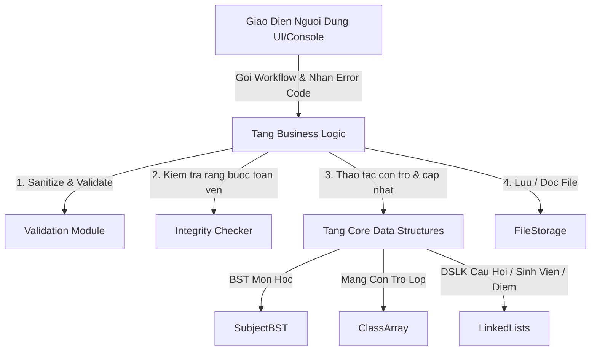
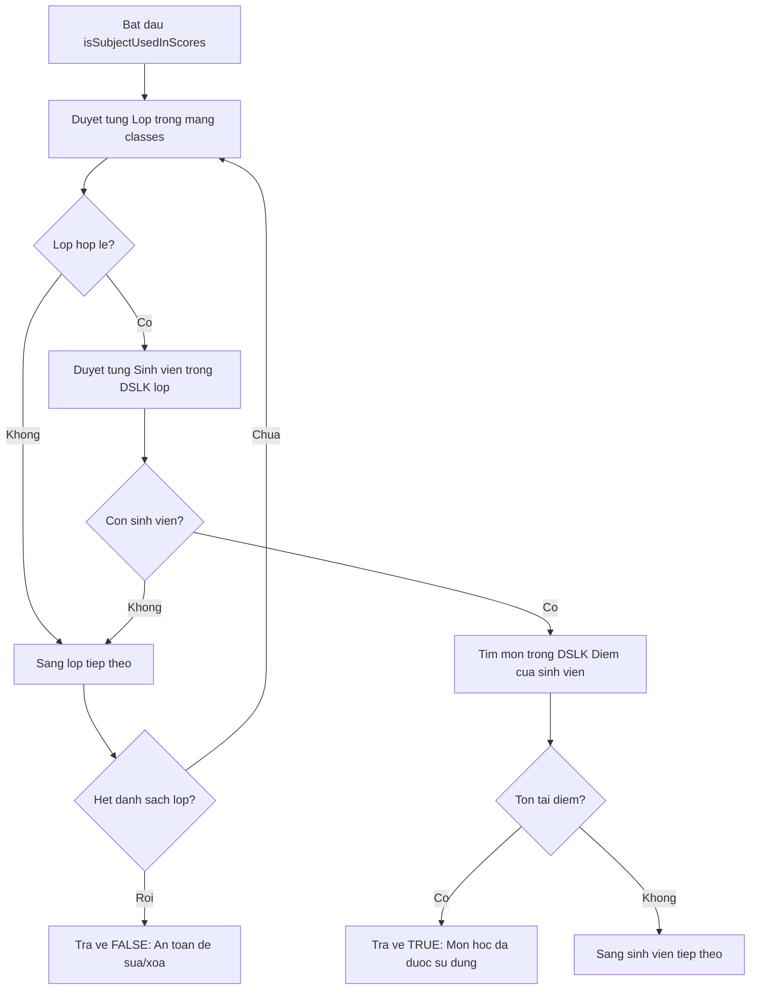
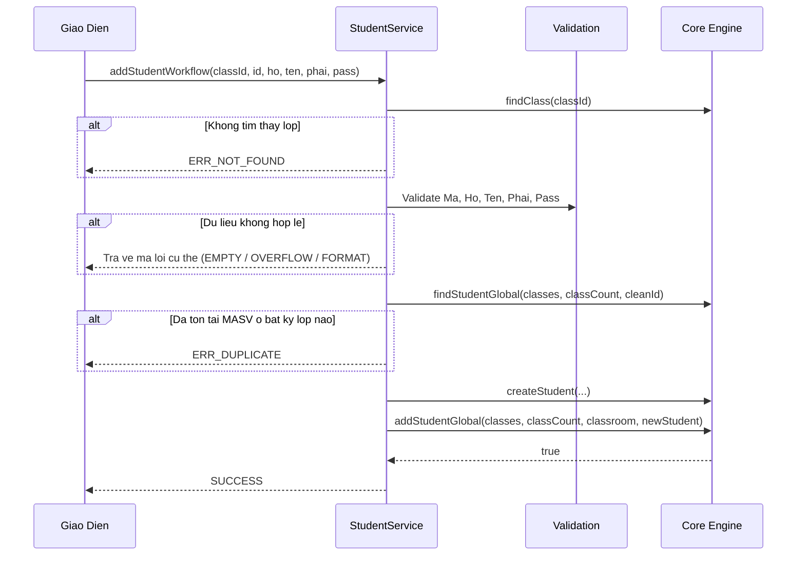
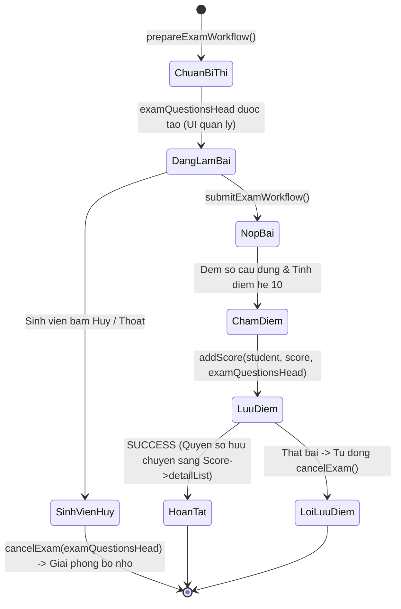
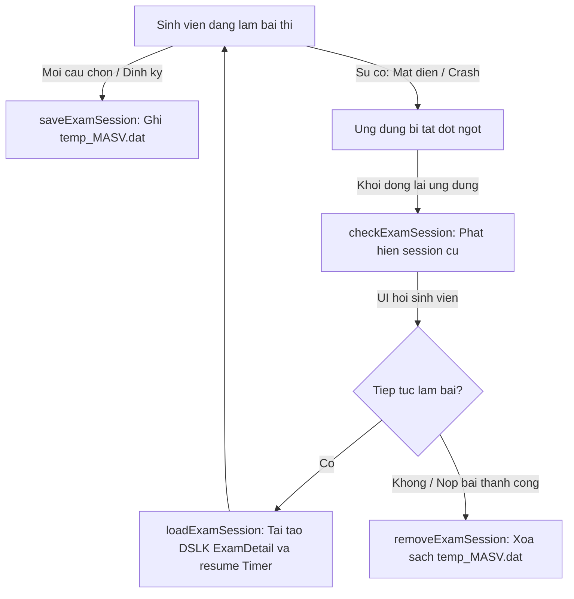

# TÀI LIỆU KỸ THUẬT MỞ RỘNG TẦNG NGHIỆP VỤ (BUSINESS LOGIC EXTENSION)

> **Dự án**: Hệ Thống Quản Lý Thi Trắc Nghiệm  
> **Thư mục**: `DSA-Project-ThiTracNghiem/business/`  
> **Người phụ trách**: Người 3 (Business Logic & Backend Workflows)  
> **Mục tiêu tài liệu**: Phân tích cặn kẽ từng file nguồn trong thư mục `business/`, giải thích chi tiết nguyên lý hoạt động, thuật toán bên dưới (kèm phân tích Big-O), các ví dụ minh họa bằng mã nguồn thực tế và hướng dẫn kết nối an toàn cho tầng Giao diện (UI).

---

## MỤC LỤC CHI TIẾT

1. [Tổng Quan Kiến Trúc & Triết Lý Thiết Kế](#1-tổng-quan-kiến-trúc--triết-lý-thiết-kế)
2. [File 1: BusinessErrors.h – Hệ Thống Chuẩn Hóa Mã Lỗi](#2-file-1-businesserrorsh--hệ-thống-chuẩn-hóa-mã-lỗi)
3. [File 2: Validation.h & Validation.cpp – Làm Sạch & Xác Thực Dữ Liệu](#3-file-2-validationh--validationcpp--làm-sạch--xác-thực-dữ-liệu)
4. [File 3: SubjectService.h & SubjectService.cpp – Quản Lý Môn Học & Ràng Buộc](#4-file-3-subjectserviceh--subjectservicecpp--quản-lý-môn-học--ràng-buộc)
5. [File 4: QuestionService.h & QuestionService.cpp – Quản Lý Câu Hỏi & Snapshot](#5-file-4-questionserviceh--questionservicecpp--quản-lý-câu-hỏi--snapshot)
6. [File 5: ClassService.h & ClassService.cpp – Quản Lý Lớp Học Mảng Tuyến Tính](#6-file-5-classserviceh--classservicecpp--quản-lý-lớp-học-mảng-tuyến-tính)
7. [File 6: StudentService.h & StudentService.cpp – Quản Lý Sinh Viên Toàn Cục](#7-file-6-studentserviceh--studentservicecpp--quản-lý-sinh-viên-toàn-cục)
8. [File 7: AuthService.h & AuthService.cpp – Xác Thực Đa Quyền & Phân Quyền](#8-file-7-authserviceh--authservicecpp--xác-thực-đa-quyền--phân-quyền)
9. [File 8: ExamService.h & ExamService.cpp – Động Cơ Thi, Bộ Đếm ExamTimer & Session Persistence](#9-file-8-examserviceh--examservicecpp--động-cơ-thi-bộ-đếm-examtimer--session-persistence)
10. [File 9: ReportService.h & ReportService.cpp – Báo Cáo, Tra Cứu & In Ấn](#10-file-9-reportserviceh--reportservicecpp--báo-cáo-tra-cứu--in-ấn)
11. [File 10: FileStorage.h & FileStorage.cpp – Tuần Tự Hóa Dữ Liệu Phân Cấp](#11-file-10-filestorageh--filestoragecpp--tuần-tự-hóa-dữ-liệu-phân-cấp)
12. [Bảng Tra Cứu Độ Phức Tạp Thuật Toán (Big-O Cheat Sheet)](#12-bảng-tra-cứu-độ-phức-tạp-thuật-toán-big-o-cheat-sheet)
13. [Cẩm Nang Kết Nối Dành Cho Lập Trình Viên UI](#13-cẩm-nang-kết-nối-dành-cho-lập-trình-viên-ui)

---

## 1. TỔNG QUAN KIẾN TRÚC & TRIẾT LÝ THIẾT KẾ

### 1.1 Vị trí của tầng Business trong hệ thống
Tầng `business` hoạt động như một "Bộ vi xử lý trung tâm" (Control Center) đứng giữa hai lớp:
- **Tầng Core Data Structures (`core/`)**: Chịu trách nhiệm về cấu trúc dữ liệu nguyên thủy (BST, Danh sách liên kết đơn, Con trỏ mảng, Cấp phát/Thu hồi vùng nhớ thô). Tầng này **không** quan tâm dữ liệu có hợp lệ theo quy chế thi hay không.
- **Tầng Presentation/UI**: Chịu trách nhiệm nhận tương tác từ bàn phím, điều hướng menu, in màu sắc và bắt sự kiện. Tầng này **không** được trực tiếp thao tác con trỏ dữ liệu thô.



### 1.2 Các nguyên tắc thiết kế bất biến (Invariants)
1. **Tuân thủ triệt để No-STL**: Không sử dụng `std::vector`, `std::list`, `std::map`, hay smart pointers (`std::unique_ptr`). Mọi thao tác đều dùng con trỏ C++ truyền thống, mảng động (`new[]`/`delete[]`), và chuỗi ký tự kết thúc bằng null (`char[]`).
2. **Ngăn chặn rò rỉ bộ nhớ (Zero Memory Leak)**: Nếu một thao tác nghiệp vụ thất bại giữa chừng (ví dụ: xác thực không thành công sau khi đã `new`), toàn bộ vùng nhớ cấp phát tạm thời **phải** được dọn dẹp trước khi trả quyền điều khiển về UI.
3. **Bất biến khóa chính (Primary Key Immutability)**: Mã sinh viên (`MASV`), Mã câu hỏi (`ID`) là các trường định danh duy nhất và không được phép chỉnh sửa sau khi khởi tạo. Mã môn học (`MAMH`) chỉ được sửa khi môn học đó chưa phát sinh bất kỳ điểm thi nào trên toàn hệ thống.
4. **Độc lập bản ghi thi (Exam Snapshot Independence)**: Khi sinh viên thi, các câu hỏi được sao chép sâu (Deep Copy) sang cấu trúc `ExamDetail`. Do đó, sau này giảng viên có sửa nội dung hoặc xóa câu hỏi trong ngân hàng đề, bài thi lịch sử của sinh viên vẫn giữ nguyên 100% nội dung tại thời điểm thi.

---

## 2. FILE 1: [BusinessErrors.h](file:///d:/Download/DSA-Project-ThiTracNghiem/business/BusinessErrors.h) – HỆ THỐNG CHUẨN HÓA MÃ LỖI

### 2.1 Bản chất kỹ thuật & Mục đích
Trong lập trình C++ không dùng Exception (để đảm bảo hiệu năng và dễ kiểm soát luồng điều khiển), phương pháp Error Code tập trung thông qua `enum` là chuẩn mực vàng. Thay vì trả về `bool` (chỉ biết thành công hay thất bại nhưng không rõ nguyên nhân), mọi hàm workflow trong tầng Business đều trả về `BusinessResult`.

### 2.2 Danh mục mã lỗi và ý nghĩa
```cpp
enum BusinessResult {
    SUCCESS = 0,               // Thao tac thanh cong hoan toan
    ERR_EMPTY_FIELD,           // Truong du lieu bi de trong hoac chi chua khoang trang
    ERR_BUFFER_OVERFLOW,       // Do dai chuoi vuot qua gioi han mang tinh (Constants.h)
    ERR_INVALID_FORMAT,        // Dinh dang sai (vi du: phai khong hop le, dap an khong phai A-D)
    ERR_NOT_FOUND,             // Khong tim thay doi tuong (lop, mon, sinh vien, cau hoi)
    ERR_DUPLICATE,             // Du lieu bi trung khoa chinh (trung MAMH, MALOP, MASV)
    ERR_LIST_FULL,             // Danh sach mang tinh da day (lop dat MAX_CLASS = 10000)
    ERR_CONSTRAINT_VIOLATION,  // Vi pham rang buoc toan ven (xoa mon da co diem, xoa lop co SV)
    ERR_UNKNOWN                // Loi khong xac dinh (cap phat bo nho that bai, loi he thong)
};
```

### 2.3 Hàm chuyển đổi chuỗi `getErrorMessage()`
```cpp
inline const char* getErrorMessage(BusinessResult result);
```
- **Cách hoạt động**: Sử dụng cấu trúc `switch-case` ánh xạ giá trị `enum` sang chuỗi hằng `const char*` nằm ở phân vùng tĩnh (Static Data Segment).
- **Độ phức tạp**: Thời gian `O(1)`, Không gian phụ `O(1)` (không tốn một byte heap nào).
- **Lợi ích cho UI**: UI chỉ cần gọi `getErrorMessage(res)` là lập tức có chuỗi tiếng Việt rõ ràng để in thông báo lỗi ra màn hình.

### 2.4 Ví dụ ứng dụng trong UI
```cpp
BusinessResult res = addSubjectWorkflow(rootSubject, inputId, inputName);
if (res != SUCCESS) {
    // UI in ra thong bao loi chuan xac ma khong can hard-code
    std::cout << "[LOI]: " << getErrorMessage(res) << "\n";
    if (res == ERR_DUPLICATE) {
        std::cout << "Goi y: Vui long chon ma mon hoc khac!\n";
    }
} else {
    std::cout << "[THANH CONG]: Mon hoc da duoc them vao he thong!\n";
}
```

---

## 3. FILE 2: [Validation.h](file:///d:/Download/DSA-Project-ThiTracNghiem/business/Validation.h) & [Validation.cpp](file:///d:/Download/DSA-Project-ThiTracNghiem/business/Validation.cpp) – LÀM SẠCH & XÁC THỰC DỮ LIỆU

### 3.1 Thuật toán 1: Two-Pointer In-Place String Trim (`trimString`)
Khi người dùng nhập chuỗi từ bàn phím, các khoảng trắng vô tình ở đầu hoặc cuối chuỗi (`"   IT01  \t "`) có thể gây sai lệch khi so khớp chuỗi hoặc băm dữ liệu. Thuật toán `trimString` loại bỏ các khoảng trắng này tại chỗ mà không cấp phát thêm chuỗi mới.

#### Nguyên lý từng bước:
1. **Kiểm tra biên**: Nếu `str == nullptr` hoặc chuỗi rỗng (`len == 0`), kết thúc ngay.
2. **Tìm con trỏ đầu (`start`)**: Duyệt từ trái sang phải, tìm chỉ số đầu tiên mà ký tự tại đó không phải ký tự trắng (`' '`, `'\t'`, `'\n'`, `'\r'`).
3. **Kiểm tra chuỗi toàn trắng**: Nếu duyệt đến hết chuỗi (`start == len`), đặt `str[0] = '\0'` và kết thúc.
4. **Tìm con trỏ cuối (`end`)**: Duyệt từ phải sang trái (`len - 1` lùi dần), tìm chỉ số đầu tiên gặp ký tự không phải khoảng trắng.
5. **Dồn chuỗi (In-Place Copy)**: Dùng chỉ số `idx = 0`, sao chép các ký tự từ `start` đến `end` về vị trí `str[idx++]`.
6. **Đóng chuỗi**: Đặt `str[idx] = '\0'`.

```
Vi du minh hoa bo nho cua trimString:
Ban dau:    [' ', ' ', 'I', 'T', '0', '1', ' ', '\0']  (len = 7)
Con tro:            ^start          ^end
Dich chuyen: str[0]='I', str[1]='T', str[2]='0', str[3]='1'
Ket qua:    ['I', 'T', '0', '1', '\0', ...]
```

- **Độ phức tạp thời gian**: `O(N)` với N là chiều dài chuỗi (mỗi ký tự được duyệt qua tối đa 2 lần).
- **Độ phức tạp không gian**: `O(1)` bổ trợ (hoàn toàn thao tác trên mảng gốc).

### 3.2 Thuật toán 2: Chuyển Đổi Ký Tự Hoa Bằng Số Học ASCII (`toUpperString`)
Thay vì gọi hàm thư viện chuẩn `toupper` cho từng ký tự (có thể phụ thuộc vào Locale máy), hệ thống sử dụng phép tính dịch chuyển khoảng cách mã ASCII trực tiếp:
```cpp
if (str[i] >= 'a' && str[i] <= 'z') {
    str[i] = (char)(str[i] - ('a' - 'A'));
}
```
- **Bản chất**: Khoảng cách giữa chữ thường và chữ hoa trong bảng mã ASCII là một hằng số cố định (`'a' - 'A' = 97 - 65 = 32`). Trừ đi 32 sẽ chuyển chữ thường thành chữ hoa.
- **Độ phức tạp**: `O(N)` thời gian, `O(1)` không gian.

### 3.3 Thuật toán 3: Kiểm Tra Ký Tự Trắng Tuyến Tính (`containsWhitespace` & `isAllWhitespace`)
- `containsWhitespace`: Duyệt tuyến tính chuỗi từ đầu đến cuối. Trả về `true` ngay khi phát hiện ký tự trắng đầu tiên. Dùng để kiểm tra các trường cấm có dấu cách như Mật khẩu (`password`).
- `isAllWhitespace`: Duyệt kiểm tra nếu toàn bộ chuỗi đều là ký tự trắng hoặc rỗng.

### 3.4 Nhóm hàm kiểm tra nghiệp vụ (Validation Helpers)
Các hàm `validateSubjectId`, `validateSubjectName`, `validateClassId`, `validateClassName`, `validateStudentId`, `validateStudentName`, `validateQuestionContent`, `validateAnswerContent` tuân thủ mô hình bảo vệ 2 lớp:
1. **Lớp 1 - Kiểm tra rỗng**: `if (str == nullptr || isAllWhitespace(str)) return ERR_EMPTY_FIELD;`
2. **Lớp 2 - Kiểm tra độ dài biên**: So sánh `stringLength(str) >= MAX_LEN`. Nếu vượt quá kích thước mảng tĩnh, trả về `ERR_BUFFER_OVERFLOW` để tuyệt đối ngăn chặn lỗi tràn bộ đệm (Buffer Overflow Vulnerability).

#### Xác thực đặc thù:
- **`validateGender(char gender[])`**: Tự động gọi `trimString` và `toUpperString`, sau đó chuẩn hóa:
  - Nếu là `"NAM"` -> sao chép thành `"Nam"`, trả về `SUCCESS`.
  - Nếu là `"NU"` -> sao chép thành `"Nu"`, trả về `SUCCESS`.
  - Bất kỳ giá trị nào khác -> trả về `ERR_INVALID_FORMAT`.
- **`validateCorrectAnswer(char &correct)`**: Tự động chuyển thường sang hoa ('a'-'d' -> 'A'-'D'). Nếu không nằm trong tập `{'A', 'B', 'C', 'D'}` -> trả về `ERR_INVALID_FORMAT`.

---

## 4. FILE 3: [SubjectService.h](file:///d:/Download/DSA-Project-ThiTracNghiem/business/SubjectService.h) & [SubjectService.cpp](file:///d:/Download/DSA-Project-ThiTracNghiem/business/SubjectService.cpp) – QUẢN LÝ MÔN HỌC & RÀNG BUỘC

### 4.1 Thuật toán Kiểm Tra Toàn Vẹn Quan Hệ (`isSubjectUsedInScores`)
Một quy chế nghiêm ngặt trong hệ thống thi cử: **Không được phép xóa môn học hoặc đổi mã môn học nếu môn học đó đã có điểm thi của bất kỳ sinh viên nào.**



- **Mã giả chi tiết**:
  ```cpp
  for (int i = 0; i < classCount; ++i) {
      Student* student = classes[i]->studentList;
      while (student != nullptr) {
          if (findScore(student, cleanSubId) != nullptr) {
              return true; // Phat hien rang buoc ton tai
          }
          student = student->next;
      }
  }
  return false;
  ```
- **Độ phức tạp tính toán**:
  - Gọi C là số lớp, S là số sinh viên trung bình mỗi lớp, M là số môn sinh viên đã thi.
  - Thời gian: `O(C * S * M)` trong trường hợp xấu nhất (duyệt hết hệ thống).
  - Không gian: `O(1)` (chỉ dùng con trỏ duyệt).

### 4.2 Thuật toán Thêm Môn Học (`addSubjectWorkflow`)
1. Xác thực cú pháp `validateSubjectId` và `validateSubjectName`.
2. Chuẩn hóa chuỗi: Trim và viết hoa `MAMH`, Trim `TENMH`.
3. Kiểm tra trùng lặp trên Cây nhị phân tìm kiếm (BST): `findSubject(root, cleanId)`. Nếu tìm thấy -> trả về `ERR_DUPLICATE` (độ phức tạp trung bình `O(log N)`).
4. Tạo node môn học mới: `createSubject(cleanId, cleanName)`.
5. Chèn vào cây BST: `root = insertSubject(root, newSubject)`. Môn học tự động được sắp xếp theo thứ tự từ điển của mã môn học.
6. Trả về `SUCCESS`.

### 4.3 Thuật toán Sửa Môn Học (`editSubjectWorkflow`)
1. Tìm môn học cũ trong cây BST theo `oldId`. Nếu không thấy -> trả về `ERR_NOT_FOUND`.
2. Xác thực và làm sạch `newId` và `newName`.
3. **Nếu có sự thay đổi mã môn học (`cleanOldId != cleanNewId`)**:
   - Gọi `isSubjectUsedInScores(classes, classCount, cleanOldId)`: Nếu môn đã có điểm -> trả về `ERR_CONSTRAINT_VIOLATION` (chặn sửa mã).
   - Kiểm tra xem `cleanNewId` đã tồn tại trong BST chưa -> nếu có, trả về `ERR_DUPLICATE`.
4. Gọi hàm core `editSubject(root, cleanOldId, cleanNewId, cleanNewName)`.
   - *Lưu ý cơ chế Core*: Vì khóa của BST là `MAMH`, khi đổi `MAMH`, hệ thống phải tháo gỡ node cũ ra khỏi cây BST, đổi tên, rồi chèn lại vào đúng vị trí mới để bảo toàn tính chất cây tìm kiếm nhị phân.

### 4.4 Thuật toán Xóa Môn Học (`deleteSubjectWorkflow`)
1. Tìm kiếm môn học theo `id` trong cây BST. Không thấy -> `ERR_NOT_FOUND`.
2. Kiểm tra ràng buộc toàn vẹn: `isSubjectUsedInScores(classes, classCount, cleanId)`. Nếu môn đã phát sinh điểm thi -> lập tức trả về `ERR_CONSTRAINT_VIOLATION`.
3. Nếu an toàn -> gọi `root = deleteSubject(root, cleanId)`. Hàm này sẽ tự động giải phóng toàn bộ danh sách liên kết câu hỏi thuộc môn học đó trước khi giải phóng node môn học.

---

## 5. FILE 4: [QuestionService.h](file:///d:/Download/DSA-Project-ThiTracNghiem/business/QuestionService.h) & [QuestionService.cpp](file:///d:/Download/DSA-Project-ThiTracNghiem/business/QuestionService.cpp) – QUẢN LÝ CÂU HỎI & SNAPSHOT

### 5.1 Cơ chế Tự Động Sinh Mã Câu Hỏi Tăng Dần (Auto-Increment ID)
- Câu hỏi thi trắc nghiệm không dùng mã chuỗi do người dùng nhập mà sử dụng số nguyên dương duy nhất `int questionId`.
- **Cơ chế hoạt động**: Sử dụng một biến đếm tĩnh toàn cục `g_questionIdCounter` trong `QuestionList.cpp`.
  - Khi thêm câu hỏi mới: `generateQuestionId()` thực hiện `return ++g_questionIdCounter;` (thời gian `O(1)`).
  - Khi nạp dữ liệu từ file: gọi `updateQuestionIdCounter(qId)` để đảm bảo biến đếm luôn lớn hơn ID lớn nhất đã tồn tại trong file, tránh xung đột ID khi khởi động lại ứng dụng.

### 5.2 Thuật toán Thêm Câu Hỏi (`addQuestionWorkflow`)
1. Tìm con trỏ `Subject` trong BST theo `subjectId`.
2. Xác thực nội dung câu hỏi (`validateQuestionContent`), xác thực 4 phương án A, B, C, D (`validateAnswerContent`), xác thực đáp án đúng (`validateCorrectAnswer`).
3. Chuẩn hóa chuỗi nội dung và các phương án bằng `trimString`.
4. Sinh ID tự động: `generatedId = generateQuestionId()`.
5. Cấp phát struct: `Question* q = createQuestion(...)`.
6. Chèn vào danh sách liên kết đơn `subject->questionList` thông qua `insertQuestion`.

### 5.3 Thuật toán Sửa & Xóa Câu Hỏi
- **Sửa câu hỏi (`editQuestionWorkflow`)**: Tìm môn học trong BST -> Duyệt tìm node câu hỏi trong DSLK theo `questionId` -> Ghi đè trực tiếp các mảng ký tự nội dung và đáp án đúng.
- **Xóa câu hỏi (`deleteQuestionWorkflow`)**: Tìm môn học -> Gọi `deleteQuestion(subject->questionList, questionId)`. Hàm core duyệt tìm node mang ID đó, nối con trỏ node trước với node sau, và gọi `delete` node mục tiêu.

### 5.4 Cơ chế Snapshot Độc Lập Giữa Ngân Hàng Câu Hỏi & Bài Thi
> [!IMPORTANT]
> Nhiều hệ thống thi cử mắc lỗi nghiêm trọng: Bài thi của sinh viên chỉ lưu con trỏ `Question*` trỏ về ngân hàng đề. Khi giảng viên sửa nội dung hoặc xóa câu hỏi, bài thi trong quá khứ của sinh viên bị méo mó hoặc gây crash chương trình (Dangling Pointer).
> 
> Trong hệ thống này: Khi thi, một bản sao độc lập `ExamDetail` được tạo ra. Kể cả khi câu hỏi trong `subject->questionList` bị xóa bỏ hoàn toàn, dữ liệu trong `ExamDetail` của sinh viên vẫn tồn tại nguyên vẹn.

---

## 6. FILE 5: [ClassService.h](file:///d:/Download/DSA-Project-ThiTracNghiem/business/ClassService.h) & [ClassService.cpp](file:///d:/Download/DSA-Project-ThiTracNghiem/business/ClassService.cpp) – QUẢN LÝ LỚP HỌC MẢNG TUYẾN TÍNH

### 6.1 Cấu trúc Dữ liệu & Lý do Lựa chọn
Danh sách lớp học được tổ chức dưới dạng **Mảng con trỏ tuyến tính** (`Class* classes[MAX_CLASS]`) với `MAX_CLASS = 10000` (theo đề bài đồ án DSA).
- **Ưu điểm**: Truy xuất phần tử theo chỉ số cực nhanh, tiết kiệm bộ nhớ hơn danh sách liên kết vì chỉ tốn 8 byte con trỏ cho mỗi phần tử, không cần cấp phát node bao bọc.
- **Quản lý kích thước**: Biến `classCount` lưu trữ số lớp thực tế hiện có (`0 <= classCount <= MAX_CLASS`).

### 6.2 Thuật toán Thêm Lớp Học (`addClassWorkflow`)
1. **Kiểm tra sức chứa**: `if (classCount >= MAX_CLASS) return ERR_LIST_FULL;` (`O(1)`).
2. Xác thực và làm sạch `id` và `name`.
3. **Kiểm tra trùng mã**: Duyệt tuyến tính mảng `findClass(classes, classCount, cleanId)` (`O(N)`). Nếu trùng -> trả về `ERR_DUPLICATE`.
4. Cấp phát thực thể lớp học: `Class* newClass = createClass(cleanId, cleanName);`.
5. Đưa vào mảng: `addClass(classes, classCount, newClass)`. Lớp học được gán vào `classes[classCount]` và `classCount++`.
6. Nếu có lỗi bất ngờ, tự động gọi `delete newClass` để chống rò rỉ bộ nhớ.

### 6.3 Thuật toán Xóa Lớp Học An Toàn (`deleteClassWorkflow`)
1. Tìm kiếm lớp học trong mảng theo `id`. Nếu không thấy -> `ERR_NOT_FOUND`.
2. **Kiểm tra ràng buộc sinh viên**:
   ```cpp
   if (classroom->studentList != nullptr) {
       return ERR_CONSTRAINT_VIOLATION; // Khong duoc xoa lop dang co sinh vien
   }
   ```
   *Mục đích*: Ngăn chặn việc làm mất dữ liệu sinh viên một cách vô ý và loại bỏ hoàn toàn nguy cơ rò rỉ bộ nhớ các danh sách con.
3. Nếu lớp rỗng: Gọi `deleteClass(classes, classCount, cleanId)`.
   - Hàm core giải phóng bộ nhớ `delete classroom`.
   - Dồn toàn bộ các con trỏ từ vị trí xóa về bên trái một nấc: `classes[j] = classes[j + 1]`.
   - Giảm số lượng lớp: `classCount--`.
- **Độ phức tạp**: `O(N)` thời gian thao tác dồn mảng.

---

## 7. FILE 6: [StudentService.h](file:///d:/Download/DSA-Project-ThiTracNghiem/business/StudentService.h) & [StudentService.cpp](file:///d:/Download/DSA-Project-ThiTracNghiem/business/StudentService.cpp) – QUẢN LÝ SINH VIÊN TOÀN CỤC

### 7.1 Tính Bất Biến Về Duy Nhất Mã Sinh Viên Toàn Cục (Global Uniqueness)
Trong trường học, mỗi sinh viên chỉ có một Mã sinh viên (`MASV`) duy nhất trên toàn trường, không được phép trùng lặp kể cả ở hai lớp khác nhau. Do danh sách sinh viên được lưu dưới dạng danh sách liên kết đơn riêng biệt theo từng lớp, việc kiểm tra trùng mã đòi hỏi thuật toán duyệt toàn cục.

### 7.2 Thuật toán Thêm Sinh Viên (`addStudentWorkflow`)


- **Độ phức tạp kiểm tra toàn cục**: `O(N_student)` với N_student là tổng số sinh viên của toàn bộ các lớp học trong trường.

### 7.3 Thuật toán Sửa Sinh Viên (`editStudentWorkflow`)
- **Nguyên lý bảo toàn khóa chính**: Sinh viên chỉ được phép sửa Họ, Tên, Phái và Mật khẩu. Mã sinh viên (`MASV`) tuyệt đối **không** được thay đổi vì toàn bộ lịch sử điểm thi liên kết chặt chẽ với mã này.
- **Quy trình**:
  1. Gọi `findStudentGlobal` để định vị con trỏ sinh viên trên toàn hệ thống.
  2. Xác thực dữ liệu mới.
  3. Gọi `editStudent(student, cleanHo, cleanTen, cleanGender, password)`.

### 7.4 Thuật toán Xóa Sinh Viên Hai Bước (`deleteStudentWorkflow`)
1. **Bước 1 - Pre-check**: Tìm kiếm lớp -> Tìm kiếm sinh viên `findStudent(classroom->studentList, cleanStudentId)`. Nếu không tồn tại -> trả về `ERR_NOT_FOUND` ngay lập tức.
2. **Bước 2 - Deletion**: Gọi `deleteStudent(classroom, cleanStudentId)`.
   - Tháo gỡ node sinh viên ra khỏi DSLK đơn của lớp.
   - Giải phóng toàn bộ danh sách điểm `ScoreList` của sinh viên đó.
   - Với mỗi điểm thi, tự động giải phóng toàn bộ danh sách chi tiết bài thi `ExamDetail`.
   - Thu hồi vùng nhớ struct `Student`.
   - Trả về `SUCCESS`.

---

## 8. FILE 7: [AuthService.h](file:///d:/Download/DSA-Project-ThiTracNghiem/business/AuthService.h) & [AuthService.cpp](file:///d:/Download/DSA-Project-ThiTracNghiem/business/AuthService.cpp) – XÁC THỰC ĐA QUYỀN & PHÂN QUYỀN

### 8.1 Kiến Trúc Xác Thực Kép (Two-Path Authentication)
Hệ thống hỗ trợ 2 vai trò đăng nhập với luồng xử lý độc lập:
1. **Giảng viên (Teacher/Admin)**: Tài khoản quản trị cố định với quyền lực tối cao (Thêm/Sửa/Xóa môn, lớp, câu hỏi, in báo cáo).
2. **Sinh viên (Student)**: Đăng nhập bằng `MASV` và `password` cá nhân (Chỉ được thi trắc nghiệm và xem lại bài thi của chính mình).

### 8.2 Quy Tắc Xử Lý Chuỗi Trong Xác Thực
- **Tên đăng nhập (`username`)**: Tự động áp dụng `trimString` và `toUpperString`. Ví dụ: Sinh viên gõ `" n21dccn001 "` sẽ được chuẩn hóa thành `"N21DCCN001"`. Giảng viên gõ `"gv"` hay `" gv "` đều nhận diện là `"GV"`.
- **Mật khẩu (`password`)**: Tự động áp dụng `trimString` loại bỏ khoảng trắng thừa đầu cuối, nhưng **giữ nguyên phân biệt chữ hoa chữ thường (Case-Sensitive)** để đảm bảo an toàn bảo mật.

### 8.3 So Sánh Hai Hàm Xác Thực Trong `AuthService`

| Tiêu chí | Hàm `login()` | Hàm `loginWorkflow()` |
|---|---|---|
| **Mục đích** | Tương thích chuẩn FunctionPrototype | Cung cấp mã lỗi chi tiết cho UI hiện đại |
| **Kiểu trả về** | `LoginRole` (`LOGIN_FAILED`, `LOGIN_TEACHER`, `LOGIN_STUDENT`) | `BusinessResult` (`SUCCESS`, `ERR_EMPTY_FIELD`, `ERR_NOT_FOUND`, `ERR_INVALID_FORMAT`,...) |
| **Cách trả vai trò** | Trả về trực tiếp | Trả qua tham chiếu `LoginRole& role` |
| **Báo lỗi sai mật khẩu** | Trả về `LOGIN_FAILED` chung chung | Trả về `ERR_INVALID_FORMAT` (giúp UI thông báo rõ: "Sai mật khẩu") |
| **Báo lỗi tài khoản không tồn tại** | Trả về `LOGIN_FAILED` chung chung | Trả về `ERR_NOT_FOUND` (giúp UI thông báo: "Mã sinh viên không tồn tại") |

### 8.4 Ví dụ mẫu tích hợp màn hình đăng nhập
```cpp
LoginRole role;
Student* loggedStudent = nullptr;

BusinessResult res = loginWorkflow(classes, classCount, userIn, passIn, role, loggedStudent);

if (res == SUCCESS) {
    if (role == LOGIN_TEACHER) {
        showTeacherMenu();
    } else if (role == LOGIN_STUDENT) {
        showStudentDashboard(loggedStudent);
    }
} else if (res == ERR_NOT_FOUND) {
    std::cout << "Tai khoan khong ton tai tren he thong!\n";
} else if (res == ERR_INVALID_FORMAT) {
    std::cout << "Mat khau khong chinh xac. Vui long thu lai!\n";
} else {
    std::cout << "Dang nhap that bai: " << getErrorMessage(res) << "\n";
}
```

---

## 9. FILE 8: [ExamService.h](file:///d:/Download/DSA-Project-ThiTracNghiem/business/ExamService.h) & [ExamService.cpp](file:///d:/Download/DSA-Project-ThiTracNghiem/business/ExamService.cpp) – ĐỘNG CƠ THI, BỘ ĐẾM EXAMTIMER & SESSION PERSISTENCE

Đây là phân hệ cốt lõi và phức tạp nhất của toàn bộ dự án, chịu trách nhiệm rút đề thi ngẫu nhiên, kiểm soát thời gian, chấm điểm và lưu trữ bài làm.

### 9.1 Thuật toán Trộn Đề Fisher-Yates (Knuth Shuffle) Không Dùng STL
Đề bài yêu cầu lấy ngẫu nhiên N câu hỏi từ ngân hàng câu hỏi M câu (`N <= M`). Mỗi câu hỏi chỉ được xuất hiện đúng một lần trong đề thi và các câu hỏi phải được phân phối ngẫu nhiên đồng đều (Uniform Distribution).

#### Vấn đề khi không dùng STL:
Trong C++ chuẩn có `std::shuffle` và `std::vector`, nhưng dự án cấm STL. Hơn nữa, ngân hàng câu hỏi đang nằm trong Danh sách liên kết đơn `QuestionList`, cấu trúc này không hỗ trợ truy xuất ngẫu nhiên `O(1)` theo chỉ số index.

#### Giải pháp kỹ thuật được triển khai:
1. Đếm tổng số câu hỏi hiện có: `int totalAvailable = countQuestions(subject->questionList);`.
2. Cấp phát một **mảng động các con trỏ hằng** trên heap:
   ```cpp
   const Question** questionPool = new const Question*[totalAvailable];
   ```
   *Lưu ý an toàn*: Dùng `const Question*` để đảm bảo quá trình trộn câu hỏi không thể vô tình sửa đổi dữ liệu gốc trong ngân hàng đề.
3. Duyệt danh sách liên kết một lần duy nhất (`O(M)`), sao chép con trỏ của từng câu hỏi vào mảng `questionPool`.
4. **Khởi tạo bộ sinh số ngẫu nhiên một lần duy nhất (`initializeRngOnce`)**: Sử dụng biến cờ tĩnh `static bool rngInitialized = false;` để chỉ gọi `srand(time(nullptr))` đúng 1 lần duy nhất trong suốt vòng đời ứng dụng. Tránh lỗi kinh điển của lập trình viên khi gọi `srand` lặp đi lặp lại dẫn đến đề thi sinh ra bị trùng lặp trong cùng một giây.
5. **Thực thi vòng lặp Fisher-Yates Shuffle**:
   Duyệt ngược từ phần tử cuối cùng `i = totalAvailable - 1` lùi về 1:
   - Chọn ngẫu nhiên một chỉ số j trong đoạn `[0, i]`: `int j = rand() % (i + 1);`
   - Hoán vị con trỏ `questionPool[i]` và `questionPool[j]`.
6. **Tạo Snapshot đề thi**:
   Duyệt qua N phần tử đầu tiên của `questionPool` (`i = 0 -> N - 1`):
   - Gọi `createExamDetail(questionPool[i])` để cấp phát struct `ExamDetail` mới (sao chép toàn bộ nội dung câu hỏi và 4 đáp án).
   - Nối vào danh sách liên kết `examQuestionsHead` bằng `addExamDetail`.
7. **Giải phóng mảng con trỏ phụ**:
   ```cpp
   delete[] questionPool; // Chi xoa mang con tro, TUYET DOI KHONG xoa cac Question
   ```

- **Độ phức tạp**:
  - Thời gian: `O(M + N)` (duyệt tạo mảng `O(M)`, trộn Fisher-Yates `O(M)`, tạo đề thi `O(N)`). Cực kỳ nhanh chóng ngay cả với 50.000 câu hỏi.
  - Bộ nhớ phụ: `O(M)` con trỏ trong thời gian ngắn ngủi của hàm, giải phóng ngay lập tức trước khi hàm kết thúc.

### 9.2 Thuật toán Kiểm Tra Hết Giờ Không Block CPU (`isExamTimeExpired`)
Để giao diện UI có thể hiển thị đồng hồ đếm ngược hoặc tự động thu bài khi hết giờ mà không làm treo ứng dụng bằng các hàm sleep:
```cpp
bool isExamTimeExpired(time_t startTime, int minutes) {
    if (minutes <= 0) return true;
    return difftime(time(nullptr), startTime) >= static_cast<double>(minutes * 60);
}
```
- **Nguyên lý**: Sử dụng hàm chuẩn POSIX/C `difftime(now, startTime)` tính số giây trôi qua thực tế theo đồng hồ hệ thống. Nếu `>= minutes * 60`, xác định đã hết giờ thi.
- **Độ phức tạp**: `O(1)`.

### 9.3 Thuật toán Tính Điểm Hệ Số 10 (`calculateScore`)
Công thức quy đổi điểm số trên thang điểm 10 chuẩn đại học:

```
Điểm = (Số câu đúng * 10.0) / Tổng số câu
```

- **Xử lý an toàn số học**:
  - Kiểm tra `totalQuestions <= 0` hoặc `correctAnswers <= 0` -> trả về `0.0f`.
  - Cắt biên an toàn: `if (correctAnswers > totalQuestions) correctAnswers = totalQuestions;`.
  - Ép kiểu `static_cast<float>` để tránh phép chia nguyên (Integer Division).

### 9.4 Thuật toán Nộp Bài & Chuyển Giao Quyền Sở Hữu Bộ Nhớ (`submitExamWorkflow`)
Quy trình nộp bài được thiết kế để đảm bảo không một byte bộ nhớ nào bị rò rỉ kể cả khi ghi điểm thất bại:
1. Kiểm tra sinh viên đã có điểm môn này chưa (`findScore(student, cleanSubId)`). Nếu đã có điểm -> gọi `cancelExam(examQuestionsHead)` và trả về `ERR_CONSTRAINT_VIOLATION`.
2. **Chấm điểm**:
   - Duyệt qua DSLK `examQuestionsHead`.
   - Chuẩn hóa `selectedAnswer` về chữ hoa ('a'-'d' -> 'A'-'D').
   - So sánh với `current->correctAnswer`. Nếu khớp -> tăng `correctCount++`.
3. Tính `finalScore = calculateScore(correctCount, totalCount)`.
4. **Chuyển giao quyền sở hữu bộ nhớ (Ownership Transfer)**:
   ```cpp
   if (!addScore(student, cleanSubId, finalScore, examQuestionsHead)) {
       cancelExam(examQuestionsHead); // Thu hoi bo nho neu that bai
       return ERR_CONSTRAINT_VIOLATION;
   }
   ```
   *Bản chất*: Danh sách liên kết `examQuestionsHead` được chuyển giao hoàn toàn quyền quản lý sang con trỏ `Score->detailList`. Kể từ thời điểm này, UI không được gọi `cancelExam` hay `delete` đối với `examQuestionsHead` nữa vì struct `Score` sẽ quản lý việc giải phóng bộ nhớ khi sinh viên bị xóa.



### 9.5 Cấu Trúc Bộ Đếm Thời Gian Hướng Đối Tượng (`struct ExamTimer`) & Thuật Toán Thời Gian Thực Theo Giây
Trong các ứng dụng Console hoặc GUI C++, việc hiển thị đồng hồ đếm ngược thời gian thực thường đối mặt với một vấn đề kỹ thuật hóc búa: **Hiện tượng trôi thời gian (Clock Drift)** nếu dùng `Sleep(1000)` hoặc đếm vòng lặp. Quá trình xử lý giao diện, bắt phím từ người dùng (`_getch()`, `cin`) và độ trễ I/O sẽ tích lũy khiến đồng hồ chạy chậm hơn thực tế.

`ExamService` giải quyết triệt để vấn đề này bằng mô hình **State Machine đồng hồ phần cứng**:

```cpp
struct ExamTimer {
    time_t startTime;               // Mốc thời điểm bắt đầu hệ thống
    int totalDurationSeconds;       // Tổng thời gian bài thi (giây)
    int initialRemainingSeconds;     // Số giây còn lại tại thời điểm bắt đầu/tiếp tục
    bool isRunning;                 // Cờ trạng thái hoạt động

    ExamTimer();
    explicit ExamTimer(int durationSeconds);

    void start(int durationSeconds);
    void startMinutes(int minutes);
    void resume(int remainingSeconds);
    int getRemainingSeconds() const;
    int getElapsedSeconds() const;
    bool isExpired() const;
    void stop();
    void formatTime(char buffer[], int bufferSize) const;
};
```

#### Nguyên lý tính toán không phụ thuộc chu kỳ CPU:
- **Hàm `getRemainingSeconds()`**:
  ```cpp
  int ExamTimer::getRemainingSeconds() const {
      if (!isRunning) return 0;
      double elapsed = difftime(time(nullptr), startTime);
      int remaining = initialRemainingSeconds - static_cast<int>(elapsed);
      return (remaining > 0) ? remaining : 0;
  }
  ```
  Hàm lấy thời gian thực `time(nullptr)` của hệ điều hành trừ đi mốc `startTime`. Nhờ đó, dù giao diện render nhanh hay chậm, số giây còn lại luôn phản ánh **chính xác 100% thời gian thực tế bên ngoài**.
- **Hàm `resume(remainingSeconds)`**:
  Khi sinh viên tiếp tục bài thi từ session đã lưu, `initialRemainingSeconds` nhận số giây còn lại và `startTime` được gán lại mốc hiện tại. Đồng hồ tiếp tục đếm ngược liền mạch mà không bị reset về tổng thời gian ban đầu.
- **Hàm `formatExamTime(remainingSeconds, buffer, bufferSize)`**:
  Sử dụng `std::snprintf` để định dạng thời gian thành dạng `MM:SS (M phut S giay)`. Cơ chế này loại bỏ hoàn toàn nguy cơ Buffer Overflow, đảm bảo an toàn bộ nhớ tuyệt đối.

### 9.6 Phân Hệ Quản Lý Phiên Thi Bền Vững (Exam Session Persistence) & Thuật Toán Phục Hồi Chống Lỗi (Fault-Tolerance)

#### 1. Bài toán thực tế trong phòng thi trắc nghiệm
Trong môi trường giáo dục thực tế, các sự cố ngoại cảnh như sập nguồn điện lưới, sự cố ngắt kết nối, hoặc sinh viên vô tình tắt ứng dụng sẽ làm mất toàn bộ danh sách `ExamDetail*` trên RAM. Sinh viên bị mất bài thi và phải thi lại từ đầu (vi phạm quy chế thi).

Phân hệ `ExamSession` trong `ExamService` được phát triển nhằm mang lại tính năng **Fault-Tolerant High Availability (Phục hồi chịu lỗi cao)** cho hệ thống.



#### 2. Cơ chế Tuần Tự Hóa (Serialization) `saveExamSession`
Khi gọi `saveExamSession()`, hệ thống tạo file tạm định danh theo mã sinh viên: `temp_<MASV>.dat` (được làm sạch và chuẩn hóa hoa `toUpperString(cleanStdId)`):

- **Cấu trúc dòng tiêu đề**:
  ```text
  MASV|MAMON|THOI_GIAN_CON_LAI|SO_CAU
  ```
- **Hỗ trợ 2 chế độ tuần tự hóa linh hoạt**:
  1. **Chế độ Snapshot Đầy Đủ (Full Snapshot)**:
     ```text
     ID|Selected|Correct|Content|A|B|C|D
     ```
     Toàn bộ câu hỏi, 4 phương án, đáp án đúng và đáp án sinh viên đã chọn được lưu độc lập. Ngay cả khi môn học bị sửa trong thời gian mất điện, bài thi của sinh viên vẫn giữ đúng 100% đề thi ban đầu.
  2. **Chế độ Thu Gọn (Compact Mode)**:
     ```text
     ID|Selected
     ```
     Phù hợp với tầng UI muốn lưu nhanh mảng phẳng `int questionIds[]` và `char selectedAnswers[]` với chi phí I/O ổ đĩa cực nhỏ (`O(N)` byte).

#### 3. Thuật toán Giải Mã & Tái Tạo Con Trỏ (Deserialization & Pointer Reconstruction - `loadExamSession`)
Khi khôi phục bài thi dở dang:
1. Đọc dòng Header bằng `std::getline`: Phân tách dấu `|` để trích xuất `MAMON` và `remainingSecondsOut`.
2. Đọc từng dòng dữ liệu:
   - Nếu phát hiện cấu trúc Full Snapshot (>= 8 token): Khởi tạo một node `new ExamDetail`, sao chép toàn bộ nội dung câu hỏi và đáp án vào chuỗi ký tự bằng `stringCopy()`, gán `selectedAnswer` (nếu là `'-'` thì gán `'\0'`), rồi chèn vào DSLK bằng `addExamDetail()`.
   - Nếu phát hiện cấu trúc Compact (2 token: `ID|Selected`): Tự động định vị môn học trên cây BST `root`, gọi `findQuestion(subjectNode->questionList, qId)`, sau đó gọi `createExamDetail(q)` để tái tạo snapshot chính xác.
3. Trả về con trỏ đầu `ExamDetail*& examQuestionsHead`.
- **Độ phức tạp**:
  - Thời gian: `O(N)` với Full Snapshot; `O(N * (log S + K))` với Compact Mode tra cứu cây BST.
  - Bộ nhớ heap: Cấp phát đúng `N` struct `ExamDetail` mới.

#### 4. Kỹ thuật Type-Safety C++11 (`std::nullptr_t`)
Do `saveExamSession`, `checkExamSession`, và `removeExamSession` đều có nhiều overloads nhận tham số đầu tiên là chuỗi `const char studentId[]` hoặc con trỏ đối tượng `Student* student`, khi lập trình viên vô tình gọi:
```cpp
saveExamSession(nullptr, ...);
```
Trình biên dịch C++ sẽ báo lỗi nghiêm trọng: `call of overloaded 'saveExamSession(NULL, ...)' is ambiguous` (do cả con trỏ `char*` và `Student*` đều chuyển đổi ngầm định từ `0` hoặc `NULL`).

Hệ thống đã giải quyết triệt để lỗi này bằng việc định nghĩa các hàm overload với kiểu `std::nullptr_t`:
```cpp
inline bool saveExamSession(std::nullptr_t, const char*, int, ExamDetail*, const char* = nullptr) { return false; }
inline bool checkExamSession(std::nullptr_t, const char* = nullptr) { return false; }
inline bool removeExamSession(std::nullptr_t, const char* = nullptr) { return false; }
```
Khi gọi với `nullptr`, trình biên dịch sẽ ưu tiên khớp chính xác với `std::nullptr_t`, hàm trả về `false` một cách an toàn mà không sinh ra bất kỳ lỗi biên dịch nào.

---

## 10. FILE 9: [ReportService.h](file:///d:/Download/DSA-Project-ThiTracNghiem/business/ReportService.h) & [ReportService.cpp](file:///d:/Download/DSA-Project-ThiTracNghiem/business/ReportService.cpp) – BÁO CÁO, TRA CỨU & IN ẤN

### 10.1 Kiến Trúc Tách Biệt: Query API vs Print Helper
`ReportService` được thiết kế theo mô hình tách biệt trách nhiệm:
1. **Nhóm Data Query API (`hasStudentTakenExam`, `getStudentExamScore`, `getStudentExamDetails`)**:
   - Trả về dữ liệu thô (Raw Data / Pointers).
   - Dành cho tầng UI tự do thiết kế bảng biểu, render giao diện đồ họa hoặc giao diện ncurses mà không bị bó buộc vào định dạng text cố định.
2. **Nhóm Print Helper (`printClassScoreTable`, `printExamDetailReview`, `printStudentScores`)**:
   - Cung cấp sẵn các mẫu in bảng biểu chuẩn hóa, đẹp mắt ra console.
   - Hỗ trợ Dependency Injection thông qua tham số `std::ostream& out = std::cout`.

### 10.2 Kỹ Thuật Dependency Injection Trong In Ấn
Mọi hàm in ấn đều nhận tham số mặc định: `std::ostream& out = std::cout`. Kỹ thuật này đem lại hai lợi ích vô cùng to lớn:
- **Tự động hóa kiểm thử (Unit Testing)**: Thay vì in ra màn hình console, kiểm thử viên có thể truyền vào một đối tượng `std::stringstream buffer` để kiểm tra chuỗi sinh ra mà không làm bẩn màn hình console.
- **Xuất báo cáo ra file text**: UI có thể mở một file `std::ofstream fileOut("report.txt")` và truyền thẳng vào hàm in để ghi kết quả ra file mà không cần viết lại một dòng logic nào.

### 10.3 Thuật toán In Bảng Điểm Môn Học Của Lớp (`printClassScoreTable`)
1. Tìm lớp trong mảng `classes` và tìm môn trong cây BST `root`.
2. In tiêu đề báo cáo, mã lớp, tên lớp, mã môn, tên môn.
3. In hàng tiêu đề cột được căn gióng chuyên nghiệp bằng `std::setw`:
   - Cột STT (5 ký tự).
   - Cột MASV (15 ký tự).
   - Cột HỌ VÀ TÊN (30 ký tự, tự động ghép chuỗi `ho` + `" "` + `ten`).
   - Cột ĐIỂM.
4. Duyệt qua DSLK sinh viên của lớp:
   - Với mỗi sinh viên, gọi `hasStudentTakenExam(student, cleanSubId, scoreVal)`.
   - Nếu sinh viên đã thi -> in điểm định dạng 2 chữ số thập phân (`std::fixed << std::setprecision(2)`).
   - Nếu sinh viên chưa thi -> in `"Chua thi"`.
- **Độ phức tạp**: `O(S * M)` với S là số sinh viên trong lớp, M là số môn sinh viên đã thi.

### 10.4 Thuật toán Xem Lại Chi Tiết Bài Thi (`printExamDetailReview`)
1. Tìm con trỏ `Score` của sinh viên thông qua `findScore(student, cleanSubId)`.
2. Kiểm tra danh sách snapshot `score->detailList`. Nếu rỗng -> trả về `ERR_NOT_FOUND`.
3. Duyệt từng node trong danh sách snapshot `ExamDetail`:
   - In số thứ tự câu hỏi và nội dung câu hỏi.
   - In 4 phương án A, B, C, D.
   - In đáp án sinh viên đã chọn (hoặc in `"(Bo trong)"` nếu sinh viên không chọn đáp án nào).
   - In đáp án đúng của câu hỏi.
   - So khớp và dán nhãn trực quan: `[DUNG]` nếu `selectedAnswer == correctAnswer`, ngược lại dán nhãn `[SAI]`.

---

## 11. FILE 10: [FileStorage.h](file:///d:/Download/DSA-Project-ThiTracNghiem/business/FileStorage.h) & [FileStorage.cpp](file:///d:/Download/DSA-Project-ThiTracNghiem/business/FileStorage.cpp) – TUẦN TỰ HÓA DỮ LIỆU PHÂN CẤP & TÁCH FILE ĐỘC LẬP

Hệ thống sử dụng cơ chế lưu trữ file văn bản phân tách độc lập (Decoupled File Storage) kết hợp chuẩn hóa dữ liệu dòng bằng dấu gạch đứng (`|`), không phụ thuộc vào bất kỳ thư viện ngoài nào (như JSON, XML hay Protocol Buffers).

### 11.1 Thuật toán Lưu Môn Học Bằng In-Order BST Traversal & Tách File Câu Hỏi (`saveSubjectsToFile`)
Cây BST lưu trữ các môn học. Khi lưu file, để danh mục môn học luôn có thứ tự từ điển tự nhiên, `FileStorage` áp dụng **Thuật toán Duyệt Trung Thứ Tự (In-Order Traversal: Trái -> Gốc -> Phải)**:

```cpp
static void writeSubjectsRecursive(Subject* node, std::ostream& out, const std::string& dir) {
    if (node == nullptr) return;

    writeSubjectsRecursive(node->left, out, dir);  // 1. Duyệt toàn bộ nhánh trái

    // 2. Ghi danh mục môn học vào subjects.txt (MAMH|TENMH)
    out << node->id << "|" << node->name << "\n";

    // 3. Tách toàn bộ câu hỏi của môn này ra file riêng dir/<MAMH>.txt
    std::string qPath = getSubjectQuestionFilePath(dir, node->id);
    std::ofstream qOut(qPath);
    if (qOut.is_open()) {
        Question* q = node->questionList;
        while (q != nullptr) {
            // ID|Nội dung|Đáp án A|Đáp án B|Đáp án C|Đáp án D|Đáp án đúng
            qOut << q->id << "|" << q->content << "|"
                 << q->answerA << "|" << q->answerB << "|"
                 << q->answerC << "|" << q->answerD << "|"
                 << q->correctAnswer << "\n";
            q = q->next;
        }
        qOut.close();
    }

    writeSubjectsRecursive(node->right, out, dir); // 4. Duyệt toàn bộ nhánh phải
}
```
- **Lợi ích**: Danh mục môn học trong `subjects.txt` được sắp xếp tăng dần theo mã môn học (`MAMH`). Mỗi môn quản lý ngân hàng đề riêng biệt trong `<dir>/<MAMH>.txt`, giảm kích thước file tổng thể và tránh xung đột dữ liệu.
- **Độ phức tạp**: `O(S_tree + Q_total)` thời gian, `O(H)` không gian ngăn xếp đệ quy với H là chiều cao cây BST.

### 11.2 Định Dạng Lưu Trữ Phân Cấp & Gom Dòng Bằng Dấu `|` Trong `classes.txt`
File `classes.txt` tối ưu hóa số dòng lưu trữ bằng cách gom các trường liên quan của cùng một đối tượng lên đúng 1 dòng duy nhất phân cách bởi dấu `|`:

```text
[SoLuongLop]
  [MaLop_1]
  [TenLop_1]
  [SoLuongSinhVien]
    [MASV]|[Ho]|[Ten]|[Phai]|[MatKhau]|[SoMonDaThi]
      [MaMon_1]
      [DiemSo]
      [SoLuongCauHoiTrongBaiThi]
        [questionId]|[content]|[answerA]|[answerB]|[answerC]|[answerD]|[correctAnswer]|[selectedAnswer]
```

### 11.3 Bộ Ba Hàm Quản Lý File Câu Hỏi Tự Động
Khi giảng viên thao tác trên giao diện, hệ thống tự động đồng bộ file vật lý tương ứng:
1. **`createEmptyQuestionFile(dir, subjectId)`**: Tự động tạo file rỗng `data/<MAMH>.txt` ngay khi môn học mới được thêm vào hệ thống.
2. **`renameSubjectQuestionFile(dir, oldId, newId)`**: Tự động gọi `std::rename` đổi tên file câu hỏi khi mã môn học được cập nhật.
3. **`deleteSubjectQuestionFile(dir, subjectId)`**: Tự động gọi `std::remove` xóa file câu hỏi vật lý khi môn học bị xóa khỏi hệ thống.

### 11.4 Cơ Chế Phòng Thủ & Tương Thích Ngược Khi Đọc File (Defensive & Backward-Compatible Deserialization)
Khi đọc file, hệ thống áp dụng các nguyên tắc phòng thủ cao cấp:
- **Tương thích ngược (Backward-Compatible)**: Parser kiểm tra sự tồn tại của ký tự phân cách `|`. Nếu có, xử lý theo chuẩn gom dòng mới bằng hàm nội bộ `splitPipe()`. Nếu không, tự động chuyển sang đọc định dạng nhiều dòng cũ, đảm bảo không làm gãy các bộ dữ liệu lịch sử.
- **Kiểm tra tính duy nhất của ID câu hỏi (`isQuestionIdUsedAnywhere`)**: Duyệt cây BST kiểm tra nếu ID câu hỏi đã tồn tại trên bất kỳ môn nào, tự động gọi `generateQuestionId()` để sinh ID mới duy nhất, ngược lại gọi `updateQuestionIdCounter(id)` để đồng bộ counter.
- **Làm sạch chuỗi (`trimLine`)**: Tự động loại bỏ các ký tự xuống dòng `\r`, `\n` và khoảng trắng dư thừa, đảm bảo chạy ổn định trên cả Windows và Linux.
- **Dọn dẹp rò rỉ bộ nhớ khi load dữ liệu lỗi**:
  Trong vòng lặp đọc chi tiết bài thi `ExamDetail`, nếu xảy ra lỗi giữa chừng hoặc sinh viên bị null:
  ```cpp
  if (student != nullptr) {
      if (!addScore(student, subId.c_str(), scoreVal, detailHead)) {
          deleteExamDetailList(detailHead); // Giải phóng ngay nếu không thêm được điểm
      }
  } else {
      deleteExamDetailList(detailHead);     // Giải phóng ngay nếu không có sinh viên
  }
  ```

### 11.5 Hỗ Trợ Đa Nền Tảng Cho Quản Lý Thư Mục
Hệ thống tự động nhận diện hệ điều hành khi lưu dữ liệu vào thư mục `data/`:
```cpp
#if defined(_WIN32)
#include <direct.h>
#define CREATE_DIR(d) _mkdir(d)
#else
#include <sys/stat.h>
#define CREATE_DIR(d) mkdir(d, 0755)
#endif
```

---

## 12. BẢNG TRA CỨU ĐỘ PHỨC TẠP THUẬT TOÁN (BIG-O CHEAT SHEET)

Dưới đây là bảng phân tích độ phức tạp thời gian và không gian của toàn bộ các hàm nghiệp vụ trong thư mục `business/`:

| Tên Hàm | Thuật Toán / Cấu Trúc | Thời Gian (Trung bình) | Thời Gian (Xấu nhất) | Không Gian Bổ Trợ | An Toàn Bộ Nhớ |
|---|---|:---:|:---:|:---:|:---:|
| `trimString` | Two-Pointer In-Place | `O(N)` | `O(N)` | `O(1)` | Không cấp phát |
| `toUpperString` | ASCII Math Iteration | `O(N)` | `O(N)` | `O(1)` | Không cấp phát |
| `containsWhitespace` | Linear Scan | `O(N)` | `O(N)` | `O(1)` | Không cấp phát |
| `validate*` | Boundary & Null Check | `O(1) - O(N)` | `O(N)` | `O(1)` | Không cấp phát |
| `isSubjectUsedInScores` | Nested Traversal (Class -> SV -> Score) | `O(C * S * M)` | `O(C * S * M)` | `O(1)` | Chỉ đọc |
| `addSubjectWorkflow` | BST Search & Insert | `O(log N)` | `O(N)` | `O(1)` | Cấp phát 1 node |
| `editSubjectWorkflow` | BST Re-balancing / In-place update | `O(log N)` | `O(N)` | `O(1)` | Bảo toàn cây |
| `deleteSubjectWorkflow` | Referential Check & BST Delete | `O(C * S * M)` | `O(C * S * M)` | `O(1)` | Giải phóng toàn bộ QList |
| `addQuestionWorkflow` | BST Find + SLL Insert Tail | `O(log N + K)` | `O(N + K)` | `O(1)` | Cấp phát 1 Question |
| `editQuestionWorkflow` | SLL Linear Search & Update | `O(K)` | `O(K)` | `O(1)` | Cập nhật tại chỗ |
| `deleteQuestionWorkflow` | SLL Linear Search & Delete Node | `O(K)` | `O(K)` | `O(1)` | Thu hồi bộ nhớ |
| `addClassWorkflow` | Linear Search & Dynamic Array Insert | `O(C)` | `O(C)` | `O(1)` | Tự delete nếu mảng đầy |
| `deleteClassWorkflow` | Constraint Check & Array Shifting | `O(C)` | `O(C)` | `O(1)` | Thu hồi bộ nhớ |
| `addStudentWorkflow` | Global Search & SLL Insert | `O(N_student)` | `O(N_student)` | `O(1)` | Tự delete nếu trùng |
| `editStudentWorkflow` | Global Search & In-place update | `O(N_student)` | `O(N_student)` | `O(1)` | Khóa chính bất biến |
| `deleteStudentWorkflow` | Pre-check & Cascade SLL Delete | `O(S)` | `O(S)` | `O(1)` | Thu hồi SV, Score, Detail |
| `loginWorkflow` | Global Search & Case-sensitive Match | `O(N_student)` | `O(N_student)` | `O(1)` | Không cấp phát |
| `prepareExamWorkflow` | **Fisher-Yates Shuffle + Snapshot** | `O(K + N)` | `O(K + N)` | `O(K)` | Tự delete mảng phụ |
| `submitExamWorkflow` | Linear Scoring & Ownership Transfer | `O(N)` | `O(N)` | `O(1)` | Chuyển quyền sang Score |
| `cancelExam` | Cascade SLL Free | `O(N)` | `O(N)` | `O(1)` | Giải phóng sạch đề thi |
| `isExamTimeExpired` | Chrono Diff (`difftime`) | `O(1)` | `O(1)` | `O(1)` | Không block CPU |
| `calculateExamRemainingSeconds` | Real-time Chrono Math | `O(1)` | `O(1)` | `O(1)` | Kẹp biên >= 0 |
| `isExamTimeExpiredSeconds` | Chrono Diff (`difftime`) | `O(1)` | `O(1)` | `O(1)` | Kiểm tra theo giây |
| `formatExamTime` | Safe Buffer Formatter (`snprintf`) | `O(1)` | `O(1)` | `O(1)` | Chống tràn bộ đệm |
| `ExamTimer::*` | Object Clock State Machine | `O(1)` | `O(1)` | `O(1)` | Đóng gói biến thời gian |
| `saveExamSession` | Text Stream Serialization (Pipe format) | `O(N)` | `O(N)` | `O(1)` | Lưu file `temp_<MASV>.dat` |
| `checkExamSession` | File Probe & Header Parse | `O(1) - O(N)` | `O(N)` | `O(1)` | Đóng file an toàn |
| `removeExamSession` | OS File Deletion (`std::remove`) | `O(1)` | `O(1)` | `O(1)` | Xóa file tạm |
| `loadExamSession` | **Deserialization & Snapshot Rebuilding** | `O(N)` | `O(N * log S)` | `O(N)` | Tái tạo DSLK ExamDetail* |
| `hasStudentTakenExam` | SLL Score Search | `O(M)` | `O(M)` | `O(1)` | Trả điểm qua tham số out |
| `getStudentExamScore` | SLL Score Search | `O(M)` | `O(M)` | `O(1)` | Trả con trỏ Score* |
| `getStudentExamDetails` | SLL Score Search + Detail | `O(M)` | `O(M)` | `O(1)` | Trả snapshot đầu DSLK |
| `printClassScoreTable` | Formatted Print & Score Query | `O(S * M)` | `O(S * M)` | `O(1)` | Hỗ trợ Dependency Injection |
| `printExamDetailReview` | SLL Snapshot Traversal | `O(N)` | `O(N)` | `O(1)` | Căn lề tự động |
| `printStudentScores` | SLL Score Traversal + BST Lookup | `O(M * log S)` | `O(M * S)` | `O(1)` | Hỗ trợ Dependency Injection |
| `createEmptyQuestionFile` | File Check & Create | `O(1)` | `O(1)` | `O(1)` | An toàn file |
| `renameSubjectQuestionFile` | File Check & Rename | `O(1)` | `O(1)` | `O(1)` | Tự tạo file mới nếu cần |
| `deleteSubjectQuestionFile` | File Check & Remove | `O(1)` | `O(1)` | `O(1)` | Bỏ qua nếu không tồn tại |
| `saveSubjectsToFile` | **Recursive In-order BST Traversal + Multi-file** | `O(S_tree + Q)` | `O(S_tree + Q)` | `O(H)` | Đóng file an toàn |
| `loadSubjectsFromFile` | Multi-file Parse & Counter Sync | `O(S_file * log S + Q)` | `O(S_file^2 + Q * N)` | `O(1)` | Bọc try-catch & backward-compatible |
| `saveClassesToFile` | 4-Level Nested Iteration (Gom dòng pipe) | `O(Total)` | `O(Total)` | `O(1)` | Lưu trọn vẹn snapshot |
| `loadClassesFromFile` | 4-Level Defensive Construction (Đa định dạng) | `O(Total)` | `O(Total)` | `O(1)` | Auto-clean rò rỉ nếu lỗi |

*(Ghi chú ký hiệu: C: số lớp, S: số sinh viên/lớp, M: số môn đã thi, N: số môn trong BST hoặc số câu thi, K: số câu hỏi trong môn, H: chiều cao cây BST, N_student: tổng sinh viên toàn trường).*

---

## 13. CẨM NANG KẾT NỐI DÀNH CHO LẬP TRÌNH VIÊN UI

Khi lập trình viên phụ trách giao diện (Console hoặc GUI) tích hợp với tầng `business`, cần tuân thủ 5 nguyên tắc sau:

### 1. Luôn kiểm tra mã lỗi trả về
Mọi thao tác thay đổi dữ liệu đều trả về `BusinessResult`. Tuyệt đối không giả định thao tác luôn thành công. Luôn hiển thị chuỗi lỗi từ `getErrorMessage(res)`.

### 2. Quản lý vòng đời bộ nhớ đề thi (`ExamDetail`)
- Khi gọi `prepareExamWorkflow(..., examQuestionsHead)` thành công, biến `examQuestionsHead` đang nắm giữ vùng nhớ của đề thi.
- Nếu sinh viên làm xong và nộp bài: Gọi `submitExamWorkflow(...)`. Lúc này quyền sở hữu bộ nhớ **đã được chuyển giao** cho sinh viên. UI không được phép đụng vào vùng nhớ này nữa.
- Nếu sinh viên bấm Thoát / Hủy / Đóng ứng dụng giữa chừng: UI **BẮT BUỘC** phải gọi `cancelExam(examQuestionsHead)`. Nếu không gọi hàm này, toàn bộ danh sách câu hỏi đề thi sẽ bị rò rỉ (Memory Leak) trong RAM.

### 3. Vòng lặp làm bài thi và kiểm tra hết giờ
```cpp
ExamDetail* examHead = nullptr;
BusinessResult res = prepareExamWorkflow(root, student, "CTDL", 20, 15, examHead);

if (res == SUCCESS) {
    time_t startTime = time(nullptr);
    int durationMinutes = 15;

    while (true) {
        // 1. Kiem tra het gio khong block
        if (isExamTimeExpired(startTime, durationMinutes)) {
            std::cout << "\n[THONG BAO]: Da het thoi gian lam bai! He thong tu dong nop bai...\n";
            break;
        }

        // 2. Render cau hoi hien tai va bat phim tu UI
        // ... (Sinh vien chon A/B/C/D, gan vao curQuestion->selectedAnswer) ...
        
        // 3. Neu sinh vien chu dong bam Nop bai
        if (userPressedSubmit) {
            break;
        }
    }

    // 4. Nop bai va lay diem
    float score;
    int correct, total;
    submitExamWorkflow(student, "CTDL", examHead, score, correct, total);
    std::cout << "Ket qua: " << correct << "/" << total << " cau. Diem: " << score << "\n";
}
```

### 4. Tận dụng Data Query APIs để vẽ giao diện tùy biến
Nếu không muốn dùng các hàm in có sẵn (`printClassScoreTable`), lập trình viên UI hoàn toàn có thể tự vẽ bảng bằng các hàm Query:
- `hasStudentTakenExam(student, subjectId, outScore)`: Lấy nhanh điểm số để tô màu xanh/đỏ trên bảng điểm.
- `getStudentExamDetails(student, subjectId)`: Lấy con trỏ đầu danh sách để làm tính năng "Lật trang xem lại từng câu hỏi" trên giao diện đồ họa.

### 5. Tự động lưu trữ dữ liệu
Mọi thao tác thêm/sửa/xóa trên RAM chỉ có hiệu lực tức thời. Trước khi thoát chương trình (hoặc sau mỗi thao tác quan trọng), UI cần gọi:
```cpp
saveAllData(rootSubject, classes, classCount, "data");
```
để đảm bảo dữ liệu được ghi bền vững xuống ổ cứng.

### 6. Quy trình hoàn chỉnh xử lý phiên thi dở dang (Fault-Tolerant Exam Workflow)
Khi sinh viên đăng nhập vào hệ thống, UI nên thực hiện theo quy trình 5 bước sau:

```cpp
// 1. Kiểm tra bài thi dở dang khi sinh viên vào hệ thống
char ongoingSubjectId[SUBJECT_ID_LEN] = {};
int remainingSec = 0;
if (checkExamSession(loggedStudent->id, ongoingSubjectId, remainingSec)) {
    std::cout << "[CANH BAO]: Phat hien bai thi mon " << ongoingSubjectId 
              << " dang lam do voi con lai " << remainingSec << " giay.\n";
    std::cout << "Ban co muon tiep tuc lam bai thi nay? (Y/N): ";
    char choice;
    std::cin >> choice;
    
    if (choice == 'Y' || choice == 'y') {
        ExamDetail* examHead = nullptr;
        if (loadExamSession(loggedStudent->id, ongoingSubjectId, remainingSec, examHead, rootSubject)) {
            // 2. Khởi tạo đồng hồ đếm ngược từ thời gian còn lại
            ExamTimer timer;
            timer.resume(remainingSec);

            // 3. Vòng lặp làm bài thi tiếp tục...
            while (!timer.isExpired()) {
                // Render câu hỏi, nhận đáp án...
                // Định kỳ lưu tiến độ:
                saveExamSession(loggedStudent->id, ongoingSubjectId, timer.getRemainingSeconds(), examHead);
                if (userSubmitted) break;
            }

            // 4. Nộp bài
            float score = 0.0f;
            int correct = 0, total = 0;
            submitExamWorkflow(loggedStudent, ongoingSubjectId, examHead, score, correct, total);

            // 5. BẮT BUỘC: Xóa file phiên thi tạm sau khi nộp thành công
            removeExamSession(loggedStudent->id);
            return;
        }
    } else {
        // Sinh viên từ chối tiếp tục -> Xóa bài thi dở dang cũ
        removeExamSession(loggedStudent->id);
    }
}
```

---
*(Tài liệu kỹ thuật mở rộng được biên soạn đồng bộ với mã nguồn thực tế tại `DSA-Project-ThiTracNghiem/business/`)*
