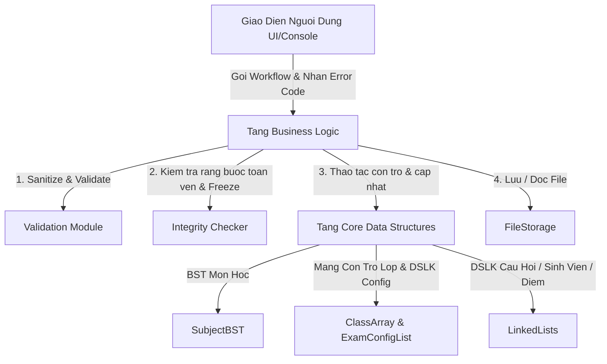
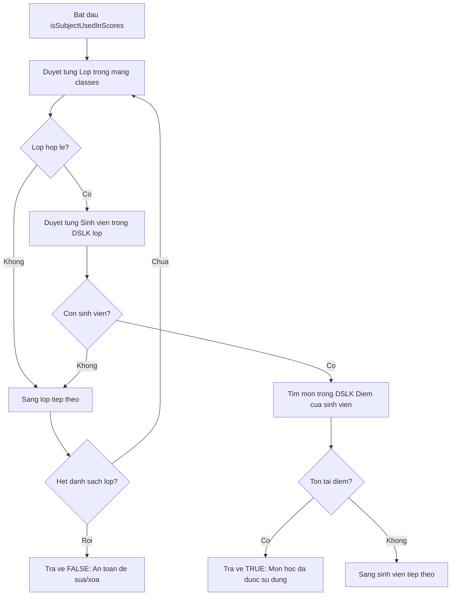
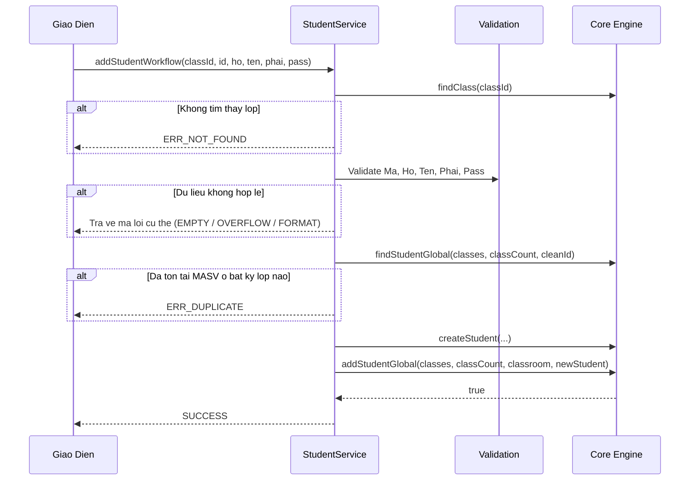
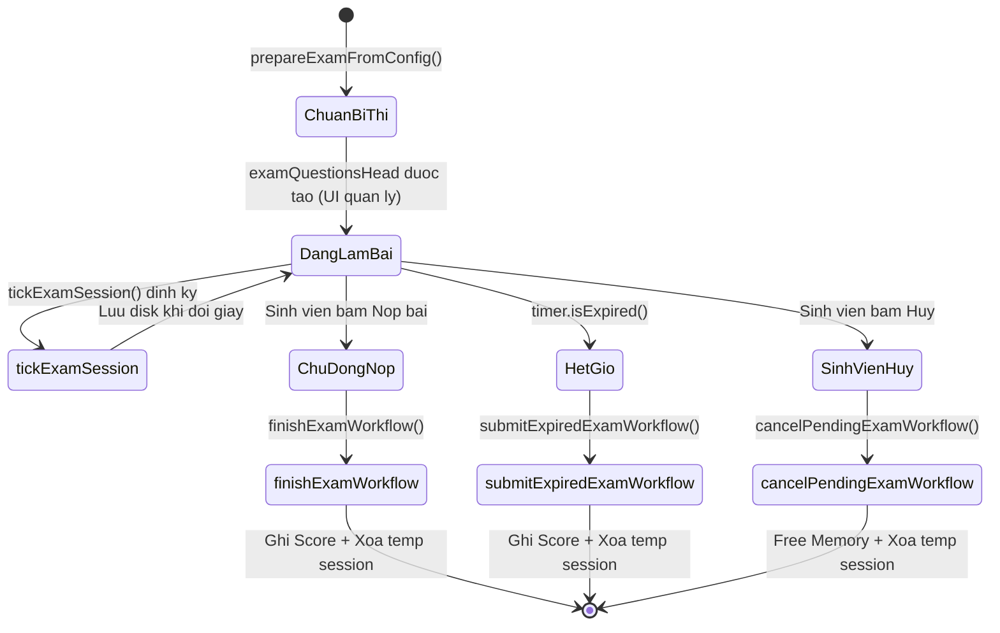
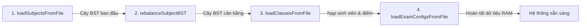

# TÀI LIỆU KỸ THUẬT MỞ RỘNG TẦNG NGHIỆP VỤ (BUSINESS LOGIC EXTENSION)

> **Dự án**: Hệ Thống Quản Lý Thi Trắc Nghiệm  
> **Thư mục**: `DSA-Project-ThiTracNghiem/business/`  
> **Người phụ trách**: Người 2 (Business Logic & Backend Workflows)  
> **Cập nhật ngày**: 24/10/2026 (Đồng bộ toàn diện kiến trúc cấu hình theo lớp, BST Rebalance, Runtime Timer & Session)  
> **Mục tiêu tài liệu**: Phân tích cặn kẽ từng file nguồn trong thư mục `business/`, giải thích chi tiết nguyên lý hoạt động, thuật toán bên dưới (kèm phân tích Big-O), các ví dụ minh họa bằng mã nguồn thực tế và hướng dẫn kết nối an toàn cho tầng Giao diện (UI).

---

## MỤC LỤC CHI TIẾT

1. [Tổng Quan Kiến Trúc & Triết Lý Thiết Kế](#1-tổng-quan-kiến-trúc--triết-lý-thiết-kế)
2. [File 1: BusinessErrors.h – Hệ Thống Chuẩn Hóa Mã Lỗi](#2-file-1-businesserrorsh--hệ-thống-chuẩn-hóa-mã-lỗi)
3. [File 2: Validation.h & Validation.cpp – Làm Sạch & Xác Thực Dữ Liệu](#3-file-2-validationh--validationcpp--làm-sạch--xác-thực-dữ-liệu)
4. [File 3: SubjectService.h & SubjectService.cpp – Quản Lý Môn Học & Cân Bằng Cây BST](#4-file-3-subjectserviceh--subjectservicecpp--quản-lý-môn-học--cân-bằng-cây-bst)
5. [File 4: QuestionService.h & QuestionService.cpp – Quản Lý Câu Hỏi & Ràng Buộc Xóa An Toàn](#5-file-4-questionserviceh--questionservicecpp--quản-lý-câu-hỏi--ràng-buộc-xóa-an-toàn)
6. [File 5: ExamConfigService.h & ExamConfigService.cpp – Cấu Hình Thi Theo Lớp, Bốc Đề Cố Định & Freeze Policy](#6-file-5-examconfigserviceh--examconfigservicecpp--cấu-hình-thi-theo-lớp-bốc-đề-cố-định--freeze-policy)
7. [File 6: BusinessQueries.h & PipeCodec.h – Truy Vấn Dùng Chung & Bộ Mã Hóa Ký Tự Pipe](#7-file-6-businessqueriesh--pipecodech--truy-vấn-dùng-chung--bộ-mã-hóa-ký-tự-pipe)
8. [File 7: ClassService.h & ClassService.cpp – Quản Lý Lớp Học Mảng Tuyến Tính](#8-file-7-classserviceh--classservicecpp--quản-lý-lớp-học-mảng-tuyến-tính)
9. [File 8: StudentService.h & StudentService.cpp – Quản Lý Sinh Viên Toàn Cục](#9-file-8-studentserviceh--studentservicecpp--quản-lý-sinh-viên-toàn-cục)
10. [File 9: AuthService.h & AuthService.cpp – Xác Thực Đa Quyền & Phân Quyền](#10-file-9-authserviceh--authservicecpp--xác-thực-đa-quyền--phân-quyền)
11. [File 10: ExamService.h & ExamService.cpp – Động Cơ Thi, Bộ Đếm ExamTimer & Session Runtime](#11-file-10-examserviceh--examservicecpp--động-cơ-thi-bộ-đếm-examtimer--session-runtime)
12. [File 11: ReportService.h & ReportService.cpp – Báo Cáo, Tra Cứu & In Ấn](#12-file-11-reportserviceh--reportservicecpp--báo-cáo-tra-cứu--in-ấn)
13. [File 12: FileStorage.h & FileStorage.cpp – Tuần Tự Hóa Dữ Liệu Phân Cấp & Đồng Bộ File](#13-file-12-filestorageh--filestoragecpp--tuần-tự-hóa-dữ-liệu-phân-cấp--đồng-bộ-file)
14. [Bảng Tra Cứu Độ Phức Tạp Thuật Toán (Big-O Cheat Sheet)](#14-bảng-tra-cứu-độ-phức-tạp-thuật-toán-big-o-cheat-sheet)
15. [Cẩm Nang Kết Nối Dành Cho Lập Trình Viên UI](#15-cẩm-nang-kết-nối-dành-cho-lập-trình-viên-ui)

---

## 1. TỔNG QUAN KIẾN TRÚC & TRIẾT LÝ THIẾT KẾ

### 1.1 Vị trí của tầng Business trong hệ thống
Tầng `business` hoạt động như một "Bộ vi xử lý trung tâm" (Control Center) đứng giữa hai lớp:
- **Tầng Core Data Structures (`core/`)**: Chịu trách nhiệm về cấu trúc dữ liệu nguyên thủy (BST, Danh sách liên kết đơn, Con trỏ mảng, Cấp phát/Thu hồi vùng nhớ thô). Tầng này **không** quan tâm dữ liệu có hợp lệ theo quy chế thi hay không.
- **Tầng Presentation/UI**: Chịu trách nhiệm nhận tương tác từ bàn phím, điều hướng menu, in màu sắc và bắt sự kiện. Tầng này **không** được trực tiếp thao tác con trỏ dữ liệu thô.



### 1.2 Các nguyên tắc thiết kế bất biến (Invariants)
1. **Tuân thủ triệt để No-STL**: Không sử dụng `std::vector`, `std::list`, `std::map`, hay smart pointers (`std::unique_ptr`). Mọi thao tác đều dùng con trỏ C++ truyền thống, mảng động (`new[]`/`delete[]`), và chuỗi ký tự kết thúc bằng null (`char[]`).
2. **Ngăn chặn rò rỉ bộ nhớ (Zero Memory Leak)**: Nếu một thao tác nghiệp vụ thất bại giữa chừng (ví dụ: xác thực không thành công sau khi đã `new`), toàn bộ vùng nhớ cấp phát tạm thời **phải** được dọn dẹp trước khi trả quyền điều khiển về UI.
3. **Bất biến khóa chính (Primary Key Immutability)**: Mã sinh viên (`MASV`), Mã câu hỏi (`ID`) là các trường định danh duy nhất và không được phép chỉnh sửa sau khi khởi tạo. Mã môn học (`MAMH`) chỉ được sửa khi môn học đó chưa phát sinh bất kỳ điểm thi nào trên toàn hệ thống.
4. **Độc lập bản ghi thi (Exam Snapshot Independence)**: Khi sinh viên thi, các câu hỏi được sao chép sâu (Deep Copy) sang cấu trúc `ExamDetail`. Do đó, sau này giảng viên có sửa nội dung hoặc xóa câu hỏi trong ngân hàng đề, bài thi lịch sử của sinh viên vẫn giữ nguyên 100% nội dung tại thời điểm thi.
5. **Cấu hình thi gắn liền với từng lớp học & Đóng băng đề thi (Class Exam Config & Freeze Invariant)**: Cấu hình thi (số câu, số phút, bộ ID câu hỏi) được gắn trực tiếp vào từng lớp học trong `Class.configList` (`ExamConfigService`). Bộ câu hỏi được bốc cố định một lần khi lưu cấu hình để toàn bộ sinh viên trong lớp thi chung một bộ đề. Khi lớp đã có bất kỳ sinh viên nào thi môn đó, cấu hình bị đóng băng (**Freeze**) — cấm tuyệt đối việc sửa hoặc xóa.
6. **Thu hồi bộ nhớ phân cấp an toàn (Safe Cascading Deletion)**: Hệ thống cho phép xóa lớp học kể cả khi lớp đang có sinh viên; tầng Core tự động thu hồi toàn bộ cây dữ liệu phụ thuộc (Sinh viên -> Bảng điểm -> Chi tiết đề thi -> Cấu hình thi) một cách an toàn mà không gây rò rỉ bộ nhớ (Zero Leak).

---

## 2. FILE 1: [BusinessErrors.h](file:///d:/Download/DSA-Project-ThiTracNghiem/business/BusinessErrors.h) – HỆ THỐNG CHUẨN HÓA MÃ LỖI

### 2.1 Bản chất kỹ thuật & Mục đích
Trong lập trình C++ không dùng Exception (để đảm bảo hiệu năng và dễ kiểm soát luồng điều khiển), phương pháp Error Code tập trung thông qua `enum` là chuẩn mực vàng. Thay vì trả về `bool` (chỉ biết thành công hay thất bại nhưng không rõ nguyên nhân), mọi hàm workflow trong tầng Business đều trả về `BusinessResult`.

### 2.2 Danh mục mã lỗi và ý nghĩa
```cpp
enum BusinessResult {
    SUCCESS = 0,               // Thao tac thanh cong hoan toan
    ERR_EMPTY_FIELD,           // Truong du lieu bi de trong hoac chi chua khoang trang
    ERR_BUFFER_OVERFLOW,       // Do dai chuoi vuot qua gioi han mang tinh (Constants.h)
    ERR_INVALID_FORMAT,        // Dinh dang sai (vi du: phai khong hop le, dap an khong phai A-D)
    ERR_NOT_FOUND,             // Khong tim thay doi tuong (lop, mon, sinh vien, cau hoi)
    ERR_DUPLICATE,             // Du lieu bi trung khoa chinh (trung MAMH, MALOP, MASV)
    ERR_LIST_FULL,             // Danh sach mang tinh da day (lop dat MAX_CLASS = 10000)
    ERR_CONSTRAINT_VIOLATION,  // Vi pham rang buoc toan ven (xoa/sua mon da co diem, cau hinh thi ngoai pham vi)
    ERR_UNKNOWN                // Loi khong xac dinh (cap phat bo nho that bai, loi he thong)
};
```
*(Ghi chú: Kể từ bản cập nhật v2.2.0, thao tác xóa lớp đang có sinh viên không còn bị chặn bởi `ERR_CONSTRAINT_VIOLATION` nữa mà cho phép xóa và tự động giải phóng dây chuyền toàn bộ sinh viên, điểm số và bài thi của lớp).*

### 2.3 Hàm chuyển đổi chuỗi `getErrorMessage()`
```cpp
inline const char* getErrorMessage(BusinessResult result);
```
- **Cách hoạt động**: Sử dụng cấu trúc `switch-case` ánh xạ giá trị `enum` sang chuỗi hằng `const char*` nằm ở phân vùng tĩnh (Static Data Segment).
- **Độ phức tạp**: Thời gian `O(1)`, Không gian phụ `O(1)` (không tốn một byte heap nào).
- **Lợi ích cho UI**: UI chỉ cần gọi `getErrorMessage(res)` là lập tức có chuỗi tiếng Việt rõ ràng để in thông báo lỗi ra màn hình.

### 2.4 Ví dụ ứng dụng trong UI
```cpp
BusinessResult res = addSubjectWorkflow(rootSubject, inputId, inputName);
if (res != SUCCESS) {
    // UI in ra thong bao loi chuan xac ma khong can hard-code
    std::cout << "[LOI]: " << getErrorMessage(res) << "\n";
    if (res == ERR_DUPLICATE) {
        std::cout << "Goi y: Vui long chon ma mon hoc khac!\n";
    }
} else {
    std::cout << "[THANH CONG]: Mon hoc da duoc them vao he thong!\n";
}
```

---

## 3. FILE 2: [Validation.h](file:///d:/Download/DSA-Project-ThiTracNghiem/business/Validation.h) & [Validation.cpp](file:///d:/Download/DSA-Project-ThiTracNghiem/business/Validation.cpp) – LÀM SẠCH & XÁC THỰC DỮ LIỆU

### 3.1 Thuật toán 1: Two-Pointer In-Place String Trim (`trimString`)
Khi người dùng nhập chuỗi từ bàn phím, các khoảng trắng vô tình ở đầu hoặc cuối chuỗi (`"   IT01  \t "`) có thể gây sai lệch khi so khớp chuỗi hoặc băm dữ liệu. Thuật toán `trimString` loại bỏ các khoảng trắng này tại chỗ mà không cấp phát thêm chuỗi mới.

#### Nguyên lý từng bước:
1. **Kiểm tra biên**: Nếu `str == nullptr` hoặc chuỗi rỗng (`len == 0`), kết thúc ngay.
2. **Tìm con trỏ đầu (`start`)**: Duyệt từ trái sang phải, tìm chỉ số đầu tiên mà ký tự tại đó không phải ký tự trắng (`' '`, `'\t'`, `'\n'`, `'\r'`).
3. **Kiểm tra chuỗi toàn trắng**: Nếu duyệt đến hết chuỗi (`start == len`), đặt `str[0] = '\0'` và kết thúc.
4. **Tìm con trỏ cuối (`end`)**: Duyệt từ phải sang trái (`len - 1` lùi dần), tìm chỉ số đầu tiên gặp ký tự không phải khoảng trắng.
5. **Dồn chuỗi (In-Place Copy)**: Dùng chỉ số `idx = 0`, sao chép các ký tự từ `start` đến `end` về vị trí `str[idx++]`.
6. **Đóng chuỗi**: Đặt `str[idx] = '\0'`.

```
Vi du minh hoa bo nho cua trimString:
Ban dau:    [' ', ' ', 'I', 'T', '0', '1', ' ', '\0']  (len = 7)
Con tro:            ^start          ^end
Dich chuyen: str[0]='I', str[1]='T', str[2]='0', str[3]='1'
Ket qua:    ['I', 'T', '0', '1', '\0', ...]
```

- **Độ phức tạp thời gian**: `O(N)` với N là chiều dài chuỗi (mỗi ký tự được duyệt qua tối đa 2 lần).
- **Độ phức tạp không gian**: `O(1)` bổ trợ (hoàn toàn thao tác trên mảng gốc).

### 3.2 Thuật toán 2: Chuyển Đổi Ký Tự Hoa Bằng Số Học ASCII (`toUpperString`)
Thay vì gọi hàm thư viện chuẩn `toupper` cho từng ký tự (có thể phụ thuộc vào Locale máy), hệ thống sử dụng phép tính dịch chuyển khoảng cách mã ASCII trực tiếp:
```cpp
if (str[i] >= 'a' && str[i] <= 'z') {
    str[i] = (char)(str[i] - ('a' - 'A'));
}
```
- **Bản chất**: Khoảng cách giữa chữ thường và chữ hoa trong bảng mã ASCII là một hằng số cố định (`'a' - 'A' = 97 - 65 = 32`). Trừ đi 32 sẽ chuyển chữ thường thành chữ hoa.
- **Độ phức tạp**: `O(N)` thời gian, `O(1)` không gian.

### 3.3 Thuật toán 3: Kiểm Tra Ký Tự Trắng Tuyến Tính (`containsWhitespace` & `isAllWhitespace`)
- `containsWhitespace`: Duyệt tuyến tính chuỗi từ đầu đến cuối. Trả về `true` ngay khi phát hiện ký tự trắng đầu tiên. Dùng để kiểm tra các trường cấm có dấu cách như Mật khẩu (`password`).
- `isAllWhitespace`: Duyệt kiểm tra nếu toàn bộ chuỗi đều là ký tự trắng hoặc rỗng.

### 3.4 Nhóm hàm kiểm tra nghiệp vụ (Validation Helpers)
Các hàm `validateSubjectId`, `validateSubjectName`, `validateClassId`, `validateClassName`, `validateStudentId`, `validateStudentName`, `validateQuestionContent`, `validateAnswerContent` tuân thủ mô hình bảo vệ 2 lớp:
1. **Lớp 1 - Kiểm tra rỗng**: `if (str == nullptr || isAllWhitespace(str)) return ERR_EMPTY_FIELD;`
2. **Lớp 2 - Kiểm tra độ dài biên**: So sánh `stringLength(str) >= MAX_LEN`. Nếu vượt quá kích thước mảng tĩnh, trả về `ERR_BUFFER_OVERFLOW` để tuyệt đối ngăn chặn lỗi tràn bộ đệm (Buffer Overflow Vulnerability).

#### Xác thực đặc thù:
- **`validateStudentId(const char id[])`**: Ngoài kiểm tra rỗng và độ dài `< STUDENT_ID_LEN = 20`, hàm duyệt từng ký tự và thực hiện **Whitelist kiểm tra an ninh**: chỉ chấp nhận các ký tự chữ cái hoa/thường (`'A'-'Z'`, `'a'-'z'`), chữ số (`'0'-'9'`), gạch dưới (`'_'`) và gạch nối (`'-'`). Nếu xuất hiện ký tự khác (đặc biệt là dấu chấm `.` hoặc dấu gạch chéo `/`, `\`), lập tức trả về `ERR_INVALID_FORMAT`. Cơ chế này ngăn chặn tuyệt đối lỗ hổng bảo mật **Path Traversal** khi hệ thống dùng `MASV` để sinh tên file phiên thi tạm `temp_<MASV>.dat` (B07).
- **`validateGender(char gender[])`**: Tự động gọi `trimString` và `toUpperString`, sau đó chuẩn hóa:
  - Nếu là `"NAM"` -> sao chép thành `"Nam"`, trả về `SUCCESS`.
  - Nếu là `"NU"` -> sao chép thành `"Nu"`, trả về `SUCCESS`.
  - Bất kỳ giá trị nào khác -> trả về `ERR_INVALID_FORMAT`.
- **`validateCorrectAnswer(char &correct)`**: Tự động chuyển thường sang hoa ('a'-'d' -> 'A'-'D'). Nếu không nằm trong tập `{'A', 'B', 'C', 'D'}` -> trả về `ERR_INVALID_FORMAT`.

---

## 4. FILE 3: [SubjectService.h](file:///d:/Download/DSA-Project-ThiTracNghiem/business/SubjectService.h) & [SubjectService.cpp](file:///d:/Download/DSA-Project-ThiTracNghiem/business/SubjectService.cpp) – QUẢN LÝ MÔN HỌC & RÀNG BUỘC

### 4.1 Thuật toán Kiểm Tra Toàn Vẹn Quan Hệ (`isSubjectUsedInScores`)
Một quy chế nghiêm ngặt trong hệ thống thi cử: **Không được phép xóa môn học hoặc đổi mã môn học nếu môn học đó đã có điểm thi của bất kỳ sinh viên nào.**



- **Mã giả chi tiết**:
  ```cpp
  for (int i = 0; i < classCount; ++i) {
      Student* student = classes[i]->studentList;
      while (student != nullptr) {
          if (findScore(student, cleanSubId) != nullptr) {
              return true; // Phat hien rang buoc ton tai
          }
          student = student->next;
      }
  }
  return false;
  ```
- **Độ phức tạp tính toán**:
  - Gọi C là số lớp, S là số sinh viên trung bình mỗi lớp, M là số môn sinh viên đã thi.
  - Thời gian: `O(C * S * M)` trong trường hợp xấu nhất (duyệt hết hệ thống).
  - Không gian: `O(1)` (chỉ dùng con trỏ duyệt).

### 4.2 Thuật toán Thêm Môn Học (`addSubjectWorkflow`)
1. Xác thực cú pháp `validateSubjectId` và `validateSubjectName`.
2. Chuẩn hóa chuỗi: Trim và viết hoa `MAMH`, Trim `TENMH`.
3. Kiểm tra trùng lặp trên Cây nhị phân tìm kiếm (BST): `findSubject(root, cleanId)`. Nếu tìm thấy -> trả về `ERR_DUPLICATE` (độ phức tạp trung bình `O(log N)`).
4. Tạo node môn học mới: `createSubject(cleanId, cleanName)`.
5. Chèn vào cây BST: `root = insertSubject(root, newSubject)`. Môn học tự động được sắp xếp theo thứ tự từ điển của mã môn học.
6. Trả về `SUCCESS`.

### 4.3 Thuật toán Sửa Môn Học (`editSubjectWorkflow`)
1. Tìm môn học cũ trong cây BST theo `oldId`. Nếu không thấy -> trả về `ERR_NOT_FOUND`.
2. Xác thực và làm sạch `newId` và `newName`.
3. **Nếu có sự thay đổi mã môn học (`cleanOldId != cleanNewId`)**:
   - Gọi `isSubjectUsedInScores(classes, classCount, cleanOldId)`: Nếu môn đã có điểm -> trả về `ERR_CONSTRAINT_VIOLATION` (chặn sửa mã).
   - Kiểm tra xem `cleanNewId` đã tồn tại trong BST chưa -> nếu có, trả về `ERR_DUPLICATE`.
4. Gọi hàm core `editSubject(root, cleanOldId, cleanNewId, cleanNewName)`.
   - *Lưu ý cơ chế Core*: Vì khóa của BST là `MAMH`, khi đổi `MAMH`, hệ thống phải tháo gỡ node cũ ra khỏi cây BST, đổi tên, rồi chèn lại vào đúng vị trí mới để bảo toàn tính chất cây tìm kiếm nhị phân.
5. **Đồng bộ cấu hình thi theo lớp (`ExamConfig`)**: Nếu đổi mã môn thành công, duyệt qua mảng `classes[]`, tìm các `ExamConfig` của môn cũ và cập nhật trường `subjectId` sang `cleanNewId`.

### 4.4 Thuật toán Xóa Môn Học (`deleteSubjectWorkflow`)
1. Tìm kiếm môn học theo `id` trong cây BST. Không thấy -> `ERR_NOT_FOUND`.
2. Kiểm tra ràng buộc toàn vẹn: `isSubjectUsedInScores(classes, classCount, cleanId)`. Nếu môn đã phát sinh điểm thi -> lập tức trả về `ERR_CONSTRAINT_VIOLATION`.
3. **Dọn dẹp cấu hình thi của môn khỏi các lớp**: Duyệt qua từng lớp học trong `classes[]`, gọi `deleteExamConfig(classes[i], cleanId)` để thu hồi vùng nhớ các cấu hình thi của môn này trước khi xóa node môn học.
4. Gọi `root = deleteSubject(root, cleanId)`. Hàm này sẽ tự động giải phóng toàn bộ danh sách liên kết câu hỏi thuộc môn học đó trước khi giải phóng node môn học.

### 4.5 Thuật toán Tái Cân Bằng Cây BST Môn Học (`rebalanceSubjectBST` — B01 / R1)

Khi nạp dữ liệu từ file `subjects.txt` (được lưu theo thứ tự in-order tăng dần), cây BST nếu chèn liên tiếp sẽ bị suy biến hoàn toàn thành danh sách liên kết lệch phải với chiều cao $O(N)$, làm tốc độ tìm kiếm suy giảm về $O(N)$. Để khôi phục hiệu năng $O(\log N)$, thuật toán `rebalanceSubjectBST` được triển khai:

- **Chữ ký hàm**:
  ```cpp
  void rebalanceSubjectBST(Subject*& root);
  ```

- **Nguyên lý 2 pha (Two-Phase Mid-First Reconstruction)**:
  1. **Pha 1 - Thu thập mảng con trỏ In-order**:
     - Đếm tổng số node $N$ trên cây BST (`countSubjectNodes`). Nếu $N < 2$, kết thúc ngay.
     - Cấp phát mảng con trỏ tạm: `Subject** nodes = new Subject*[count];`.
     - Duyệt in-order đệ quy (`collectSubjectNodes`) và lưu con trỏ của từng node vào `nodes[index++]`.
  2. **Pha 2 - Dựng lại cây nhị phân cân bằng (Divide and Conquer)**:
     - Hàm `buildBalancedSubjects(nodes, left, right)` lấy phần tử trung vị `mid = left + (right - left) / 2` làm node gốc.
     - Đệ quy gán `root->left = buildBalancedSubjects(nodes, left, mid - 1);`.
     - Đệ quy gán `root->right = buildBalancedSubjects(nodes, mid + 1, right);`.
     - **Tính chất an toàn**: Hoàn toàn không tạo node mới, không xóa node cũ, không can thiệp nội dung `name` hay `questionList`, chỉ gán lại con trỏ `left` và `right`.
  3. **Thu hồi mảng con trỏ tạm**: `delete[] nodes;`.

- **Độ phức tạp**:
  - Thời gian: `O(N)` (đếm node `O(N)`, duyệt in-order `O(N)`, dựng lại `O(N)`).
  - Không gian bổ trợ: `O(N)` cho mảng con trỏ tạm trên heap (thu hồi ngay).
  - Kết quả: Chiều cao cây đạt $H \le 2 \times \lceil\log_2(N+1)\rceil$, tối ưu triệt để chi phí tìm kiếm môn học.
  - Được tự động gọi trong `loadAllData()` ngay sau khi nạp xong danh sách môn.

*(Ghi chú: Hàm `setExamConfigWorkflow` trên `Subject` cũ đã trở thành legacy và chỉ còn giữ lại để UI cũ biên dịch, hệ thống hiện tại đã chuyển sang cấu hình theo lớp).*

---

## 5. FILE 4: [QuestionService.h](file:///d:/Download/DSA-Project-ThiTracNghiem/business/QuestionService.h) & [QuestionService.cpp](file:///d:/Download/DSA-Project-ThiTracNghiem/business/QuestionService.cpp) – QUẢN LÝ CÂU HỎI & RÀNG BUỘC XÓA AN TOÀN

### 5.1 Cơ chế Tự Động Sinh Mã Câu Hỏi Tăng Dần (Auto-Increment ID)
- Câu hỏi thi trắc nghiệm không dùng mã chuỗi do người dùng nhập mà sử dụng số nguyên dương duy nhất `int questionId`.
- **Cơ chế hoạt động**: Sử dụng một biến đếm tĩnh toàn cục `g_questionIdCounter` trong `QuestionList.cpp`.
  - Khi thêm câu hỏi mới: `generateQuestionId()` thực hiện `return ++g_questionIdCounter;` (thời gian `O(1)`).
  - Khi nạp dữ liệu từ file: gọi `updateQuestionIdCounter(qId)` để đảm bảo biến đếm luôn lớn hơn ID lớn nhất đã tồn tại trong file, tránh xung đột ID khi khởi động lại ứng dụng.

### 5.2 Thuật toán Thêm Câu Hỏi (`addQuestionWorkflow`)
1. Tìm con trỏ `Subject` trong BST theo `subjectId`.
2. Xác thực nội dung câu hỏi (`validateQuestionContent`), xác thực 4 phương án A, B, C, D (`validateAnswerContent`), xác thực đáp án đúng (`validateCorrectAnswer`).
3. Chuẩn hóa chuỗi nội dung và các phương án bằng `trimString`.
4. Sinh ID tự động: `generatedId = generateQuestionId()`.
5. Cấp phát struct: `Question* q = createQuestion(...)`.
6. Chèn vào danh sách liên kết đơn `subject->questionList` thông qua `insertQuestion`.

### 5.3 Thuật toán Sửa & Xóa Câu Hỏi Có Ràng Buộc An Toàn (B05)
- **Sửa câu hỏi (`editQuestionWorkflow`)**: Tìm môn học trong BST -> Duyệt tìm node câu hỏi trong DSLK theo `questionId` -> Ghi đè trực tiếp các mảng ký tự nội dung và đáp án đúng.
- **Xóa câu hỏi (`deleteQuestionWorkflow`)**:
  Hệ thống hỗ trợ 2 chữ ký:
  ```cpp
  // Chữ ký chuẩn mới bảo vệ toàn vẹn dữ liệu:
  BusinessResult deleteQuestionWorkflow(
      Subject* root, Class* classes[], int classCount,
      const char subjectId[], int questionId
  );
  ```
  **Hai tầng kiểm tra ràng buộc trước khi xóa**:
  1. *Tầng 1 - Kiểm tra điểm thi*: Nếu môn học đã có sinh viên làm bài thi (`isSubjectUsedInScores`) -> trả về `ERR_CONSTRAINT_VIOLATION` (chặn xóa).
  2. *Tầng 2 - Kiểm tra cấu hình thi của lớp*: Duyệt qua toàn bộ `classes[]`, nếu `questionId` đang nằm trong danh sách câu hỏi đã bốc của cấu hình thi bất kỳ lớp nào (`ExamConfig.questionIds`) -> trả về `ERR_CONSTRAINT_VIOLATION` (chặn xóa).
  3. Chỉ khi vượt qua an toàn, hệ thống mới gọi `deleteQuestion(subject->questionList, questionId)`.

### 5.4 Cơ chế Snapshot Độc Lập Giữa Ngân Hàng Câu Hỏi & Bài Thi
> [!IMPORTANT]
> Trong hệ thống này: Khi thi, một bản sao độc lập `ExamDetail` được tạo ra. Kể cả khi câu hỏi trong `subject->questionList` bị xóa bỏ hoàn toàn, dữ liệu trong `ExamDetail` của sinh viên vẫn tồn tại nguyên vẹn.

---

## 6. FILE 5: [ExamConfigService.h](file:///d:/Download/DSA-Project-ThiTracNghiem/business/ExamConfigService.h) & [ExamConfigService.cpp](file:///d:/Download/DSA-Project-ThiTracNghiem/business/ExamConfigService.cpp) – CẤU HÌNH THI THEO LỚP, BỐC ĐỀ CỐ ĐỊNH & FREEZE POLICY (B02 / R2)

### 6.1 Bài toán nghiệp vụ & Triết lý thiết kế
Trong các phiên bản trước, cấu hình số câu thi và thời gian thi được gắn trực tiếp trên môn học. Tuy nhiên trong môi trường trường đại học, mỗi lớp học có thể có thời lượng và số câu thi khác nhau cho cùng một môn học. Hơn nữa, để đảm bảo tính công bằng trong cùng một lớp, **mọi sinh viên cùng lớp phải thi cùng một bộ câu hỏi**.

Module `ExamConfigService` giải quyết trọn vẹn bài toán này:
- Mỗi cặp `(MALOP, MAMH)` sở hữu cấu hình độc lập gắn vào `Class.configList`.
- Bốc ngẫu nhiên $N$ câu hỏi **một lần duy nhất** khi giảng viên lưu cấu hình; mọi sinh viên trong lớp thi đúng bộ câu hỏi đó (thứ tự đáp án vẫn đảo ngẫu nhiên).
- Giảng viên được phép xem trước (preview) bộ đề đã bốc.
- **Freeze Policy**: Ngay khi có bất kỳ sinh viên nào trong lớp nộp bài thi môn đó, cấu hình thi bị đóng băng vĩnh viễn (cấm sửa hoặc xóa).

### 6.2 Thuật toán Bốc Đề Không Trùng Lặp (`drawQuestionIds`)
```cpp
int drawQuestionIds(Subject* subject, int count, int outIds[]);
```
1. Lấy tổng số câu hiện có trong môn: `available = countQuestions(subject->questionList);`.
2. Nếu `count > available`, trả về 0 (không đủ câu).
3. Cấp phát mảng con trỏ hằng tạm: `const Question** pool = new const Question*[available];`.
4. Sao chép con trỏ các câu hỏi vào `pool`.
5. Khởi tạo `srand` một lần duy nhất qua `initializeRngOnce()`.
6. Thực hiện **Knuth Fisher-Yates Shuffle**: Duyệt từ `i = available - 1` về 1, hoán vị phần tử `pool[i]` với phần tử ngẫu nhiên `pool[rand() % (i + 1)]`.
7. Lấy `count` phần tử đầu tiên gán ID vào `outIds[i] = pool[i]->id`.
8. Giải phóng mảng con trỏ tạm: `delete[] pool;` và trả về `count`.
- **Độ phức tạp**: Thời gian `O(K)`, Bộ nhớ phụ `O(K)` con trỏ (với K là số câu trong môn).

### 6.3 Thuật toán Lưu Cấu Hình Thi Lớp (`setClassExamConfigWorkflow`)
1. Chuẩn hóa mã lớp và mã môn (trim + upper).
2. Kiểm tra tồn tại của lớp và môn; kiểm tra $1 \le \text{numberOfQuestions} \le \text{available}$ và $1 \le \text{minutes} \le 180$.
3. **Kiểm tra Freeze**: Gọi `classHasTakenSubject(classes, classCount, cleanClass, cleanSubject)`. Nếu đã có điểm thi -> trả về `ERR_CONSTRAINT_VIOLATION`.
4. Tìm cấu hình đã có qua `findExamConfig(classroom, cleanSubject)`:
   - Nếu đã có và **cùng số câu hỏi**: chỉ cập nhật `existing->minutes = minutes;` và **giữ nguyên bộ câu hỏi cũ**.
   - Nếu đã có nhưng **khác số câu hỏi**: giải phóng mảng ID cũ, gọi `drawQuestionIds` bốc bộ ID mới, cập nhật lại `createdAt`.
   - Nếu chưa có: bốc bộ ID mới, gọi `createExamConfig(...)` và chèn vào `addExamConfig(classroom, config)`.

### 6.4 Thuật toán Chuẩn Bị Bài Thi Từ Cấu Hình (`prepareExamFromConfig`)
```cpp
BusinessResult prepareExamFromConfig(
    Subject* root, Class* classes[], int classCount, Student* student,
    const char subjectId[], ExamDetail*& examQuestionsHead
);
```
1. Kiểm tra điều kiện thi qua `canStudentTakeSubject(...)`.
2. Định vị cấu hình thi của lớp: `ExamConfig* config = findExamConfig(classroom, cleanSubject);`.
3. Duyệt mảng `config->questionIds[i]` theo đúng thứ tự đã lưu.
4. Với mỗi ID, tìm câu hỏi trong ngân hàng `findQuestion(subject->questionList, id)`:
   - Nếu không tìm thấy (câu hỏi bị xóa ngoài ý muốn): dọn dẹp qua `cancelExam(examQuestionsHead)` và trả về `ERR_NOT_FOUND`.
   - Nếu tìm thấy: tạo snapshot `createExamDetail(question)` và nối vào `addExamDetail(examQuestionsHead, detail)`.
5. Đề thi snapshot hoàn chỉnh được chuyển giao quyền quản lý tạm thời cho caller.

---

## 7. FILE 6: [BusinessQueries.h](file:///d:/Download/DSA-Project-ThiTracNghiem/business/BusinessQueries.h) & [PipeCodec.h](file:///d:/Download/DSA-Project-ThiTracNghiem/business/PipeCodec.h) – TRUY VẤN DÙNG CHUNG & BỘ MÃ HÓA PIPE (B04 & B06)

### 7.1 Truy vấn nghiệp vụ dùng chung (`BusinessQueries.h`)
Tránh phân mảnh logic giữa Console và GUI:
- `isPassingScore(float score)`: Quy chuẩn đạt / không đạt tập trung (ngưỡng $\ge 5.0f$).
- `countStudentsInClass(const Class* classroom)`: Đếm sĩ số lớp trong $O(S)$, loại bỏ 3 bản cài đặt trùng lặp trong UI.
- `collectSubjectsInOrder(Subject* root, Subject* out[], int capacity)`: Duyệt in-order lấy mảng môn học theo thứ tự bảng chữ cái để hiển thị danh sách.
- `freeAllData(Subject*& root, Class* classes[], int& classCount)`: Thu hồi an toàn toàn bộ dữ liệu khi kết thúc phiên làm việc.

### 7.2 Bộ mã hóa ký tự phân cách Pipe (`PipeCodec.h` — B06)
- **Vấn đề**: File storage dùng `|` làm delimiter. Nếu tên môn, nội dung câu hỏi hoặc đáp án chứa ký tự `|` (ví dụ: toán tử `||`, câu hỏi logic), file sẽ bị lệch cột khi nạp lại.
- **Giải pháp**:
  - `escapePipe(const char* value)`: Chuyển ký tự `|` thành `\|` và `\` thành `\\`.
  - `splitEscapedPipe(const std::string& line, std::string fields[], int capacity)`: Tách chuỗi theo ký tự `|` nhưng bỏ qua các ký tự đã được escape (`\|`), tự động giải mã về chuỗi gốc trong RAM.
  - Đảm bảo tính toàn vẹn 100% qua các vòng lưu / đọc file.

---

## 8. FILE 7: [ClassService.h](file:///d:/Download/DSA-Project-ThiTracNghiem/business/ClassService.h) & [ClassService.cpp](file:///d:/Download/DSA-Project-ThiTracNghiem/business/ClassService.cpp) – QUẢN LÝ LỚP HỌC MẢNG TUYẾN TÍNH

### 8.1 Cấu trúc Dữ liệu & Lý do Lựa chọn
Danh sách lớp học được tổ chức dưới dạng **Mảng con trỏ tuyến tính** (`Class* classes[MAX_CLASS]`) với `MAX_CLASS = 10000` (theo đề bài đồ án DSA).
- **Ưu điểm**: Truy xuất phần tử theo chỉ số cực nhanh, tiết kiệm bộ nhớ hơn danh sách liên kết vì chỉ tốn 8 byte con trỏ cho mỗi phần tử, không cần cấp phát node bao bọc.
- **Quản lý kích thước**: Biến `classCount` lưu trữ số lớp thực tế hiện có (`0 <= classCount <= MAX_CLASS`).

### 8.2 Thuật toán Thêm Lớp Học (`addClassWorkflow`)
1. **Kiểm tra sức chứa**: `if (classCount >= MAX_CLASS) return ERR_LIST_FULL;` (`O(1)`).
2. Xác thực và làm sạch `id` và `name`.
3. **Kiểm tra trùng mã**: Duyệt tuyến tính mảng `findClass(classes, classCount, cleanId)` (`O(N)`). Nếu trùng -> trả về `ERR_DUPLICATE`.
4. Cấp phát thực thể lớp học: `Class* newClass = createClass(cleanId, cleanName);`.
5. Đưa vào mảng: `addClass(classes, classCount, newClass)`. Lớp học được gán vào `classes[classCount]` và `classCount++`.
6. Nếu có lỗi bất ngờ, tự động gọi `delete newClass` để chống rò rỉ bộ nhớ.

### 8.3 Thuật toán Xóa Lớp Học An Toàn & Cascade Giải Phóng (`deleteClassWorkflow`)

Kể từ bản cập nhật v2.2.0, quy chế xóa lớp đã được điều chỉnh: **Cho phép xóa lớp học kể cả khi lớp đang có sinh viên**, nhằm nâng cao trải nghiệm quản trị (không bắt buộc giảng viên phải xóa thủ công từng sinh viên trước khi xóa lớp).

- **Chữ ký hàm**:
  ```cpp
  BusinessResult deleteClassWorkflow(
      Class* classes[],
      int& classCount,
      const char id[]
  );
  ```

- **Luồng xử lý chi tiết**:
  1. **Kiểm tra đầu vào**: Nếu `id == nullptr` -> trả về `ERR_NOT_FOUND`.
  2. **Chuẩn hóa mã lớp**: Sử dụng `trimString` và `toUpperString`.
  3. **Định vị lớp học**: Tìm kiếm lớp trong mảng `findClass(classes, classCount, cleanId)`. Nếu không tìm thấy -> trả về `ERR_NOT_FOUND`.
  4. **Bãi bỏ kiểm tra chặn sinh viên**: Đoạn code cũ `if (classroom->studentList != nullptr) return ERR_CONSTRAINT_VIOLATION;` đã được gỡ bỏ hoàn toàn.
  5. **Bàn giao cho tầng Core thực thi giải phóng Cascade**:
     - Gọi `deleteClass(classes, classCount, cleanId)`.
     - Tầng Core (`core/ClassArray.cpp`) duyệt qua toàn bộ danh sách liên kết sinh viên (`studentList`) của lớp.
     - Với mỗi sinh viên, giải phóng danh sách điểm thi `ScoreList`.
     - Với mỗi điểm thi, giải phóng danh sách chi tiết bài thi snapshot `ExamDetail`.
     - Giải phóng toàn bộ danh sách cấu hình thi theo lớp `classroom->configList`.
     - Thu hồi bộ nhớ node `Student` và struct `Class`.
     - Dồn toàn bộ các con trỏ từ vị trí xóa về bên trái một nấc: `classes[j] = classes[j + 1]`.
     - Giảm số lượng lớp: `classCount--`.
  6. Trả về `SUCCESS` nếu xóa thành công, ngược lại `ERR_UNKNOWN`.

- **Độ phức tạp**:
  - Thời gian: `O(C + S * M * D + E)` với C là số lớp (dồn mảng), S là số sinh viên của lớp bị xóa, M là số môn sinh viên đã thi, D là số câu hỏi trong bài thi chi tiết được giải phóng, E là số cấu hình thi của lớp.
  - Không gian bổ trợ: `O(1)` (không cấp phát thêm bộ nhớ).

> [!TIP]
> **Biện pháp an toàn phía Giao diện (UI UX)**: Để tránh việc giảng viên vô tình xóa nhầm lớp có đông sinh viên, tầng UI đã hiển thị cảnh báo sĩ số rõ ràng trong hộp thoại xác nhận xóa (Modal Confirm): *"Lớp đang có N sinh viên. Bạn có chắc chắn muốn xóa kèm toàn bộ sinh viên của lớp?"*.

---

## 9. FILE 8: [StudentService.h](file:///d:/Download/DSA-Project-ThiTracNghiem/business/StudentService.h) & [StudentService.cpp](file:///d:/Download/DSA-Project-ThiTracNghiem/business/StudentService.cpp) – QUẢN LÝ SINH VIÊN TOÀN CỤC

### 9.1 Tính Bất Biến Về Duy Nhất Mã Sinh Viên Toàn Cục (Global Uniqueness)
Trong trường học, mỗi sinh viên chỉ có một Mã sinh viên (`MASV`) duy nhất trên toàn trường, không được phép trùng lặp kể cả ở hai lớp khác nhau. Do danh sách sinh viên được lưu dưới dạng danh sách liên kết đơn riêng biệt theo từng lớp, việc kiểm tra trùng mã đòi hỏi thuật toán duyệt toàn cục.

### 9.2 Thuật toán Thêm Sinh Viên (`addStudentWorkflow`)


- **Độ phức tạp kiểm tra toàn cục**: `O(N_student)` với N_student là tổng số sinh viên của toàn bộ các lớp học trong trường.

### 9.3 Thuật toán Sửa Sinh Viên (`editStudentWorkflow`)
- **Nguyên lý bảo toàn khóa chính**: Sinh viên chỉ được phép sửa Họ, Tên, Phái và Mật khẩu. Mã sinh viên (`MASV`) tuyệt đối **không** được thay đổi vì toàn bộ lịch sử điểm thi liên kết chặt chẽ với mã này.
- **Quy trình**:
  1. Gọi `findStudentGlobal` để định vị con trỏ sinh viên trên toàn hệ thống.
  2. Xác thực dữ liệu mới.
  3. Gọi `editStudent(student, cleanHo, cleanTen, cleanGender, password)`.

### 9.4 Thuật toán Xóa Sinh Viên Hai Bước (`deleteStudentWorkflow`)
1. **Bước 1 - Pre-check**: Tìm kiếm lớp -> Tìm kiếm sinh viên `findStudent(classroom->studentList, cleanStudentId)`. Nếu không tồn tại -> trả về `ERR_NOT_FOUND` ngay lập tức.
2. **Bước 2 - Deletion**: Gọi `deleteStudent(classroom, cleanStudentId)`.
   - Tháo gỡ node sinh viên ra khỏi DSLK đơn của lớp.
   - Giải phóng toàn bộ danh sách điểm `ScoreList` của sinh viên đó.
   - Với mỗi điểm thi, tự động giải phóng toàn bộ danh sách chi tiết bài thi `ExamDetail`.
   - Thu hồi vùng nhớ struct `Student`.
   - Trả về `SUCCESS`.

---

## 10. FILE 9: [AuthService.h](file:///d:/Download/DSA-Project-ThiTracNghiem/business/AuthService.h) & [AuthService.cpp](file:///d:/Download/DSA-Project-ThiTracNghiem/business/AuthService.cpp) – XÁC THỰC ĐA QUYỀN & PHÂN QUYỀN

### 10.1 Kiến Trúc Xác Thực Kép (Two-Path Authentication)
Hệ thống hỗ trợ 2 vai trò đăng nhập với luồng xử lý độc lập:
1. **Giảng viên (Teacher/Admin)**: Tài khoản quản trị cố định với quyền lực tối cao (Thêm/Sửa/Xóa môn, lớp, câu hỏi, in báo cáo).
2. **Sinh viên (Student)**: Đăng nhập bằng `MASV` và `password` cá nhân (Chỉ được thi trắc nghiệm và xem lại bài thi của chính mình).

### 10.2 Quy Tắc Xử Lý Chuỗi Trong Xác Thực
- **Tên đăng nhập (`username`)**: Tự động áp dụng `trimString` và `toUpperString`. Ví dụ: Sinh viên gõ `" n21dccn001 "` sẽ được chuẩn hóa thành `"N21DCCN001"`. Giảng viên gõ `"gv"` hay `" gv "` đều nhận diện là `"GV"`.
- **Mật khẩu (`password`)**: Tự động áp dụng `trimString` loại bỏ khoảng trắng thừa đầu cuối, nhưng **giữ nguyên phân biệt chữ hoa chữ thường (Case-Sensitive)** để đảm bảo an toàn bảo mật.

### 10.3 So Sánh Hai Hàm Xác Thực Trong `AuthService`

| Tiêu chí | Hàm `login()` | Hàm `loginWorkflow()` |
|---|---|---|
| **Mục đích** | Tương thích chuẩn FunctionPrototype | Cung cấp mã lỗi chi tiết cho UI hiện đại |
| **Kiểu trả về** | `LoginRole` (`LOGIN_FAILED`, `LOGIN_TEACHER`, `LOGIN_STUDENT`) | `BusinessResult` (`SUCCESS`, `ERR_EMPTY_FIELD`, `ERR_NOT_FOUND`, `ERR_INVALID_FORMAT`,...) |
| **Cách trả vai trò** | Trả về trực tiếp | Trả qua tham chiếu `LoginRole& role` |
| **Báo lỗi sai mật khẩu** | Trả về `LOGIN_FAILED` chung chung | Trả về `ERR_INVALID_FORMAT` (giúp UI thông báo rõ: "Sai mật khẩu") |
| **Báo lỗi tài khoản không tồn tại** | Trả về `LOGIN_FAILED` chung chung | Trả về `ERR_NOT_FOUND` (giúp UI thông báo: "Mã sinh viên không tồn tại") |

### 10.4 Ví dụ mẫu tích hợp màn hình đăng nhập
```cpp
LoginRole role;
Student* loggedStudent = nullptr;

BusinessResult res = loginWorkflow(classes, classCount, userIn, passIn, role, loggedStudent);

if (res == SUCCESS) {
    if (role == LOGIN_TEACHER) {
        showTeacherMenu();
    } else if (role == LOGIN_STUDENT) {
        showStudentDashboard(loggedStudent);
    }
} else if (res == ERR_NOT_FOUND) {
    std::cout << "Tai khoan khong ton tai tren he thong!\n";
} else if (res == ERR_INVALID_FORMAT) {
    std::cout << "Mat khau khong chinh xac. Vui long thu lai!\n";
} else {
    std::cout << "Dang nhap that bai: " << getErrorMessage(res) << "\n";
}
```

---

## 11. FILE 10: [ExamService.h](file:///d:/Download/DSA-Project-ThiTracNghiem/business/ExamService.h) & [ExamService.cpp](file:///d:/Download/DSA-Project-ThiTracNghiem/business/ExamService.cpp) – ĐỘNG CƠ THI, BỘ ĐẾM EXAMTIMER & SESSION RUNTIME (B03 / R3)

Đây là phân hệ cốt lõi và phức tạp nhất của toàn bộ dự án, chịu trách nhiệm rút đề thi ngẫu nhiên, kiểm soát thời gian, chấm điểm và lưu trữ bài làm.

### 11.1 Thuật toán Chuẩn Bị Bài Thi & Trộn Đề Fisher-Yates (Knuth Shuffle) Không Dùng STL

Hệ thống hỗ trợ 2 cơ chế chuẩn bị đề thi:
1. **Cơ chế chuẩn hiện đại theo lớp (`prepareExamFromConfig` trong `ExamConfigService`)**:
   - Mỗi lớp học sở hữu một bộ ID câu hỏi cố định đã bốc sẵn trong `ExamConfig.questionIds`.
   - Khi sinh viên làm bài, hàm duyệt mảng ID, định vị câu hỏi trong ngân hàng `findQuestion()`, và tạo bản sao sâu độc lập `createExamDetail(q)`. Đảm bảo toàn bộ sinh viên trong lớp làm chung một bộ câu hỏi.
2. **Cơ chế rút ngẫu nhiên động tại chỗ (`prepareExamWorkflow` trong `ExamService`)**:
   - Dùng khi thi tự do hoặc làm bài thi mẫu độc lập. Rút ngẫu nhiên $N$ câu hỏi từ ngân hàng $M$ câu (`N <= M`). Mỗi câu hỏi chỉ xuất hiện đúng 1 lần trong đề thi và các câu được phân phối ngẫu nhiên đồng đều (Uniform Distribution).

#### Thuật toán Fisher-Yates Shuffle không dùng STL:
1. Đếm tổng số câu hỏi hiện có: `int totalAvailable = countQuestions(subject->questionList);`.
2. Cấp phát một **mảng động các con trỏ hằng** trên heap:
   ```cpp
   const Question** questionPool = new const Question*[totalAvailable];
   ```
   *Lưu ý an toàn*: Dùng `const Question*` để đảm bảo quá trình trộn câu hỏi không thể vô tình sửa đổi dữ liệu gốc trong ngân hàng đề.
3. Duyệt danh sách liên kết một lần duy nhất (`O(M)`), sao chép con trỏ của từng câu hỏi vào mảng `questionPool`.
4. **Khởi tạo bộ sinh số ngẫu nhiên một lần duy nhất (`initializeRngOnce`)**: Sử dụng biến cờ tĩnh `static bool rngInitialized = false;` để chỉ gọi `srand(time(nullptr))` đúng 1 lần duy nhất trong suốt vòng đời ứng dụng. Tránh lỗi kinh điển của lập trình viên khi gọi `srand` lặp đi lặp lại dẫn đến đề thi sinh ra bị trùng lặp trong cùng một giây.
5. **Thực thi vòng lặp Fisher-Yates Shuffle**:
   Duyệt ngược từ phần tử cuối cùng `i = totalAvailable - 1` lùi về 1:
   - Chọn ngẫu nhiên một chỉ số j trong đoạn `[0, i]`: `int j = rand() % (i + 1);`
   - Hoán vị con trỏ `questionPool[i]` và `questionPool[j]`.
6. **Tạo Snapshot đề thi**:
   Duyệt qua N phần tử đầu tiên của `questionPool` (`i = 0 -> N - 1`):
   - Gọi `createExamDetail(questionPool[i])` để cấp phát struct `ExamDetail` mới (sao chép toàn bộ nội dung câu hỏi và 4 đáp án).
   - Nối vào danh sách liên kết `examQuestionsHead` bằng `addExamDetail`.
7. **Giải phóng mảng con trỏ phụ**:
   ```cpp
   delete[] questionPool; // Chi xoa mang con tro, TUYET DOI KHONG xoa cac Question
   ```

- **Độ phức tạp**:
  - Thời gian: `O(M + N)` (duyệt tạo mảng `O(M)`, trộn Fisher-Yates `O(M)`, tạo đề thi `O(N)`).
  - Bộ nhớ phụ: `O(M)` con trỏ trong thời gian ngắn ngủi của hàm, giải phóng ngay lập tức trước khi hàm kết thúc.

### 11.2 Thuật toán Kiểm Tra Hết Giờ Theo Giây & Định Dạng Đồng Hồ Chuẩn Hóa MM:SS (B03)

Trong các phiên bản trước, việc dùng hàm kiểm tra theo phút `isExamTimeExpired(startTime, minutes)` gây sai số biên và không đồng nhất với bộ đếm giây của đồng hồ UI. Hàm này đã được loại bỏ hoàn toàn để chuẩn hóa về đơn vị **giây (seconds)**:

#### 1. Hàm tính số giây còn lại (`calculateExamRemainingSeconds`):
```cpp
int calculateExamRemainingSeconds(time_t startTime, int durationSeconds) {
    if (durationSeconds <= 0) return 0;
    double elapsed = difftime(time(nullptr), startTime);
    int remaining = durationSeconds - static_cast<int>(elapsed);
    return (remaining > 0) ? remaining : 0;
}
```
- Lấy mốc thời gian thực của hệ điều hành `time(nullptr)` trừ đi `startTime`.
- Luôn kẹp biên dưới $\ge 0$, tuyệt đối không trả về số âm.

#### 2. Hàm kiểm tra hết giờ theo giây (`isExamTimeExpiredSeconds`):
```cpp
bool isExamTimeExpiredSeconds(time_t startTime, int durationSeconds) {
    return calculateExamRemainingSeconds(startTime, durationSeconds) <= 0;
}
```

#### 3. Hàm định dạng chuỗi đồng hồ chuẩn hóa (`formatExamClock`):
```cpp
void formatExamClock(int totalSeconds, char buffer[], int bufferSize);
```
- Quy đổi `totalSeconds` thành phút và giây: `m = totalSeconds / 60`, `s = totalSeconds % 60`.
- Sử dụng `snprintf(buffer, bufferSize, "%02d:%02d", m, s)` để định dạng thành chuỗi `"MM:SS"` chuẩn (ví dụ: `125` giây -> `"02:05"`).
- Bảo vệ an toàn bộ đệm chống tràn `bufferSize`.

### 11.3 Thuật toán Tính Điểm Hệ Số 10 (`calculateScore`)
Công thức quy đổi điểm số trên thang điểm 10 chuẩn đại học:

```
Điểm = (Số câu đúng * 10.0) / Tổng số câu
```

- **Xử lý an toàn số học**:
  - Kiểm tra `totalQuestions <= 0` hoặc `correctAnswers <= 0` -> trả về `0.0f`.
  - Cắt biên an toàn: `if (correctAnswers > totalQuestions) correctAnswers = totalQuestions;`.
  - Ép kiểu `static_cast<float>` để tránh phép chia nguyên (Integer Division).

### 11.4 Thuật toán Nộp Bài & Chuyển Giao Quyền Sở Hữu Bộ Nhớ (`submitExamWorkflow`)
Quy trình nộp bài được thiết kế để đảm bảo không một byte bộ nhớ nào bị rò rỉ kể cả khi ghi điểm thất bại:
1. Kiểm tra sinh viên đã có điểm môn này chưa (`findScore(student, cleanSubId)`). Nếu đã có điểm -> gọi `cancelExam(examQuestionsHead)` và trả về `ERR_CONSTRAINT_VIOLATION`.
2. **Chấm điểm**:
   - Duyệt qua DSLK `examQuestionsHead`.
   - Chuẩn hóa `selectedAnswer` về chữ hoa ('a'-'d' -> 'A'-'D').
   - So sánh với `current->correctAnswer`. Nếu khớp -> tăng `correctCount++`.
3. Tính `finalScore = calculateScore(correctCount, totalCount)`.
4. **Chuyển giao quyền sở hữu bộ nhớ (Ownership Transfer)**:
   ```cpp
   if (!addScore(student, cleanSubId, finalScore, examQuestionsHead)) {
       cancelExam(examQuestionsHead); // Thu hoi bo nho neu that bai
       return ERR_CONSTRAINT_VIOLATION;
   }
   ```
   *Bản chất*: Danh sách liên kết `examQuestionsHead` được chuyển giao hoàn toàn quyền quản lý sang con trỏ `Score->detailList`. Kể từ thời điểm này, UI không được gọi `cancelExam` hay `delete` đối với `examQuestionsHead` nữa vì struct `Score` sẽ quản lý việc giải phóng bộ nhớ khi sinh viên bị xóa.



### 11.5 Cấu Trúc Bộ Đếm Thời Gian Hướng Đối Tượng (`struct ExamTimer`)
`ExamTimer` giải quyết triệt để vấn đề Clock Drift trong giao diện console/GUI bằng mô hình State Machine đồng hồ phần cứng:

```cpp
struct ExamTimer {
    time_t startTime;               // Mốc thời điểm bắt đầu hệ thống
    int totalDurationSeconds;       // Tổng thời gian bài thi (giây)
    int initialRemainingSeconds;     // Số giây còn lại tại thời điểm bắt đầu/tiếp tục
    bool isRunning;                 // Cờ trạng thái hoạt động

    ExamTimer();
    explicit ExamTimer(int durationSeconds);

    void start(int durationSeconds);
    void startMinutes(int minutes);
    void resume(int remainingSeconds);
    int getRemainingSeconds() const;
    int getElapsedSeconds() const;
    bool isExpired() const;
    void stop();
    void formatTime(char buffer[], int bufferSize) const;
};
```

- **`getRemainingSeconds()`**: Tính `initialRemainingSeconds - difftime(time(nullptr), startTime)`. Luôn phản ánh đúng thời gian thực của máy tính.
- **`resume(remainingSeconds)`**: Tiếp tục đếm ngược từ số giây còn lại khi khôi phục bài thi từ session.
- **`formatTime(buffer, bufferSize)`**: Gọi trực tiếp `formatExamClock(getRemainingSeconds(), buffer, bufferSize)`.

### 11.6 Phân Hệ Quản Lý Phiên Thi Runtime & Bộ Tứ Workflow Kết Thúc Phiên An Toàn (B03)

#### 1. Thuật toán `tickExamSession` (Smart Save chống Disk Thrashing):
```cpp
void tickExamSession(
    const char studentId[], const char subjectId[],
    ExamTimer& timer, ExamDetail* examHead
);
```
- Trong vòng lặp render của giao diện (chạy hàng chục lần/giây), nếu lần nào cũng gọi `saveExamSession()` để ghi file ổ đĩa, ứng dụng sẽ bị giật lag và gây hại ổ đĩa cứng (Disk Thrashing).
- `tickExamSession` sử dụng biến nhớ `static int lastSavedRemainingSeconds = -1;`:
  - Mỗi vòng lặp, kiểm tra `int currentRemaining = timer.getRemainingSeconds();`.
  - Chỉ khi `currentRemaining != lastSavedRemainingSeconds` (tức 1 giây thực sự trôi qua) mới thực hiện `saveExamSession()`.
  - Giảm số lần ghi đĩa từ $60 \times 60 = 3600$ lần/phút xuống đúng 60 lần/phút ($O(1)$ disk I/O per second).

#### 2. Bộ tứ Workflow Kết Thúc Phiên Thi Nguyên Tử:
Để UI không phải xử lý thủ công việc nộp bài, tính điểm rồi xóa file tạm (dễ quên bước xóa file dẫn đến phiên thi ma), tầng Business cung cấp 4 workflow trọn gói:

1. **`finishExamWorkflow`**:
   ```cpp
   BusinessResult finishExamWorkflow(
       Student* student, const char subjectId[], ExamDetail*& examQuestionsHead,
       float& outScore, int& outCorrect, int& outTotal
   );
   ```
   Dùng khi sinh viên chủ động nộp bài: Chấm điểm -> Chuyển giao `examQuestionsHead` vào bảng điểm sinh viên (`addScore`) -> Tự động xóa file phiên `temp_<MASV>.dat`.

2. **`submitExpiredExamWorkflow`**:
   ```cpp
   BusinessResult submitExpiredExamWorkflow(
       Student* student, const char subjectId[], ExamDetail*& examQuestionsHead,
       float& outScore, int& outCorrect, int& outTotal
   );
   ```
   Dùng khi đồng hồ đếm ngược hết giờ (`timer.isExpired()`): Tự động chấm điểm các câu sinh viên đã làm (các câu chưa chọn coi như sai) -> Lưu điểm vào hồ sơ sinh viên -> Tự động xóa file `temp_<MASV>.dat`.

3. **`cancelPendingExamWorkflow`**:
   ```cpp
   BusinessResult cancelPendingExamWorkflow(
       const char studentId[], ExamDetail*& examQuestionsHead
   );
   ```
   Dùng khi sinh viên xác nhận hủy bài thi / hủy phiên dở dang: Thu hồi toàn bộ bộ nhớ đề thi qua `cancelExam(examQuestionsHead)` và gán `examQuestionsHead = nullptr` -> Tự động xóa sạch file `temp_<MASV>.dat`.

4. **`resumeExamWorkflow`**:
   ```cpp
   BusinessResult resumeExamWorkflow(
       const char studentId[], const char subjectId[],
       ExamDetail*& examQuestionsHead, ExamTimer& timer,
       Subject* rootSubject
   );
   ```
   Dùng khi phát hiện phiên dở dang và sinh viên chọn tiếp tục: Đọc dữ liệu từ `temp_<MASV>.dat` -> Tái tạo DSLK `ExamDetail*` -> Khởi tạo lại `timer.resume(remainingSeconds)`.

#### 3. Chống Lỗ Hổng Path Traversal (`temp_<MASV>.dat` — B07):
- Hàm `getExamSessionFilePath()` làm sạch đường dẫn, đồng thời `validateStudentId()` chỉ cho phép whitelist `[A-Za-z0-9_-]`. Mọi nỗ lực truyền chuỗi chứa `../` hoặc `..\` đều bị chặn đứng ngay từ tầng xác thực.

#### 4. Kỹ thuật Type-Safety C++11 (`std::nullptr_t`):
- Toàn bộ hàm session (`saveExamSession`, `checkExamSession`, `removeExamSession`) đều được cung cấp overload `std::nullptr_t` để trình biên dịch không bị nhập nhằng (ambiguous overload) khi truyền `nullptr`.

---

## 12. FILE 11: [ReportService.h](file:///d:/Download/DSA-Project-ThiTracNghiem/business/ReportService.h) & [ReportService.cpp](file:///d:/Download/DSA-Project-ThiTracNghiem/business/ReportService.cpp) – BÁO CÁO, TRA CỨU & IN ẤN

### 12.1 Kiến Trúc Tách Biệt: Query API vs Print Helper
`ReportService` được thiết kế theo mô hình tách biệt trách nhiệm:
1. **Nhóm Data Query API (`hasStudentTakenExam`, `getStudentExamScore`, `getStudentExamDetails`)**:
   - Trả về dữ liệu thô (Raw Data / Pointers).
   - Dành cho tầng UI tự do thiết kế bảng biểu, render giao diện đồ họa hoặc giao diện ncurses mà không bị bó buộc vào định dạng text cố định.
2. **Nhóm Print Helper (`printClassScoreTable`, `printExamDetailReview`, `printStudentScores`)**:
   - Cung cấp sẵn các mẫu in bảng biểu chuẩn hóa, đẹp mắt ra console.
   - Hỗ trợ Dependency Injection thông qua tham số `std::ostream& out = std::cout`.

### 12.2 Kỹ Thuật Dependency Injection Trong In Ấn
Mọi hàm in ấn đều nhận tham số mặc định: `std::ostream& out = std::cout`. Kỹ thuật này đem lại hai lợi ích vô cùng to lớn:
- **Tự động hóa kiểm thử (Unit Testing)**: Thay vì in ra màn hình console, kiểm thử viên có thể truyền vào một đối tượng `std::stringstream buffer` để kiểm tra chuỗi sinh ra mà không làm bẩn màn hình console.
- **Xuất báo cáo ra file text**: UI có thể mở một file `std::ofstream fileOut("report.txt")` và truyền thẳng vào hàm in để ghi kết quả ra file mà không cần viết lại một dòng logic nào.

### 12.3 Thuật toán In Bảng Điểm Môn Học Của Lớp (`printClassScoreTable`)
1. Tìm lớp trong mảng `classes` và tìm môn trong cây BST `root`.
2. In tiêu đề báo cáo, mã lớp, tên lớp, mã môn, tên môn.
3. In hàng tiêu đề cột được căn gióng chuyên nghiệp bằng `std::setw`:
   - Cột STT (5 ký tự).
   - Cột MASV (15 ký tự).
   - Cột HỌ VÀ TÊN (30 ký tự, tự động ghép chuỗi `ho` + `" "` + `ten`).
   - Cột ĐIỂM.
4. Duyệt qua DSLK sinh viên của lớp:
   - Với mỗi sinh viên, gọi `hasStudentTakenExam(student, cleanSubId, scoreVal)`.
   - Nếu sinh viên đã thi -> in điểm định dạng 2 chữ số thập phân (`std::fixed << std::setprecision(2)`).
   - Nếu sinh viên chưa thi -> in `"Chua thi"`.
- **Độ phức tạp**: `O(S * M)` với S là số sinh viên trong lớp, M là số môn sinh viên đã thi.

### 12.4 Thuật toán Xem Lại Chi Tiết Bài Thi (`printExamDetailReview`)
1. Tìm con trỏ `Score` của sinh viên thông qua `findScore(student, cleanSubId)`.
2. Kiểm tra danh sách snapshot `score->detailList`. Nếu rỗng -> trả về `ERR_NOT_FOUND`.
3. Duyệt từng node trong danh sách snapshot `ExamDetail`:
   - In số thứ tự câu hỏi và nội dung câu hỏi.
   - In 4 phương án A, B, C, D.
   - In đáp án sinh viên đã chọn (hoặc in `"(Bo trong)"` nếu sinh viên không chọn đáp án nào).
   - In đáp án đúng của câu hỏi.
   - So khớp và dán nhãn trực quan: `[DUNG]` nếu `selectedAnswer == correctAnswer`, ngược lại dán nhãn `[SAI]`.

---

## 13. FILE 12: [FileStorage.h](file:///d:/Download/DSA-Project-ThiTracNghiem/business/FileStorage.h) & [FileStorage.cpp](file:///d:/Download/DSA-Project-ThiTracNghiem/business/FileStorage.cpp) – TUẦN TỰ HÓA DỮ LIỆU PHÂN CẤP & ĐỒNG BỘ FILE

Hệ thống sử dụng cơ chế lưu trữ file văn bản phân tách độc lập (Decoupled File Storage) kết hợp chuẩn hóa dữ liệu dòng bằng dấu gạch đứng (`|`), hoàn toàn không phụ thuộc vào bất kỳ thư viện ngoài nào (như JSON, XML hay Boost).

### 13.1 Định Dạng subjects.txt Chuẩn 3 Cột & data/exam_configs.txt (B02)

#### 1. Định dạng `data/subjects.txt` chuẩn mới 3 cột:
Trước đây, cấu hình thi (số câu, số phút) được lưu trực tiếp trên dòng môn học (5 cột). Khi chuyển sang cấu hình thi độc lập theo từng lớp (`ExamConfigService`), định dạng lưu trữ môn học được tinh giản chuẩn mực:
```text
MAMH|TENMH|SO_CAU_HOI
ID|Nội dung|Đáp án A|Đáp án B|Đáp án C|Đáp án D|Đáp án đúng
...
```
- **Cột 1**: Mã môn học (`MAMH`).
- **Cột 2**: Tên môn học (`TENMH`).
- **Cột 3**: Tổng số câu hỏi hiện có trong môn học (`SO_CAU_HOI`).
- Các dòng tiếp theo là danh sách câu hỏi của môn đó. Dữ liệu được duyệt ghi theo thứ tự In-Order BST Traversal (Trái -> Gốc -> Phải) để danh mục môn học luôn tăng dần theo mã.

#### 2. Định dạng `data/exam_configs.txt` lưu cấu hình thi theo lớp:
Mỗi lớp học sở hữu cấu hình thi và bộ ID câu hỏi cố định riêng:
```text
MALOP|MAMH|SO_CAU|SO_PHUT|THOI_GIAN_TAO|ID1,ID2,ID3,...
```
- **Ví dụ**:
  ```text
  D21CQCN01|CTDL|20|45|1719230400|1,5,9,14,22,27,33,40,45,50,56,62,69,73,81,88,94,99,102,108
  ```
- **Bộ mã hóa danh sách ID**: Các ID câu hỏi được nối với nhau bằng dấu phẩy `,`. Khi nạp file, hệ thống tự động bóc tách từng ID và tái tạo mảng `int questionIds[]` trong `ExamConfig`.

### 13.2 Pipeline Nạp Dữ Liệu 4 Giai Đoạn Trong `loadAllData` (B01 & B02)

Để đảm bảo tính nhất quán dữ liệu và tối ưu hiệu năng ngay từ khi khởi động ứng dụng, hàm `loadAllData()` thực thi tuần tự theo chu trình 4 giai đoạn nghiêm ngặt:



1. **Giai đoạn 1 - `loadSubjectsFromFile(root, filename, dir)`**:
   - Đọc danh sách môn học và ngân hàng câu hỏi từ `subjects.txt` hoặc thư mục `data/<MAMH>.txt`.
   - Cây BST được dựng dần thông qua phép chèn `insertSubject()`.
2. **Giai đoạn 2 - `rebalanceSubjectBST(root)` (B01 / R1)**:
   - Vì file `subjects.txt` lưu theo thứ tự tăng dần của mã môn, phép chèn liên tiếp sẽ biến cây BST thành danh sách lệch phải suy biến ($O(N)$).
   - Ngay tại bước này, thuật toán tái cân bằng trung vị 2 pha được kích hoạt, biến cây thành Balanced BST có chiều cao tối ưu $\le 2\lceil\log_2(N+1)\rceil$ trước khi bất kỳ truy vấn nào diễn ra.
3. **Giai đoạn 3 - `loadClassesFromFile(classes, classCount, filename)`**:
   - Đọc danh sách lớp học, danh sách liên kết sinh viên, bảng điểm môn học và các bài thi snapshot lịch sử.
4. **Giai đoạn 4 - `loadExamConfigsFromFile(classes, classCount, filename)` (B02 / R2)**:
   - Đọc `data/exam_configs.txt`, tìm lớp tương ứng trong `classes[]`, cấp phát `ExamConfig` và chèn vào `classroom->configList`.

### 13.3 Định Dạng Lưu Trữ Phân Cấp & Gom Dòng Bằng Dấu `|` Trong `classes.txt`
File `classes.txt` tối ưu hóa số dòng lưu trữ bằng cách gom các trường liên quan của cùng một đối tượng lên đúng 1 dòng duy nhất phân cách bởi dấu `|`:

```text
[SoLuongLop]
  [MaLop_1]
  [TenLop_1]
  [SoLuongSinhVien]
    [MASV]|[Ho]|[Ten]|[Phai]|[MatKhau]|[SoMonDaThi]
      [MaMon_1]
      [DiemSo]
      [SoLuongCauHoiTrongBaiThi]
        [questionId]|[content]|[answerA]|[answerB]|[answerC]|[answerD]|[correctAnswer]|[selectedAnswer]
```

### 13.4 Bộ Ba Hàm Quản Lý File Câu Hỏi Tự Động
Khi giảng viên thao tác trên giao diện, hệ thống tự động đồng bộ file vật lý tương ứng:
1. **`createEmptyQuestionFile(dir, subjectId)`**: Tự động tạo file rỗng `data/<MAMH>.txt` ngay khi môn học mới được thêm vào hệ thống.
2. **`renameSubjectQuestionFile(dir, oldId, newId)`**: Tự động gọi `std::rename` đổi tên file câu hỏi khi mã môn học được cập nhật.
3. **`deleteSubjectQuestionFile(dir, subjectId)`**: Tự động gọi `std::remove` xóa file câu hỏi vật lý khi môn học bị xóa khỏi hệ thống.

### 13.5 Cơ Chế Phòng Thủ & Tương Thích Ngược Khi Đọc File
Khi đọc file, hệ thống áp dụng các nguyên tắc phòng thủ cao cấp:
- **Tương thích ngược định dạng môn học (5 cột & 3 cột)**: 
  Khi gọi `loadSubjectsFromFile()`, parser tách dòng bằng `splitPipe(subLine, tokens, 5)`:
  - Nếu file có 5 cột cũ: Trích xuất `tokens[3]` và `tokens[4]` vào biến legacy `examQuestionCount` và `examMinutes` của `Subject`.
  - Nếu file định dạng chuẩn mới 3 cột (`MAMH|TENMH|SO_CAU_HOI`): Tự động gán mặc định `0`, cấu hình sẽ được nạp chính thức từ `data/exam_configs.txt`.
- **Giải mã ký tự đặc biệt với `PipeCodec.h`**: Mọi chuỗi chứa `\|` đều được giải mã an toàn về ký tự `|` nguyên bản, tránh lỗi phân sai cột.
- **Kiểm tra tính duy nhất của ID câu hỏi (`isQuestionIdUsedAnywhere`)**: Duyệt cây BST kiểm tra nếu ID câu hỏi đã tồn tại trên bất kỳ môn nào, tự động gọi `generateQuestionId()` để sinh ID mới duy nhất, ngược lại gọi `updateQuestionIdCounter(id)` để đồng bộ counter.
- **Làm sạch chuỗi (`trimLine`)**: Tự động loại bỏ các ký tự xuống dòng `\r`, `\n` và khoảng trắng dư thừa, đảm bảo chạy ổn định trên cả Windows và Linux.
- **Dọn dẹp rò rỉ bộ nhớ khi load dữ liệu lỗi**:
  Trong vòng lặp đọc chi tiết bài thi `ExamDetail`, nếu xảy ra lỗi giữa chừng hoặc sinh viên bị null:
  ```cpp
  if (student != nullptr) {
      if (!addScore(student, subId.c_str(), scoreVal, detailHead)) {
          deleteExamDetailList(detailHead); // Giải phóng ngay nếu không thêm được điểm
      }
  } else {
      deleteExamDetailList(detailHead);     // Giải phóng ngay nếu không có sinh viên
  }
  ```

### 13.6 Hỗ Trợ Đa Nền Tảng Cho Quản Lý Thư Mục
Hệ thống tự động nhận diện hệ điều hành khi lưu dữ liệu vào thư mục `data/`:
```cpp
#if defined(_WIN32)
#include <direct.h>
#define CREATE_DIR(d) _mkdir(d)
#else
#include <sys/stat.h>
#define CREATE_DIR(d) mkdir(d, 0755)
#endif
```

---

## 14. BẢNG TRA CỨU ĐỘ PHỨC TẠP THUẬT TOÁN (BIG-O CHEAT SHEET)

Dưới đây là bảng phân tích độ phức tạp thời gian và không gian của toàn bộ các hàm nghiệp vụ trong thư mục `business/`:

| Tên Hàm / Phương thức | Thuật Toán / Cấu Trúc Dữ Liệu | Thời Gian (Trung bình) | Thời Gian (Xấu nhất) | Không Gian Bổ Trợ | An Toàn Bộ Nhớ / Ghi Chú |
|---|---|:---:|:---:|:---:|:---|
| `trimString` | Two-Pointer In-Place | $O(N)$ | $O(N)$ | $O(1)$ | Thao tác tại chỗ trên mảng |
| `toUpperString` | ASCII Math Iteration | $O(N)$ | $O(N)$ | $O(1)$ | Thao tác tại chỗ trên mảng |
| `containsWhitespace` | Linear Scan | $O(N)$ | $O(N)$ | $O(1)$ | Không cấp phát |
| `validate*` | Boundary & Whitelist Check | $O(1) - O(N)$ | $O(N)$ | $O(1)$ | Whitelist MASV chống Path Traversal |
| `isSubjectUsedInScores` | Nested Traversal (Class -> SV -> Score) | $O(C \cdot S \cdot M)$ | $O(C \cdot S \cdot M)$ | $O(1)$ | Chỉ đọc |
| `addSubjectWorkflow` | BST Search & Insert | $O(\log N)$ | $O(N)$ | $O(1)$ | Cấp phát 1 node |
| `editSubjectWorkflow` | BST Re-insert / In-place update + Config sync | $O(\log N + C \cdot E)$ | $O(N + C \cdot E)$ | $O(1)$ | Đổi mã môn tháo gỡ & chèn lại BST |
| `deleteSubjectWorkflow` | Referential Check & BST Delete + Config clean | $O(C \cdot S \cdot M + C \cdot E)$ | $O(C \cdot S \cdot M + C \cdot E)$ | $O(1)$ | Dọn dẹp config các lớp & giải phóng QList |
| `rebalanceSubjectBST` | **Two-Phase Mid-First BST Reconstruction (B01)** | $O(N)$ | $O(N)$ | $O(N)$ pointers | Thu hồi mảng con trỏ ngay; triệt tiêu lệch cây |
| `addQuestionWorkflow` | BST Find + SLL Insert Tail | $O(\log N + K)$ | $O(N + K)$ | $O(1)$ | Cấp phát 1 struct Question |
| `editQuestionWorkflow` | SLL Linear Search & Update | $O(K)$ | $O(K)$ | $O(1)$ | Cập nhật tại chỗ mảng ký tự |
| `deleteQuestionWorkflow` | **2-Layer Referential Constraint + SLL Delete (B05)** | $O(C \cdot S \cdot M + C \cdot E \cdot Q)$ | $O(C \cdot S \cdot M + C \cdot E \cdot Q)$ | $O(1)$ | Chặn xóa nếu môn có điểm hoặc đề lớp đang dùng |
| `drawQuestionIds` | **Knuth Fisher-Yates Shuffle Pool (B02)** | $O(K)$ | $O(K)$ | $O(K)$ pointers | Bốc ngẫu nhiên không trùng; thu hồi mảng phụ |
| `setClassExamConfigWorkflow`| **Freeze Check + Draw Deck + Config Update (B02)**| $O(S \cdot M + K)$ | $O(S \cdot M + K)$ | $O(K)$ | Cấm sửa nếu lớp đã có sinh viên thi |
| `deleteClassExamConfigWorkflow`| **Freeze Check + SLL Config Delete (B02)** | $O(S \cdot M + E)$ | $O(S \cdot M + E)$ | $O(1)$ | Cấm xóa nếu lớp đã có sinh viên thi |
| `findStudentClass` | Nested Scan (Class -> StudentList) | $O(C \cdot S)$ | $O(C \cdot S)$ | $O(1)$ | Trả về con trỏ Class* sở hữu sinh viên |
| `classHasTakenSubject` | Linear Class Scan (Student -> Score) | $O(S \cdot M)$ | $O(S \cdot M)$ | $O(1)$ | Kiểm tra đóng băng cấu hình (Freeze) |
| `canStudentTakeSubject` | Retake Check + Class Config Lookup | $O(M + E)$ | $O(M + E)$ | $O(1)$ | Chặn thi lại & chặn thi khi chưa có đề |
| `prepareExamFromConfig` | **Fixed Deck Lookup + Snapshot Creation (B02)** | $O(Q \cdot K)$ | $O(Q \cdot K)$ | $O(Q)$ nodes | Deep copy ExamDetail độc lập |
| `prepareExamWorkflow` | Dynamic Fisher-Yates + Snapshot Creation | $O(K + Q)$ | $O(K + Q)$ | $O(K)$ pointers | Fallback cho thi độc lập |
| `addClassWorkflow` | Linear Search & Dynamic Array Insert | $O(C)$ | $O(C)$ | $O(1)$ | Tự delete nếu mảng lớp đầy |
| `deleteClassWorkflow` | **Cascade SLL Free & Shifting (v2.2.0)** | $O(C + S \cdot M \cdot D + E)$ | $O(C + S \cdot M \cdot D + E)$ | $O(1)$ | Giải phóng dây chuyền SV, Điểm, Đề, Config |
| `addStudentWorkflow` | Global Search & SLL Insert | $O(N_{student})$ | $O(N_{student})$ | $O(1)$ | Tự delete nếu trùng mã toàn trường |
| `editStudentWorkflow` | Global Search & In-place update | $O(N_{student})$ | $O(N_{student})$ | $O(1)$ | Khóa chính MASV bất biến |
| `deleteStudentWorkflow` | Pre-check & Cascade SLL Delete | $O(S)$ | $O(S)$ | $O(1)$ | Thu hồi SV, Điểm và Bài thi chi tiết |
| `loginWorkflow` | Global Search & Case-sensitive Password | $O(N_{student})$ | $O(N_{student})$ | $O(1)$ | Không cấp phát |
| `calculateExamRemainingSeconds`| System Time Diff (`difftime`) | $O(1)$ | $O(1)$ | $O(1)$ | Kẹp biên dưới $\ge 0$ |
| `isExamTimeExpiredSeconds`| Seconds Math Comparison | $O(1)$ | $O(1)$ | $O(1)$ | Kiểm tra hết giờ theo giây |
| `formatExamClock` | String Formatter (`snprintf`) | $O(1)$ | $O(1)$ | $O(1)$ | Sinh chuỗi chuẩn `"MM:SS"` |
| `ExamTimer::*` | State Machine đồng hồ phần cứng | $O(1)$ | $O(1)$ | $O(1)$ | Không trôi thời gian (No Clock Drift) |
| `tickExamSession` | **State Check & Smart Save (B03)** | $O(1)$ (phần lớn) / $O(Q)$ (đổi giây) | $O(Q)$ | $O(1)$ | Chỉ ghi đĩa khi đổi giây, chống disk thrashing |
| `finishExamWorkflow` | **Score + Persist + Remove Session (B03 / R3)** | $O(Q)$ | $O(Q)$ | $O(1)$ | Nguyên tử: chấm điểm, ghi Score, xóa session |
| `submitExpiredExamWorkflow` | **Timeout Scoring + Remove Session (B03 / R3)** | $O(Q)$ | $O(Q)$ | $O(1)$ | Tự động chấm bài khi hết giờ |
| `cancelPendingExamWorkflow` | **Cancel Exam + Remove Session (B03 / R3)** | $O(Q)$ | $O(Q)$ | $O(1)$ | Thu hồi bộ nhớ đề và xóa session |
| `resumeExamWorkflow` | **Deserialization + Timer Resume (B03 / R3)** | $O(Q)$ | $O(Q \cdot K)$ | $O(Q)$ | Tái tạo snapshot và nạp tiếp đồng hồ |
| `submitExamWorkflow` | Linear Scoring & Ownership Transfer | $O(Q)$ | $O(Q)$ | $O(1)$ | Chuyển con trỏ sang struct Score |
| `cancelExam` | Cascade SLL Free | $O(Q)$ | $O(Q)$ | $O(1)$ | Giải phóng toàn bộ node đề thi |
| `saveExamSession` | Text Stream Serialization (Pipe codec) | $O(Q)$ | $O(Q)$ | $O(1)$ | Ghi file tạm `temp_<MASV>.dat` |
| `checkExamSession` | Header File Probe | $O(1)$ | $O(1)$ | $O(1)$ | Phát hiện phiên dở dang |
| `removeExamSession` | OS File Deletion (`std::remove`) | $O(1)$ | $O(1)$ | $O(1)$ | Xóa file tạm an toàn |
| `escapePipe` | Stream Scan & Backslash Escaping | $O(L)$ | $O(L)$ | $O(L)$ | Chống lệch cột phân tách `\|` |
| `splitEscapedPipe` | Stream Tokenizer & Unescaping | $O(L)$ | $O(L)$ | $O(L)$ | Giải mã an toàn về chuỗi gốc |
| `hasStudentTakenExam` | SLL Score Search | $O(M)$ | $O(M)$ | $O(1)$ | Trả điểm qua tham số out |
| `getStudentExamDetails` | SLL Score Search + Detail Pointer | $O(M)$ | $O(M)$ | $O(1)$ | Trả snapshot đầu DSLK |
| `printClassScoreTable` | Formatted Print & Score Query | $O(S \cdot M)$ | $O(S \cdot M)$ | $O(1)$ | Hỗ trợ Dependency Injection (`ostream`) |
| `printExamDetailReview` | SLL Snapshot Traversal | $O(Q)$ | $O(Q)$ | $O(1)$ | Căn lề tự động, dán nhãn Đúng/Sai |
| `printStudentScores` | SLL Score Traversal + BST Lookup | $O(M \cdot \log N)$ | $O(M \cdot N)$ | $O(1)$ | In bảng điểm cá nhân |
| `saveSubjectsToFile` | Recursive In-order BST Traversal | $O(N + Q_{total})$ | $O(N + Q_{total})$ | $O(H)$ | Ghi chuẩn 3 cột môn học |
| `loadSubjectsFromFile` | Multi-file Parse & Counter Sync | $O(N \cdot \log N + Q_{total})$ | $O(N^2 + Q_{total})$ | $O(1)$ | Tương thích ngược file 5 cột & 3 cột |
| `saveClassesToFile` | 4-Level Nested Iteration | $O(\text{Total})$ | $O(\text{Total})$ | $O(1)$ | Lưu toàn bộ SV, Điểm, Đề snapshot |
| `loadClassesFromFile` | 4-Level Defensive Construction | $O(\text{Total})$ | $O(\text{Total})$ | $O(1)$ | Tự động giải phóng nếu lỗi giữa chừng |
| `saveExamConfigsToFile`| Linear Class + Config SLL Serialization | $O(C \cdot E \cdot Q)$ | $O(C \cdot E \cdot Q)$ | $O(1)$ | Ghi `data/exam_configs.txt` |
| `loadExamConfigsFromFile`| Line Parse + Class Match + SLL Insert | $O(L \cdot C)$ | $O(L \cdot C)$ | $O(Q)$ | Tái kết nối cấu hình lớp học |

*(Ghi chú ký hiệu: $C$: số lớp, $S$: sĩ số sinh viên/lớp, $M$: số môn đã thi của SV, $N$: số môn trong BST, $K$: số câu hỏi của môn, $Q$: số câu hỏi trong bài thi, $E$: số cấu hình thi của lớp, $H$: chiều cao cây BST, $L$: độ dài chuỗi/dòng, $N_{student}$: tổng sinh viên toàn trường).*

---

## 15. CẨM NANG KẾT NỐI DÀNH CHO LẬP TRÌNH VIÊN UI

Khi lập trình viên phụ trách giao diện (Console hoặc GUI) tích hợp với tầng `business`, cần tuân thủ 6 nguyên tắc cốt lõi sau:

### 1. Luôn kiểm tra mã lỗi trả về
Mọi thao tác thay đổi dữ liệu đều trả về `BusinessResult`. Tuyệt đối không giả định thao tác luôn thành công. Luôn hiển thị chuỗi thông báo từ `getErrorMessage(res)`:
```cpp
BusinessResult res = addClassWorkflow(classes, classCount, idInput, nameInput);
if (res != SUCCESS) {
    showNotificationModal(getErrorMessage(res));
    return;
}
```

### 2. Quản lý vòng đời bộ nhớ bài thi (`ExamDetail`)
- Khi gọi `prepareExamFromConfig(...)` thành công, con trỏ `examQuestionsHead` đang nắm giữ vùng nhớ heap của bài thi snapshot.
- Nếu sinh viên làm xong bài thi hoặc hết giờ: Gọi `finishExamWorkflow(...)` hoặc `submitExpiredExamWorkflow(...)`. Quyền sở hữu bộ nhớ **đã được chuyển giao** cho sinh viên (`Score->detailList`). UI tuyệt đối không được gọi `cancelExam` hay `delete` đối với con trỏ này.
- Nếu sinh viên bấm Hủy bài làm: Gọi `cancelPendingExamWorkflow(studentId, examQuestionsHead)`. Hàm sẽ tự động giải phóng toàn bộ các node `ExamDetail` và xóa sạch file session tạm.

### 3. Vòng lặp làm bài thi chuẩn mực theo lớp (Class Config & Runtime Loop)
```cpp
// 1. Kiểm tra quyền thi của sinh viên đối với môn học (Retake Guard + Class Config)
BusinessResult canTake = canStudentTakeSubject(classes, classCount, loggedStudent, subjectId);
if (canTake != SUCCESS) {
    std::cout << "[KHONG THE THI]: " << getErrorMessage(canTake) << "\n";
    return;
}

// 2. Tìm cấu hình thi của lớp để lấy thông tin thời gian
Class* studentClass = findStudentClass(classes, classCount, loggedStudent->id);
ExamConfig* config = findExamConfig(studentClass, subjectId);
int durationSeconds = config->minutes * 60;

// 3. Chuẩn bị đề thi từ cấu hình cố định của lớp
ExamDetail* examHead = nullptr;
BusinessResult prepRes = prepareExamFromConfig(rootSubject, classes, classCount, loggedStudent, subjectId, examHead);
if (prepRes != SUCCESS) {
    std::cout << "[LOI CHUAN BI DE]: " << getErrorMessage(prepRes) << "\n";
    return;
}

// 4. Khởi động đồng hồ đếm ngược
ExamTimer timer(durationSeconds);
char clockStr[16];

// 5. Vòng lặp làm bài thi chính
while (!timer.isExpired()) {
    // a. Render đồng hồ chuẩn "MM:SS"
    formatExamClock(timer.getRemainingSeconds(), clockStr, sizeof(clockStr));
    renderHeader(subjectId, clockStr);

    // b. Render câu hỏi hiện tại và nhận phím bấm từ sinh viên
    // (Gán đáp án sinh viên chọn vào currentQuestion->selectedAnswer)

    // c. Nhịp tick quản lý session: Tự động lưu tiến độ dở dang (chống disk thrashing)
    tickExamSession(loggedStudent->id, subjectId, timer, examHead);

    // d. Sinh viên chủ động nộp bài
    if (studentSubmitted) {
        break;
    }
}

// 6. Xử lý kết quả thi
float finalScore = 0.0f;
int correct = 0, total = 0;

if (timer.isExpired()) {
    // Tự động nộp bài khi hết giờ
    submitExpiredExamWorkflow(loggedStudent, subjectId, examHead, finalScore, correct, total);
    std::cout << "[HET GIO]: Bai thi da tu dong nop. Diem: " << finalScore << "\n";
} else {
    // Nộp bài chủ động
    finishExamWorkflow(loggedStudent, subjectId, examHead, finalScore, correct, total);
    std::cout << "[NOP BAI THANH CONG]: Ket qua: " << correct << "/" << total 
              << " cau. Diem: " << finalScore << "\n";
}
```

### 4. Tận dụng Data Query APIs để vẽ giao diện tùy biến
Nếu không muốn dùng các hàm in có sẵn (`printClassScoreTable`), lập trình viên UI hoàn toàn có thể tự render bảng biểu bằng các hàm Query trong `ReportService.h` và `BusinessQueries.h`:
- `hasStudentTakenExam(student, subjectId, outScore)`: Lấy nhanh điểm số để tô màu xanh/đỏ trên bảng điểm.
- `getStudentExamDetails(student, subjectId)`: Lấy con trỏ đầu danh sách để làm tính năng "Lật trang xem lại từng câu hỏi" trên giao diện.
- `countStudentsInClass(classroom)`: Lấy sĩ số lớp học để hiển thị lên thanh trạng thái.
- `collectSubjectsInOrder(root, outArray, capacity)`: Thu thập danh sách môn học đã sắp xếp từ điển để đổ dữ liệu vào ComboBox / Dropdown menu.

### 5. Tự động lưu trữ dữ liệu bền vững
Mọi thao tác thêm/sửa/xóa trên RAM chỉ có hiệu lực tạm thời. Trước khi thoát chương trình (hoặc sau mỗi tác vụ quan trọng), UI cần gọi:
```cpp
saveAllData(rootSubject, classes, classCount, "data");
```
để đảm bảo dữ liệu môn học, câu hỏi, lớp học, sinh viên, bảng điểm và cấu hình thi theo lớp được ghi bền vững xuống ổ đĩa cứng.

### 6. Quy trình hoàn chỉnh phục hồi phiên thi dở dang (Fault-Tolerant Session Flow)
Khi sinh viên đăng nhập vào hệ thống, UI thực hiện theo quy trình chuẩn sau:

```cpp
char ongoingSubId[SUBJECT_ID_LEN] = {};
int remainingSec = 0;

// 1. Kiểm tra tồn tại phiên thi dở dang trên đĩa
if (checkExamSession(loggedStudent->id, ongoingSubId, remainingSec)) {
    char clockRemaining[16];
    formatExamClock(remainingSec, clockRemaining, sizeof(clockRemaining));

    std::cout << "[PHAT HIEN PHIEN THI DO DANG]\n"
              << "Mon thi: " << ongoingSubId << " | Thoi gian con lai: " << clockRemaining << "\n"
              << "1. Tiep tuc lam bai thi\n"
              << "2. Huy phien thi (Giai phong de thi va xoa phien)\n"
              << "Chon: ";
    int choice;
    std::cin >> choice;

    ExamDetail* examHead = nullptr;
    ExamTimer timer;

    if (choice == 1) {
        // Phục hồi bài thi và đồng hồ
        BusinessResult resumeRes = resumeExamWorkflow(
            loggedStudent->id, ongoingSubId, examHead, timer, rootSubject
        );

        if (resumeRes == SUCCESS) {
            // Tiếp tục vòng lặp thi runtime như bình thường...
            while (!timer.isExpired()) {
                tickExamSession(loggedStudent->id, ongoingSubId, timer, examHead);
                if (studentSubmitted) break;
            }
            float score = 0.0f; int c = 0, t = 0;
            finishExamWorkflow(loggedStudent, ongoingSubId, examHead, score, c, t);
        }
    } else {
        // Xác nhận hủy: giải phóng bộ nhớ và xóa file tạm
        cancelPendingExamWorkflow(loggedStudent->id, examHead);
        std::cout << "[DA HUY]: Phien thi do dang da duoc don dep an toan.\n";
    }
}
```

---
*(Tài liệu kỹ thuật mở rộng được biên soạn đồng bộ với mã nguồn thực tế tại `DSA-Project-ThiTracNghiem/business/`)*

