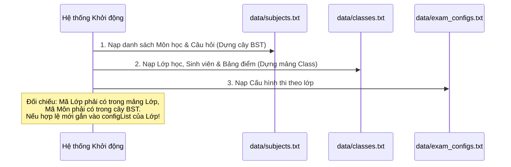

# 📋 BẢN THIẾT KẾ CHI TIẾT: HỆ THỐNG CẤU HÌNH THI TRẮC NGHIỆM THEO LỚP HỌC (PER-CLASS EXAM CONFIGURATION SYSTEM)

> **Tài liệu:** Bản thiết kế kiến trúc, mô hình dữ liệu, quy tắc nghiệp vụ và giao thức lưu trữ  
> **Áp dụng cho:** Hệ thống Quản lý và Thi Trắc Nghiệm C++ (Data Structures & Algorithms)  
> **Mục tiêu:** Cho phép mỗi lớp học có một cấu hình thi riêng biệt cho từng môn học, lưu trữ bền vững (persistence) và cung cấp giao diện quản lý/xem lại trực quan.

---

## MỤC LỤC
1. [Bối Cảnh & Mục Tiêu Thiết Kế](#1-bối-cảnh--mục-tiêu-thiết-kế)
2. [Mô Hình Hóa Dữ Liệu Tầng Core](#2-mô-hình-hóa-dữ-liệu-tầng-core)
3. [Ràng Buộc Nghiệp Vụ & Logic Xử Lý (Business Layer)](#3-ràng-buộc-nghiệp-vụ--logic-xử-lý-business-layer)
4. [Giao Thức Lưu Trữ File Bền Vững (Persistence Protocol)](#4-giao-thức-lưu-trữ-file-bền-vững-persistence-protocol)
5. [Thiết Kế Trải Nghiệm & Giao Diện Người Dùng (UI Flow)](#5-thiết-kế-trải-nghiệm--giao-diện-người-dùng-ui-flow)
6. [Kịch Bản Kiểm Thử Toàn Diện (Test Cases)](#6-kịch-bản-kiểm-thử-toàn-diện-test-cases)
7. [Lộ Trình Triển Khai Từng Bước (Implementation Roadmap)](#7-lộ-trình-triển-khai-từng-bước-implementation-roadmap)

---

## 1. Bối Cảnh & Mục Tiêu Thiết Kế

### 1.1. Hạn chế của thiết kế hiện tại
- **Mô hình cũ:** Hai thuộc tính cấu hình `examQuestionCount` (số câu) và `examMinutes` (thời gian thi) được gắn trực tiếp vào bên trong `struct Subject`.
- **Hệ quả:** Một môn học chỉ có **duy nhất 1 cấu hình chung cho toàn trường**. Nếu môn *Cấu trúc dữ liệu* cấu hình 40 câu / 50 phút thì tất cả sinh viên mọi khoa, mọi lớp khi thi môn này đều phải thi đúng 40 câu / 50 phút.

### 1.2. Nhu cầu thực tế cần giải quyết
1. **Phân hóa theo chương trình đào tạo:** 
   - Lớp Chuyên ngành Công nghệ Thông tin (`D23CQCN01`): Thi 40 câu trong 50 phút.
   - Lớp Đại cương / Viễn thông (`D23CQVT01`): Thi 25 câu trong 35 phút.
2. **Lưu trữ cấu hình bền vững:** Cấu hình bài thi sau khi Giảng viên tạo phải được ghi xuống file đĩa cứng (`.txt`), khi tắt máy mở lại hệ thống không bị mất.
3. **Xem lại và quản lý trạng thái:** Giảng viên có thể tra cứu danh sách các bài thi đã giao cho từng lớp, xem lớp nào đã thi, lớp nào chưa thi; cho phép chỉnh sửa hoặc thu hồi cấu hình nếu chưa có sinh viên nào làm bài.

---

## 2. Mô Hình Hóa Dữ Liệu Tầng Core

Bản chất quan hệ giữa **Lớp học** và **Môn học** trong bài toán này là quan hệ **Nhiều - Nhiều ($N - N$)**:
- Một Lớp có thể được giao thi nhiều Môn học khác nhau.
- Một Môn học có thể được tổ chức thi cho nhiều Lớp học khác nhau với thông số đề thi độc lập.

```
┌──────────────────────┐                     ┌──────────────────────┐
│       LỚP HỌC        │1                   *│    CẤU HÌNH BÀI THI   │
│     (ClassArray)     ├────────────────────►│    (ExamConfigList)  │
└──────────────────────┘                     └──────────┬───────────┘
                                                        │*
                                                        │Tham chiếu mã môn
                                                        ▼1
                                             ┌──────────────────────┐
                                             │       MÔN HỌC        │
                                             │     (SubjectBST)     │
                                             └──────────────────────┘
```

### 2.1. Lựa chọn cấu trúc dữ liệu theo chuẩn CTDL&GT
Có 2 phương án cài đặt cấu trúc dữ liệu phù hợp với đề bài:

| Tiêu chí | Phương án A (Khuyên dùng): Gắn vào từng `Class` | Phương án B: Danh sách liên kết đơn độc lập toàn cục |
|---|---|---|
| **Cài đặt** | Thêm con trỏ `ExamConfig* configList` vào trong `struct Class`. | Tạo một con trỏ danh sách liên kết đơn `ExamConfig* globalConfigHead` ở tầng quản lý ngoài. |
| **Bản chất dữ liệu** | Mỗi lớp sở hữu danh mục bài thi của riêng mình: `Class ➔ configList ➔ ExamConfig`. | Một danh sách phẳng lưu toàn bộ cấu hình thi của mọi lớp trong trường. |
| **Tốc độ tra cứu** | **Rất nhanh ($O(K)$)**: Khi sinh viên lớp $X$ đăng nhập, chỉ cần duyệt danh sách cấu hình của lớp $X$ ($K \le 20$ môn). | **Trung bình ($O(C \times K)$)**: Phải duyệt qua danh sách cấu hình của toàn bộ các lớp. |
| **Giải phóng bộ nhớ** | Tự động cascade theo lớp: khi xóa lớp thì xóa luôn danh sách cấu hình thi của lớp đó. | Phải có hàm dọn dẹp riêng khi xóa từng lớp hoặc khi tắt chương trình. |
| **Tính tương thích đề bài** | Rất tự nhiên, phù hợp với mô hình Master-Detail của lớp học. | Giữ nguyên 100% định nghĩa `struct Class` cũ nếu không muốn chạm vào struct ban đầu. |

> **Khuyến nghị lựa chọn:** **Phương án A** (Gắn vào `struct Class`) vì vừa tối ưu tốc độ tìm kiếm, vừa đảm bảo tính đóng gói (Encapsulation) tự nhiên theo mô hình nghiệp vụ.

### 2.2. Định nghĩa cấu trúc `struct ExamConfig`
```cpp
struct ExamConfig {
    char classId[20];        // Mã lớp được áp dụng (Foreign Key tham chiếu Class)
    char subjectId[16];      // Mã môn học được thi (Foreign Key tham chiếu Subject)
    int questionCount;       // Số lượng câu hỏi lấy ngẫu nhiên cho đề thi
    int minutes;             // Thời gian làm bài thi (phút)
    char createdAt[20];      // Ngày giờ thiết lập cấu hình (YYYY-MM-DD HH:MM)
    ExamConfig* next;        // Con trỏ tới cấu hình thi tiếp theo của lớp
};
```

### 2.3. Các thao tác Core cần thiết lập
1. `ExamConfig* createExamConfig(...)`: Cấp phát động một node cấu hình mới trên Heap.
2. `bool addExamConfig(ExamConfig*& head, ExamConfig* newConfig)`: Chèn vào đầu hoặc cuối danh sách; **tự động từ chối nếu môn học đó đã được cấu hình trong lớp rồi** (chống trùng lặp môn thi trong cùng 1 lớp).
3. `ExamConfig* findExamConfig(ExamConfig* head, const char subjectId[])`: Tìm kiếm cấu hình thi của một môn học cụ thể trong lớp với độ phức tạp $O(K)$.
4. `bool deleteExamConfig(ExamConfig*& head, const char subjectId[])`: Xóa một cấu hình thi ra khỏi danh sách của lớp.
5. `void deleteExamConfigList(ExamConfig*& head)`: Giải phóng toàn bộ bộ nhớ của danh sách cấu hình khi lớp bị xóa hoặc khi thoát chương trình.

---

## 3. Ràng Buộc Nghiệp Vụ & Logic Xử Lý (Business Layer)

Tầng Business chịu trách nhiệm thực thi các quy tắc đảm bảo tính toàn vẹn và công bằng trong thi cử:

### 3.1. Ràng buộc khi Giảng viên Thêm/Sửa Cấu hình
1. **Kiểm tra thực thể tồn tại:**
   - Mã lớp phải tồn tại trong mảng `classes`.
   - Mã môn phải tồn tại trên cây `SubjectBST`.
2. **Kiểm tra năng lực đề thi:**
   - Số câu hỏi cấu hình phải thỏa mãn: $1 \le \text{questionCount} \le \text{tổng số câu hỏi hiện có trong môn}$.
   - Không cho phép cấu hình số câu vượt quá ngân hàng câu hỏi hiện có.
3. **Kiểm tra thời gian thi:**
   - Thời gian thi hợp lệ: $1 \le \text{minutes} \le 180$.
4. **Quy tắc Bất biến về Tính Công bằng (Immutability / Freeze Rule):**
   - **Nguyên tắc:** Nếu trong lớp đó **đã có ít nhất một sinh viên đã dự thi môn này** (đã có điểm số trong `scoreList`):
     ➔ **HỆ THỐNG KHÓA TOÀN BỘ QUYỀN SỬA HOẶC XÓA CẤU HÌNH NÀY**.
   - **Mục đích:** Bảo đảm tính công bằng tuyệt đối. Không thể để sinh viên đầu tiên thi đề 40 câu trong 50 phút, sau đó giáo viên lại sửa cấu hình của lớp đó thành 20 câu trong 30 phút cho các sinh viên thi sau!
   - **Quyền sửa/xóa:** Chỉ được phép sửa hoặc xóa cấu hình thi khi **lớp đó chưa có bất kỳ sinh viên nào nộp bài thi**.

### 3.2. Thay đổi luồng Chuẩn bị thi của Sinh viên (`prepareExamWorkflow`)
Khi sinh viên đăng nhập và bấm vào một môn học để thi:
1. Lấy thông tin lớp của sinh viên: `classId = student->classId`.
2. Tìm kiếm lớp tương ứng trong mảng `classes`.
3. Tra cứu cấu hình thi của môn học trong lớp đó:
   ```cpp
   ExamConfig* config = findExamConfig(targetClass->configList, subjectId);
   ```
4. **Kiểm tra trạng thái:**
   - Nếu `config == nullptr`: Trả về mã lỗi `ERR_NOT_FOUND` kèm thông báo: *"Môn học này chưa được giảng viên mở thi cho lớp của bạn"*.
   - Nếu sinh viên đã có điểm môn này: Khóa nút thi và báo điểm cũ.
   - Nếu đủ điều kiện: Rút đúng `config->questionCount` câu hỏi và gán đồng hồ đếm ngược `config->minutes` phút.

---

## 4. Giao Thức Lưu Trữ File Bền Vững (Persistence Protocol)

Để bảo đảm tính ổn định và an toàn dữ liệu, giải pháp tối ưu nhất là **tách riêng một file dữ liệu độc lập**.

### 4.1. File `data/exam_configs.txt`
- **Lý do tách file riêng:**
  - Không làm thay đổi hay gây rủi ro phá vỡ định dạng của 2 file dữ liệu cốt lõi đang chạy ổn định là `data/subjects.txt` và `data/classes.txt`.
  - Dễ dàng kiểm tra, sao lưu hoặc reset cấu hình thi mà không ảnh hưởng danh sách sinh viên hay câu hỏi.
- **Cấu trúc từng dòng của file:**
  ```text
  MALOP|MAMH|SO_CAU_THI|SO_PHUT_THI|NGAY_TAO
  ```
- **Ví dụ thực tế:**
  ```text
  D23CQCN01|CTDL|40|50|2026-10-24 08:00
  D23CQCN01|CSDL|30|45|2026-10-24 09:30
  D23CQCN02|CTDL|30|40|2026-10-24 10:00
  D23CQVT01|CTDL|25|35|2026-10-24 14:00
  ```

### 4.2. Trình tự nạp dữ liệu khi khởi động ứng dụng (Initialization Order)
Trình tự nạp dữ liệu bắt buộc phải tuân theo thứ tự phụ thuộc khóa ngoại (Foreign Key Dependency):



---

## 5. Thiết Kế Trải Nghiệm & Giao Diện Người Dùng (UI Flow)

### 5.1. Phân hệ Giảng viên (Admin UI)

#### Màn hình 1: Thiết lập cấu hình bài thi (Thêm mới)
- **Luồng chọn phân cấp:**
  1. *Bước 1 (Chọn lớp):* Hộp chọn hoặc bảng danh sách lớp học ➔ Chọn lớp cần giao bài thi (ví dụ: `D23CQCN01`).
  2. *Bước 2 (Chọn môn):* Danh sách môn học hiển thị tổng số câu hỏi hiện có trong ngân hàng đề.
  3. *Bước 3 (Nhập thông số):* Ô nhập *Số câu hỏi* và *Số phút thi*. Có nhãn hiển thị gợi ý (ví dụ: *"Tối đa 50 câu"*).
  4. *Bước 4:* Bấm nút **[Lưu cấu hình bài thi]**. Hệ thống validate và lưu trực tiếp vào file.

#### Màn hình 2: Bảng Tra Cứu & Xem Lại Cấu Hình Bài Thi
Cung cấp 2 chế độ hiển thị linh hoạt:
- **Xem theo Lớp học (Khuyên dùng):**
  - Giảng viên chọn lớp ➔ Hiển thị bảng toàn bộ các môn lớp đó được thi:
  
  | Mã Môn | Tên Môn Học | Số Câu | Thời Gian | Tình Trạng Lớp Học | Thao Tác |
  |---|---|---|---|---|---|
  | `CTDL` | Cấu trúc dữ liệu | 40 câu | 50 phút | 🟢 Chưa có SV thi | `[Sửa]` `[Xóa]` |
  | `CSDL` | Cơ sở dữ liệu | 30 câu | 45 phút | 🔴 Đã có 12 SV thi | *(Đã khóa)* |

- **Cơ chế tương tác an toàn:**
  - Nếu trạng thái là `🟢 Chưa có SV thi`: Nút `[Sửa]` và `[Xóa]` hoạt động bình thường, cho phép cập nhật lại số câu/phút hoặc hủy môn thi của lớp đó.
  - Nếu trạng thái là `🔴 Đã có SV thi`: Nút `[Sửa]` và `[Xóa]` bị mờ (Disabled) kèm tooltip giải thích: *"Không thể sửa/xóa vì đã có sinh viên dự thi"*.

### 5.2. Phân hệ Sinh viên (Student UI)
- Khi sinh viên đăng nhập:
  - Hệ thống tự động lấy mã lớp của sinh viên.
  - Màn hình chọn môn thi **chỉ liệt kê các môn học đã được cấu hình cho chính lớp của sinh viên đó** (không hiện các môn chưa được cấu hình).
  - Thẻ thông tin bài thi hiển thị rõ ràng:
    - *Môn thi:* Cấu trúc dữ liệu và Giải thuật
    - *Lớp:* D23CQCN01
    - *Quy định:* **40 câu hỏi** trong vòng **50 phút**
    - *Trạng thái:* Chưa thi / Đã thi (Điểm: 8.5)

---

## 6. Kịch Bản Kiểm Thử Toàn Diện (Test Cases)

Khi triển khai xong, cần thực hiện 5 ca kiểm thử sau để nghiệm thu toàn bộ tính năng:

1. **Test Case 1 (Phân hóa cấu hình giữa các lớp):**
   - Cấu hình môn `CTDL` cho lớp `CNTT1`: 40 câu, 50 phút.
   - Cấu hình môn `CTDL` cho lớp `CNTT2`: 20 câu, 30 phút.
   - Đăng nhập bằng sinh viên lớp 1 ➔ Kiểm tra đề thi có đúng 40 câu và đồng hồ đếm từ 50 phút.
   - Đăng nhập bằng sinh viên lớp 2 ➔ Kiểm tra đề thi có đúng 20 câu và đồng hồ đếm từ 30 phút.

2. **Test Case 2 (Chặn cấu hình vượt quá số câu hỏi):**
   - Môn `DSTT` chỉ có 15 câu trong ngân hàng đề.
   - Giảng viên cấu hình thi 20 câu ➔ Hệ thống phải từ chối và báo lỗi: *"Số câu hỏi thi không được vượt quá số câu hiện có (15 câu)"*.

3. **Test Case 3 (Khóa sửa/xóa khi có sinh viên làm bài):**
   - Lớp `CNTT1` cấu hình môn `CTDL`.
   - Sinh viên `SV001` thuộc lớp `CNTT1` vào làm bài và nộp bài.
   - Giảng viên quay lại bảng cấu hình thử bấm Sửa hoặc Xóa môn `CTDL` của lớp `CNTT1` ➔ Hệ thống phải chặn và báo lỗi vi phạm ràng buộc dữ liệu.

4. **Test Case 4 (Kiểm tra lưu trữ bền vững - Persistence):**
   - Thêm 3 cấu hình mới cho các lớp khác nhau.
   - Tắt ứng dụng hoàn toàn (`make clean` hoặc đóng terminal).
   - Khởi động lại ứng dụng ➔ Vào bảng xem lại cấu hình, kiểm tra cả 3 cấu hình vẫn hiển thị đầy đủ và chính xác.

5. **Test Case 5 (Cascade delete khi xóa lớp):**
   - Lớp `D23CQCN01` có 2 cấu hình thi.
   - Giảng viên thực hiện xóa lớp `D23CQCN01` ➔ Danh sách cấu hình thi của lớp này trong bộ nhớ và trong file `exam_configs.txt` phải được dọn dẹp sạch sẽ, không để lại dữ liệu rác mồ côi.

---

## 7. Lộ Trình Triển Khai Từng Bước (Implementation Roadmap)

Để thực hiện công việc mạch lạc và không làm ảnh hưởng đến mã nguồn đang chạy tốt, bạn nên thực hiện tuần tự theo 5 bước:

```
[Bước 1: Core Data]     ──► Định nghĩa struct ExamConfig & các hàm CRUD trên DSLK đơn.
         │
[Bước 2: File Storage]  ──► Viết hàm load/save cho file data/exam_configs.txt.
         │
[Bước 3: Business Logic]──► Viết ExamConfigService (validate, kiểm tra đã thi chưa, prepareExam).
         │
[Bước 4: Console UI]    ──► Bổ sung menu Quản lý cấu hình trên giao diện dòng lệnh để test logic.
         │
[Bước 5: Raylib GUI]    ──► Vẽ bảng cấu hình Admin (GuiAdminExamConfigs) & cập nhật màn hình SV.
```

Tài liệu này cung cấp toàn bộ cơ sở lý thuyết và kiến trúc phần mềm chuẩn mực để bạn có thể tự tin trả lời vấn đáp hoặc bắt tay vào triển khai tính năng bất cứ lúc nào!
