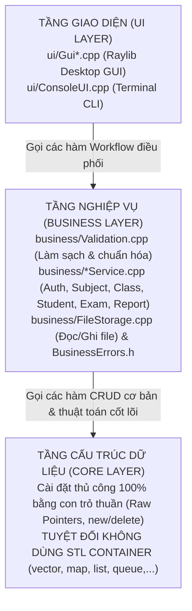

# 🎓 TÀI LIỆU TOÀN DIỆN & CẨM NANG VẤN ĐÁP BẢO VỆ ĐỒ ÁN (PROJECT SPECIFICATION & DEFENSE MASTER GUIDE)

> **Dự án:** Hệ thống Quản lý và Thi Trắc Nghiệm C++ (Cấu trúc Dữ liệu & Giải thuật)  
> **Kiến trúc:** 3 Tầng phân lập (`Core` ➔ `Business` ➔ `UI`)  
> **Giao diện:** Desktop GUI (Raylib 6.2) & Console Terminal CLI (`--console`)  
> **Tác giả:** Đồ án môn học Cấu trúc Dữ liệu và Giải thuật

---

## 📑 MỤC LỤC CHI TIẾT

1. [Tổng Quan Kiến Trúc 3 Tầng & Nguyên Tắc Thiết Kế](#1-tổng-quan-kiến-trúc-3-tầng--nguyên-tắc-thiết-kế)
2. [Phân Tích 5 Cấu Trúc Dữ Liệu Bắt Buộc & Độ Phức Tạp (Big-O)](#2-phân-tích-5-cấu-trúc-dữ-liệu-bắt-buộc--độ-phức-tạp-big-o)
3. [Chi Tiết Các Thuật Toán Cốt Lõi (Core Algorithms)](#3-chi-tiết-các-thuật-toán-cốt-lõi-core-algorithms)
4. [Quản Lý Bộ Nhớ, Vùng Nhớ Heap & Cơ Chế Cascade Delete](#4-quản-lý-bộ-nhớ-vùng-nhớ-heap--cơ-chế-cascade-delete)
5. [Quy Trình Nghiệp Vụ, Khóa Thi Lại & Cơ Chế Khôi Phục Phiên Thi (Session Persistence)](#5-quy-trình-nghiệp-vụ-khóa-thi-lại--cơ-chế-khôi-phục-phiên-thi-session-persistence)
6. [Giao Thức Lưu Trữ File (Serialization & Pre-order Tree Rebuild)](#6-giao-thức-lưu-trữ-file-serialization--pre-order-tree-rebuild)
7. [Hệ Thống Kiểm Thử Hồi Quy Tự Động (Regression Testing Suite)](#7-hệ-thống-kiểm-thử-hồi-quy-tự-động-regression-testing-suite)
8. [🎯 BỘ CÂU HỎI VẤN ĐÁP & KỊCH BẢN TRẢ LỜI LÀM KHÓ CỦA GIẢNG VIÊN (DEFENSE Q&A)](#8--bộ-câu-hỏi-vấn-đáp--kịch-bản-trả-lời-làm-khó-của-giảng-viên-defense-qa)

---

## 1. Tổng Quan Kiến Trúc 3 Tầng & Nguyên Tắc Thiết Kế

Dự án tuân thủ nghiêm ngặt mô hình kiến trúc phân tầng 3 lớp (3-Tier Layered Architecture):



### Nguyên tắc phân tách trách nhiệm:
1. **Tầng Core (`core/`):**
   - Chỉ chịu trách nhiệm quản lý cấu trúc dữ liệu trên bộ nhớ RAM: cấp phát, tìm kiếm, thêm, sửa, xóa, và thu hồi bộ nhớ.
   - Không chứa bất kỳ câu lệnh nhập xuất nào (`cin`, `cout`, `printf`).
   - Không chứa logic giao diện, không chứa kiến thức về file text trên đĩa cứng.
2. **Tầng Business (`business/`):**
   - Đóng vai trò lớp bảo vệ (Guard Layer) giữa UI và Core.
   - Mọi dữ liệu đầu vào đều được **làm sạch (trim khoảng trắng)** và **chuẩn hóa (viết hoa mã định danh)**.
   - Kiểm tra mọi ràng buộc toàn vẹn dữ liệu (không xóa môn đã có điểm, không trùng mã lớp/mã SV toàn trường).
   - Trả về mã lỗi chuẩn `BusinessResult` (`ErrorCode`: `SUCCESS`, `ERR_NOT_FOUND`, `ERR_DUPLICATE`, `ERR_CONSTRAINT_VIOLATION`,...).
3. **Tầng UI (`ui/`):**
   - Chỉ tiếp nhận input từ người dùng, gọi các workflow của tầng Business và hiển thị kết quả hoặc thông báo lỗi trực quan.
   - Có 2 giao diện song song độc lập hoàn toàn dùng chung 100% tầng Business: **Desktop GUI (Raylib 6.2)** và **Console CLI**.

---

## 2. Phân Tích 5 Cấu Trúc Dữ Liệu Bắt Buộc & Độ Phức Tạp (Big-O)

```
                            MẢNG CON TRỎ LỚP HỌC (Class* classes[10000])
                            ├── [0] Class* ──► StudentList (DSLK đơn Sinh viên)
                            │                   └── Student ──► ScoreList (DSLK đơn Điểm thi)
                            │                                    └── Score ──► ExamDetail (Snapshot bài thi)
                            ├── [1] Class* ...
                            └── [classCount - 1] ...

                            CÂY NHỊ PHÂN TÌM KIẾM MÔN HỌC (SubjectBST)
                                         [Subject: CTDL]
                                         /              \
                               [Subject: CSDL]      [Subject: OOP]
                               /                     /           \
                             ...                   ...      Danh sách câu hỏi (DSLK đơn)
                                                            └── Question -> Question -> ...
```

### Bảng phân tích chi tiết:

| Cấu trúc dữ liệu | Mục đích trong đề bài | Kiểu cài đặt | Giới hạn bộ đệm | Độ phức tạp thời gian (Time Complexity) | Độ phức tạp không gian (Space Complexity) |
|---|---|---|---|---|---|
| **1. Cây nhị phân tìm kiếm (BST)** | Quản lý danh mục Môn học theo Mã môn | `struct Subject*` với con trỏ `left`, `right`, `questionList` | `SUBJECT_ID_LEN = 16`<br/>`SUBJECT_NAME_LEN = 51` | • Tìm kiếm/Thêm: $O(h)$ ($O(\log N)$ trung bình, $O(N)$ xấu nhất)<br/>• Duyệt tăng dần In-order (LNR): $O(N)$ | $O(N)$ trên RAM |
| **2. Danh sách liên kết đơn** | Ngân hàng câu hỏi trắc nghiệm của từng môn | `struct Question*` với con trỏ `next` | `QUESTION_CONTENT_LEN = 512`<br/>`ANSWER_CONTENT_LEN = 256` | • Thêm đầu: $O(1)$<br/>• Thêm cuối: $O(M)$ ($M$ là số câu hỏi của môn)<br/>• Tìm kiếm theo ID: $O(M)$ | $O(M)$ cho mỗi môn |
| **3. Mảng con trỏ tuyến tính** | Quản lý danh sách Lớp học toàn trường | `Class* classes[MAX_CLASS]` | `MAX_CLASS = 10000`<br/>`CLASS_ID_LEN = 20`<br/>`CLASS_NAME_LEN = 51` | • Truy xuất ngẫu nhiên qua chỉ số `i`: $O(1)$<br/>• Thêm lớp cuối mảng: $O(1)$<br/>• Tìm lớp tuần tự theo mã: $O(C)$ ($C$ là số lớp)<br/>• Xóa lớp (kèm dồn mảng): $O(C)$ | $O(\text{MAX\_CLASS} \times 8\text{B}) \approx 80\text{KB}$ cố định |
| **4. Danh sách liên kết đơn** | Quản lý Sinh viên trong từng lớp | `struct Student*` với con trỏ `next`, `scoreList` | `STUDENT_ID_LEN = 20`<br/>`STUDENT_NAME_LEN = 51`<br/>`PASSWORD_LEN = 31` | • Thêm đầu: $O(1)$<br/>• Thêm cuối: $O(S)$ ($S$ là số SV trong lớp)<br/>• Tìm SV trong lớp theo MASV: $O(S)$<br/>• Tìm SV toàn trường: $O(C \times S)$ | $O(S)$ cho mỗi lớp |
| **5. Danh sách liên kết đơn** | Quản lý Điểm thi của từng sinh viên | `struct Score*` với con trỏ `next`, `detailList` | Mỗi SV có tối đa 1 điểm cho mỗi môn thi | • Thêm điểm: $O(K)$ ($K$ là số môn SV đã thi)<br/>• Tìm điểm theo mã môn: $O(K)$ | $O(K)$ cho mỗi sinh viên |
| *(Mở rộng)* **DSLK Đơn Snapshot** | Bản chụp câu hỏi và bài làm thực tế | `struct ExamDetail*` gắn liền trong từng `Score` | Sao chép câu hỏi, xáo trộn thứ tự A-D | • Đọc bài thi: $O(N)$ ($N$ câu hỏi)<br/>• Chấm điểm: $O(N)$ | $O(N)$ cho mỗi lần thi |

---

## 3. Chi Tiết Các Thuật Toán Cốt Lõi (Core Algorithms)

### 3.1. Thuật toán Xóa Node trên Cây nhị phân tìm kiếm (`deleteSubject`)
Xóa một node trên BST phải xử lý 3 trường hợp kinh điển:
1. **Trường hợp 1 (Nút không có con trái):** Cho con trỏ cha trỏ trực tiếp vào con phải `root->right`, giải phóng danh sách câu hỏi của node đó (`deleteQuestionList(root->questionList)`), giải phóng node và trả về con phải.
2. **Trường hợp 2 (Nút không có con phải):** Cho con trỏ cha trỏ trực tiếp vào con trái `root->left`, giải phóng câu hỏi, giải phóng node và trả về con trái.
3. **Trường hợp 3 (Nút có đủ 2 con):**
   - Tìm **Inorder Successor** (phần tử nhỏ nhất của cây con bên phải) bằng cách đi sang nhánh phải rồi rẽ trái hết cỡ:
     ```cpp
     Subject* successor = findMinSubject(root->right);
     ```
   - Giải phóng danh sách câu hỏi cũ của `root`.
   - Sao chép toàn bộ dữ liệu của `successor` vào `root` (bao gồm `id`, `name`, `questionList`, `examQuestionCount`, `examMinutes`). Lưu ý: gán `successor->questionList = nullptr` trước khi xóa để không bị giải phóng nhầm danh sách vừa chuyển nhượng!
   - Đệ quy xóa node successor tại cây con phải:
     ```cpp
     root->right = deleteSubject(root->right, successor->id);
     ```

### 3.2. Thuật toán Đổi Mã Môn Học (`editSubject`)
- **Tại sao không được phép dùng `strcpy(subject->id, newId)`?**
  Trong cây BST, các node được tổ chức theo quy luật: mọi node bên trái có mã nhỏ hơn gốc, mọi node bên phải có mã lớn hơn gốc ($Left < Root < Right$). Nếu thay đổi giá trị khóa `id` trực tiếp tại chỗ, cấu trúc cây sẽ bị **phá vỡ tính chất BST** ngay lập tức, các lệnh tìm kiếm `findSubject` sau đó sẽ đi sai hướng và không tìm thấy môn học!
- **Cách cài đặt đúng chuẩn:**
  1. Nếu `oldId == newId`: chỉ đổi tên `subject->name`.
  2. Nếu `oldId != newId`:
     - Kiểm tra `findSubject(root, newId)` để đảm bảo mã mới chưa tồn tại.
     - Tạo một `Subject* newSubject` mới với `newId` và `newName`.
     - Chuyển quyền sở hữu danh sách câu hỏi từ môn cũ sang môn mới: `newSubject->questionList = subject->questionList; subject->questionList = nullptr;`.
     - Xóa node cũ khỏi cây: `root = deleteSubject(root, oldId);`.
     - Chèn node mới vào cây: `root = insertSubject(root, newSubject);`.

### 3.3. Thuật toán Rút Ngẫu Nhiên $N$ Câu Hỏi Thi (Fisher-Yates Sampling)
Rút $N$ câu hỏi ngẫu nhiên trong ngân hàng gồm $M$ câu hỏi ($N \le M$):
1. **Bước 1:** Cấp phát một mảng con trỏ tạm kích thước $M$:
   ```cpp
   const Question** questionPool = new const Question*[totalAvailable];
   ```
2. **Bước 2:** Duyệt danh sách liên kết câu hỏi của môn, gán địa chỉ từng node vào `questionPool[i]` ($O(M)$).
3. **Bước 3:** Áp dụng **Thuật toán xáo trộn Fisher-Yates (Knuth Shuffle)** chạy từ cuối mảng về đầu:
   ```cpp
   for (int i = totalAvailable - 1; i > 0; --i) {
       int j = rand() % (i + 1);
       std::swap(questionPool[i], questionPool[j]);
   }
   ```
   *Độ phức tạp:* Đúng $O(M)$ phép hoán vị, chứng minh toán học đảm bảo xác suất xuất hiện của mọi hoán vị là đồng đều $\frac{1}{M!}$.
4. **Bước 4:** Lấy $N$ phần tử đầu tiên của mảng `questionPool[0 .. N-1]`, gọi `createExamDetail` để sao chép nội dung và tạo snapshot bài thi.
5. **Bước 5:** Giải phóng mảng con trỏ tạm: `delete[] questionPool;` (chỉ xóa mảng con trỏ, không xóa các node câu hỏi gốc!).

### 3.4. Thuật toán Xáo Trộn Đáp Án Câu Hỏi & Bảo Toàn Đáp Án Đúng (`shuffleExamDetailAnswers`)
- Mỗi câu hỏi thi có 4 đáp án A, B, C, D và 1 đáp án đúng ban đầu `correctAnswer` $\in \{'A', 'B', 'C', 'D'\}$.
- Đưa 4 con trỏ chuỗi đáp án vào mảng `char* answers[4] = {answerA, answerB, answerC, answerD}`.
- Lưu lại chỉ số đáp án đúng ban đầu: `correctIndex = detail->correctAnswer - 'A'` (0, 1, 2, 3).
- Thực hiện Fisher-Yates shuffle trên 4 phần tử:
  - Khi hoán đổi nội dung 2 đáp án tại vị trí `i` và `j`:
    - Nếu `correctIndex == i` thì cập nhật `correctIndex = j`.
    - Ngược lại nếu `correctIndex == j` thì cập nhật `correctIndex = i`.
- Cuối cùng, cập nhật lại ký tự đáp án đúng mới: `detail->correctAnswer = 'A' + correctIndex`.
- Thuật toán đảm bảo đáp án nội dung câu hỏi bị xáo trộn vị trí nhưng hệ thống luôn biết chính xác vị trí mới của đáp án đúng là ký tự nào.

---

## 4. Quản Lý Bộ Nhớ, Vùng Nhớ Heap & Cơ Chế Cascade Delete

Mọi đối tượng động trong tầng Core được cấp phát trên Heap qua toán tử `new` và giải phóng qua `delete`.

```mermaid
graph TD
    subgraph Thu Hồi Bộ Nhớ Thác Nước (Cascade Deallocation)
        C[deleteClass] --> S[deleteStudentListOfClass]
        S --> SC[deleteScoreListOfStudent]
        SC --> ED[deleteExamDetailList]
        ED --> D_ED[delete ExamDetail node]
        SC --> D_SC[delete Score node]
        S --> D_S[delete Student node]
        C --> D_C[delete Class node & Dồn mảng classes]
    end
```

### Cơ chế dọn dẹp bộ nhớ an toàn (Zero Memory Leak):
1. **Xóa một lớp học (`deleteClass`):**
   - Duyệt qua từng sinh viên trong lớp ➔ Giải phóng danh sách điểm của sinh viên đó.
   - Trong mỗi điểm ➔ Giải phóng toàn bộ danh sách `ExamDetail` bài thi đã làm.
   - Giải phóng node `Student` ➔ Giải phóng đối tượng `Class`.
   - Dồn các phần tử mảng con trỏ sang trái: `classes[i] = classes[i + 1]` và gán `classes[classCount - 1] = nullptr`.
2. **Xóa toàn bộ hệ thống khi thoát ứng dụng:**
   ```cpp
   while (classCount > 0) {
       deleteClass(classes, classCount, classes[0]->id);
   }
   while (root != nullptr) {
       root = deleteSubject(root, root->id);
   }
   ```
   Cơ chế vòng lặp này đảm bảo 100% các node trên cây BST môn học, ngân hàng câu hỏi, các lớp, sinh viên và bài thi đều được thu hồi hoàn toàn khỏi bộ nhớ RAM trước khi chương trình kết thúc.

---

## 5. Quy Trình Nghiệp Vụ, Khóa Thi Lại & Cơ Chế Khôi Phục Phiên Thi (Session Persistence)

### 5.1. Quy chế thi trắc nghiệm (Business Rules)
- **Cấu hình thi theo môn học:** Mỗi môn học có `examQuestionCount` (số câu thi) và `examMinutes` (thời gian làm bài tính theo phút).
  - Giá trị mặc định là `0` (nghĩa là môn chưa được cấu hình, sinh viên không thể thi).
  - Khi cấu hình: $1 \le \text{examQuestionCount} \le \text{tổng số câu hỏi hiện có của môn}$ và $1 \le \text{examMinutes} \le 180$.
- **Khóa thi lại (Retake Guard):** Mỗi sinh viên chỉ được phép thi **duy nhất 1 lần cho mỗi môn học**. Khi đăng nhập, nút bắt đầu thi của môn đã thi sẽ bị khóa và hiển thị điểm đã đạt.
- **Quy tắc tính điểm:**
  $$\text{Điểm} = \text{round}\left(\frac{\text{Số câu đúng}}{\text{Tổng số câu thi}} \times 10\right)$$
  Thang điểm 10, hiển thị số thực với độ chính xác tối đa 2 chữ số thập phân.

### 5.2. Chống gian lận & Khôi phục khi mất điện/tắt máy (Crash Resilience)
- **Vấn đề thực tế:** Sinh viên đang làm bài thi mà bị mất điện, tắt máy tính hoặc cố tình tắt ứng dụng để thi lại.
- **Giải pháp cài đặt (`ExamService.cpp`):**
  - Khi bắt đầu làm bài, hệ thống tạo một file nhị phân/text tạm: `temp_<MASV>.dat`.
  - File này lưu: Mã môn thi, mốc thời gian bắt đầu (`startTime`), tổng số phút thi, danh sách ID câu hỏi trong đề và đáp án sinh viên đã chọn.
  - Khi sinh viên mở lại ứng dụng và đăng nhập:
    - Hệ thống gọi `checkExamSession()`.
    - Nếu phát hiện file phiên thi tạm:
      - **Trường hợp A (Còn thời gian thi):** Tính số giây còn lại:
        $$\text{remainingSeconds} = \text{totalDuration} - (\text{currentTime} - \text{startTime})$$
        Nếu $\text{remainingSeconds} > 0$, hệ thống khôi phục lại đúng đề thi, các câu đã chọn và tiếp tục đếm ngược đồng hồ.
      - **Trường hợp B (Đã hết giờ thi trong thời gian ngắt kết nối):** Hệ thống tự động thu bài, chấm điểm dựa trên những câu đã lưu vào file tạm, xóa file tạm và ghi điểm vào bảng điểm chính thức. Sinh viên không thể làm lại.
  - **Bấm "Hủy phiên thi dở dang":** Hệ thống hiển thị cảnh báo: Nếu xác nhận hủy, toàn bộ các câu chưa làm sẽ bị tính là SAI, hệ thống nộp bài ngay lập tức và tính điểm, khóa quyền thi lại.

---

## 6. Giao Thức Lưu Trữ File (Serialization & Pre-order Tree Rebuild)

Dữ liệu được lưu trữ dạng văn bản có cấu trúc phân cách bằng ký tự `|` trong thư mục `data/`:

### 6.1. Tại sao lưu cây BST môn học bằng duyệt Tiền tố (Pre-order - NLR)?
- Nếu lưu theo duyệt Giữa (In-order - LNR), dữ liệu ghi ra file sẽ có thứ tự tăng dần theo mã môn (ví dụ: `CSDL`, `CTDL`, `DSTT`, `OOP`). Khi đọc file để chèn lại vào cây, mỗi node mới luôn lớn hơn node trước nên luôn bị rẽ sang nhánh phải `right`. Cây BST sẽ bị **suy biến hoàn toàn thành một đường thẳng (danh sách liên kết đơn)**, làm mất sạch ưu thế tìm kiếm $O(\log N)$!
- Lưu theo **Pre-order (NLR - Gốc trước, Trái, Phải)**: Node gốc được ghi đầu tiên, sau đó đến nhánh con trái rồi nhánh con phải. Khi đọc lại file và chèn tuần tự vào cây rỗng, cây BST sẽ được **tái lập chính xác 100% hình dạng cây ban đầu** mà không cần phải tốn thêm trường dữ liệu để lưu chỉ số cha/con.

### 6.2. Cấu trúc file dữ liệu:
- **`data/subjects.txt`**:
  ```text
  MAMH|TENMH|SO_CAU_HOI|examQuestionCount|examMinutes
  ID_CH|Noi dung cau hoi|Dap an A|Dap an B|Dap an C|Dap an D|Dap an dung
  ```
  *(Hỗ trợ tương thích ngược: file 3 cột cũ vẫn đọc được, tự gán cấu hình thi = 0).*
- **`data/classes.txt`**:
  ```text
  TONG_SO_LOP
  MALOP
  TENLOP
  TONG_SO_SINH_VIEN
  MASV|HO|TEN|PHAI|PASSWORD|SO_MON_DA_THI
  MAMH
  DIEM_SO
  SO_CAU_CHI_TIET
  ID_CH|Noi dung|A|B|C|D|DapAnDung|DapAnDaChon
  ```

---

## 7. Hệ Thống Kiểm Thử Hồi Quy Tự Động (Regression Testing Suite)

Mỗi file trong `tests/` là một executable độc lập kiểm tra một khía cạnh nghiêm ngặt:

1. **`test_class_delete_with_students.cpp`:** Kiểm tra tính năng xóa lớp kèm sinh viên (Cascade delete), đảm bảo giải phóng toàn bộ sinh viên, điểm, bài thi mà không gây leak bộ nhớ.
2. **`test_core_contracts.cpp`:** Kiểm tra các hợp đồng API Core: từ chối chuỗi ID quá dài/rỗng/null, kiểm tra thuật toán xáo trộn 1.000 lần đảm bảo đáp án đúng luôn được ánh xạ chính xác.
3. **`test_core_integration.cpp`:** Kiểm tra tích hợp liên cấu trúc giữa cả 5 cấu trúc dữ liệu.
4. **`test_duplicate_subject.cpp`:** Kiểm tra cấu trúc BST từ chối chèn môn trùng mã và tự giải phóng bộ nhớ node bị từ chối.
5. **`test_global_student_id.cpp`:** Kiểm tra thuật toán duyệt toàn trường chặn trùng mã sinh viên giữa các lớp khác nhau.
6. **`test_score_id_length.cpp` & `test_student_id_length.cpp`:** Kiểm tra tính toàn vẹn của buffer chuỗi.
7. **`test_subject_edit.cpp`:** Kiểm tra đổi mã/tên môn bảo toàn danh sách câu hỏi con.
8. **`test_subject_exam_config.cpp`:** Kiểm tra lưu/đọc cấu hình số câu và số phút thi trên node `Subject`.

> Chạy toàn bộ test suite bằng lệnh: **`make test`**

---

## 8. 🎯 BỘ CÂU HỎI VẤN ĐÁP & KỊCH BẢN TRẢ LỜI LÀM KHÓ CỦA GIẢNG VIÊN (DEFENSE Q&A)

Dưới đây là tập hợp các câu hỏi hóc búa nhất mà các thầy cô hội đồng thường dùng để kiểm tra xem sinh viên có thực sự tự làm và hiểu sâu mã nguồn hay không:

---

### ❓ Câu 1: Tại sao trong danh sách Lớp học lại dùng Mảng con trỏ (`Class* classes[10000]`) thay vì dùng Mảng tĩnh thông thường (`Class classes[10000]`) hay Danh sách liên kết?
- **Trả lời chuẩn:**
  1. **Tối ưu RAM:** Nếu dùng mảng đối tượng tĩnh `Class classes[10000]`, chương trình sẽ cấp phát cố định $10000 \times \text{sizeof(Class)}$ ngay khi khởi động dù chưa có lớp nào. Với mảng con trỏ, ban đầu ta chỉ tốn $10000 \times 8\text{ bytes} \approx 80\text{KB}$ trên RAM 64-bit; lớp nào được tạo thì mới gọi `new Class` cho lớp đó.
  2. **Tốc độ dồn mảng khi Xóa/Sắp xếp:** Khi xóa một lớp ở giữa mảng, thao tác dồn mảng chỉ cần sao chép các con trỏ 8-byte (`classes[i] = classes[i + 1]`) với chi phí $O(1)$ cho mỗi bước hoán vị, thay vì phải sao chép toàn bộ khối dữ liệu của cả một đối tượng `Class` kèm con trỏ sinh viên của nó.
  3. **Truy xuất ngẫu nhiên:** So với Danh sách liên kết, mảng con trỏ cho phép truy xuất phần tử theo chỉ số `classes[i]` với độ phức tạp $O(1)$, cực kỳ thuận lợi cho việc phân trang và hiển thị danh sách trên giao diện đồ họa.

---

### ❓ Câu 2: Khi sửa mã môn học, tại sao không dùng `strcpy(node->id, newId)` cho nhanh mà phải xóa node cũ rồi tạo node mới chèn lại vào cây?
- **Trả lời chuẩn:**
  - Vì Cây nhị phân tìm kiếm (BST) duy trì trật tự khóa nghiêm ngặt: Mọi node thuộc cây con trái phải có khóa nhỏ hơn node hiện tại, và mọi node thuộc cây con phải phải có khóa lớn hơn node hiện tại.
  - Nếu sửa trực tiếp `node->id` bằng `strcpy`, vị trí của node đó trong cây sẽ bị sai lệch so với giá trị khóa mới. Cấu trúc BST bị phá vỡ, dẫn tới việc hàm `findSubject` sẽ so sánh sai hướng và không bao giờ tìm thấy môn học đó nữa.
  - Do đó, bắt buộc phải ngắt node cũ ra khỏi cây bằng `deleteSubject(root, oldId)`, chuyển danh sách câu hỏi con sang node mới mang `newId`, rồi dùng `insertSubject` để chèn lại node mới vào đúng vị trí hợp lệ trên cây BST.

---

### ❓ Câu 3: Khi xóa một node có 2 con trong cây BST, bạn chọn node thay thế (Inorder Successor) là node nào? Thuật toán cụ thể ra sao?
- **Trả lời chuẩn:**
  - Em chọn **Inorder Successor** (phần tử kế tiếp theo thứ tự duyệt giữa), tức là **phần tử nhỏ nhất của cây con bên phải**.
  - **Cách tìm:** Từ node cần xóa, đi sang con bên phải một bước (`root->right`), sau đó liên tục rẽ sang con bên trái cho đến khi gặp node không còn con trái (`while (cur->left != nullptr) cur = cur->left;`).
  - **Thực hiện:**
    1. Sao chép dữ liệu của node nhỏ nhất đó vào node cần xóa.
    2. Chuyển quyền sở hữu con trỏ danh sách câu hỏi.
    3. Đệ quy gọi `deleteSubject(root->right, successor->id)` để xóa node successor ban đầu ở cây con phải (node này chỉ có tối đa 1 con phải nên việc xóa nó rơi vào trường hợp cơ bản, rất đơn giản).

---

### ❓ Câu 4: Khi rút ngẫu nhiên $N$ câu hỏi làm đề thi, tại sao phải dùng mảng con trỏ tạm và giải phóng bằng `delete[] pool`? Nếu em viết `delete pool[i]` thì điều gì sẽ xảy ra?
- **Trả lời chuẩn:**
  - Danh sách câu hỏi của môn là một Danh sách liên kết đơn, không hỗ trợ truy xuất ngẫu nhiên $O(1)$ theo chỉ số để chọn câu ngẫu nhiên.
  - Vì vậy, em cấp phát một mảng con trỏ tạm `const Question** pool = new const Question*[total]` để lưu địa chỉ của các câu hỏi, sau đó áp dụng thuật toán Fisher-Yates để xáo trộn các con trỏ trong mảng này với độ phức tạp $O(N)$.
  - **Nếu viết `delete pool[i]`:** Chương trình sẽ xóa mất câu hỏi thật trong ngân hàng câu hỏi gốc của môn học! Khi sinh viên khác vào thi hoặc giáo viên vào xem câu hỏi sẽ bị lỗi vùng nhớ rác (dangling pointer) hoặc crash.
  - Do đó, chỉ được dùng `delete[] pool` để giải phóng bản thân mảng con trỏ tạm, giữ nguyên vẹn các node `Question` gốc trên cây BST.

---

### ❓ Câu 5: Tại sao khi lưu kết quả bài thi lại phải sao chép toàn bộ câu hỏi sang `ExamDetail` mà không chỉ lưu danh sách các con trỏ trỏ đến `Question` gốc?
- **Trả lời chuẩn:**
  Có 2 lý do sống còn:
  1. **Tính độc lập của việc xáo trộn đáp án:** Mỗi sinh viên khi thi sẽ có thứ tự 4 đáp án A, B, C, D được xáo trộn ngẫu nhiên khác nhau. Nếu dùng con trỏ trỏ đến câu hỏi gốc, việc xáo trộn đáp án của sinh viên này sẽ làm thay đổi luôn thứ tự đáp án của câu hỏi trong ngân hàng chung của toàn trường.
  2. **Tính bất biến của lịch sử thi (Audit Trail):** Nếu sau này giáo viên chỉnh sửa nội dung câu hỏi hoặc xóa câu hỏi đó khỏi môn học, bài thi trong quá khứ của sinh viên vẫn phải được giữ nguyên vẹn nội dung câu hỏi và đáp án lúc sinh viên làm bài. Việc sao chép snapshot thành `ExamDetail` đảm bảo bài thi đã nộp không bao giờ bị thay đổi bởi các thao tác sửa đổi sau đó.

---

### ❓ Câu 6: Làm thế nào bạn đảm bảo ID câu hỏi là duy nhất trên TOÀN BỘ hệ thống (giữa tất cả các môn học) mà không dùng mảng đánh dấu hay biến toàn cục bừa bãi?
- **Trả lời chuẩn:**
  - Hệ thống sử dụng một biến bộ đếm tự tăng nội bộ `static int questionIdCounter = 0` được bao đóng trong hàm `generateQuestionId()`. Mỗi khi tạo câu hỏi mới, hàm này tự động tăng giá trị và trả về ID duy nhất.
  - Khi nạp dữ liệu từ file `subjects.txt`, tầng nạp file gọi hàm `updateQuestionIdCounter(id)` sau mỗi câu hỏi đọc được. Hàm này cập nhật: `if (id > questionIdCounter) questionIdCounter = id;`. Nhờ đó, sau khi nạp xong toàn bộ file, bộ đếm luôn ở giá trị lớn nhất đã có, đảm bảo mọi câu hỏi tạo mới trong phiên làm việc tiếp theo luôn có ID lớn hơn và không bao giờ bị trùng lặp.

---

### ❓ Câu 7: Nếu người dùng cố tình nhập chuỗi vượt quá kích thước buffer (ví dụ Mã SV dài 100 ký tự) thì chương trình của bạn xử lý ra sao? Có bị Buffer Overflow không?
- **Trả lời chuẩn:**
  - Chương trình hoàn toàn **miễn nhiễm với Buffer Overflow** nhờ cơ chế phòng thủ 2 lớp:
    1. **Lớp ngoài (Tầng Business & UI):** Trước khi gọi xử lý, hàm `validateStudentId()` trong `Validation.cpp` dùng `strlen` kiểm tra độ dài chuỗi đầu vào. Nếu độ dài $\ge 20$ (`STUDENT_ID_LEN`), hàm từ chối ngay lập tức và trả về mã lỗi `ERR_BUFFER_OVERFLOW`.
    2. **Lớp trong (Tầng Core):** Mọi hàm copy chuỗi đều dùng `stringCopy(dest, src, maxLen)` (bản bọc an toàn của `strncpy` luôn tự gán `dest[maxLen - 1] = '\0'`). Hàm `createStudent` ở tầng Core cũng kiểm tra `isValidIdentifier`, nếu vượt quá độ dài sẽ trả về `nullptr` chứ không tự ý cắt ngắn chuỗi trong âm thầm.

---

### ❓ Câu 8: Tại sao lại chọn thuật toán Fisher-Yates để xáo trộn câu hỏi và đáp án thay vì thuật toán đổi chỗ ngẫu nhiên $K$ lần ngẫu hứng?
- **Trả lời chuẩn:**
  - Thuật toán đổi chỗ ngẫu hứng (chọn 2 vị trí ngẫu nhiên rồi swap $K$ lần) vừa tốn thời gian vừa không chứng minh được tính ngẫu nhiên đều, dễ dẫn đến hiện tượng một số hoán vị xuất hiện nhiều hơn các hoán vị khác (thiên vị phân phối).
  - Thuật toán **Fisher-Yates (Knuth Shuffle)** duyệt từ phần tử cuối về đầu mảng, mỗi bước chọn ngẫu nhiên một phần tử từ $0$ đến $i$ để hoán đổi. Thuật toán này đã được chứng minh toán học:
    - Đạt phân phối đều chuẩn ngẫu nhiên (Uniform Distribution), mỗi hoán vị đều có xác suất xuất hiện chính xác bằng $\frac{1}{N!}$.
    - Độ phức tạp thời gian tối ưu tuyệt đối: đúng $O(N)$ phép toán, không thừa một vòng lặp nào.

---

### ❓ Câu 9: Cấu trúc dữ liệu cây BST có nhược điểm gì? Trong trường hợp xấu nhất độ phức tạp là bao nhiêu và cách dự án giải quyết?
- **Trả lời chuẩn:**
  - **Nhược điểm:** Cây BST thông thường không có cơ chế tự cân bằng (như cây AVL hay Red-Black). Nếu dữ liệu đầu vào được chèn theo thứ tự đã sắp xếp sẵn (ví dụ chèn lần lượt `A`, `B`, `C`, `D`), cây sẽ bị suy biến hoàn toàn thành một danh sách liên kết lệch một bên với chiều cao $h = N$. Khi đó độ phức tạp tìm kiếm/thêm/xóa bị tụt từ $O(\log N)$ xuống $O(N)$.
  - **Cách dự án giải quyết:**
    - Khi lưu file `subjects.txt`, hệ thống dùng thứ tự duyệt Tiền tố (Pre-order - NLR): gốc được ghi trước, rồi đến con trái, con phải. Khi nạp lại từ file, cây được tái tạo lại đúng cấu trúc phân nhánh cân đối như ban đầu.
    - Với số lượng môn học trong một trường đại học thường chỉ vài chục đến vài trăm môn, chiều cao cây BST thực tế luôn rất nhỏ ($h < 15$), nên tốc độ tìm kiếm luôn đạt xấp xỉ tức thì (dưới 1 microsecond).

---

### ❓ Câu 10: Bạn quản lý thời gian thi trắc nghiệm như thế nào? Làm sao ngăn sinh viên chỉnh đồng hồ máy tính để gian lận thời gian?
- **Trả lời chuẩn:**
  - Lớp `ExamTimer` trong `ExamService.cpp` không đếm thời gian bằng biến cộng dồn `counter++` mỗi frame (vì tốc độ frame trên các máy khác nhau hoặc lag sẽ làm sai giờ).
  - Đồng hồ lưu mốc thời gian bắt đầu dạng Unix Timestamp bằng `time_t startTime = time(nullptr)`.
  - Ở mỗi thời điểm cần kiểm tra:
    $$\text{elapsedSeconds} = \text{difftime}(\text{currentTime}, \text{startTime})$$
    $$\text{remainingSeconds} = \text{totalDurationSeconds} - \text{elapsedSeconds}$$
  - Khi `remainingSeconds <= 0`, hàm `isExpired()` trả về `true` và kích hoạt tự động nộp bài ngay lập tức.
  - Đồng thời, mốc thời gian và trạng thái bài làm được lưu liên tục vào file tạm `temp_<MASV>.dat` để ngăn chặn việc tắt ứng dụng mở lại nhằm kéo dài thời gian làm bài.
